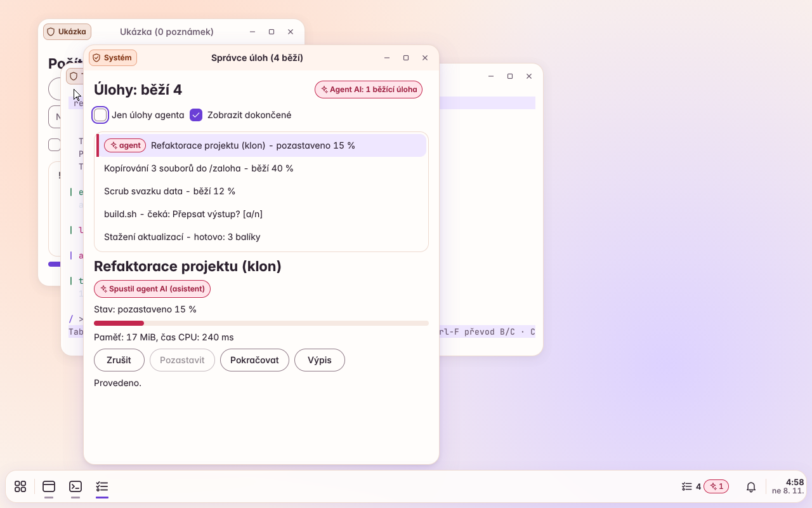
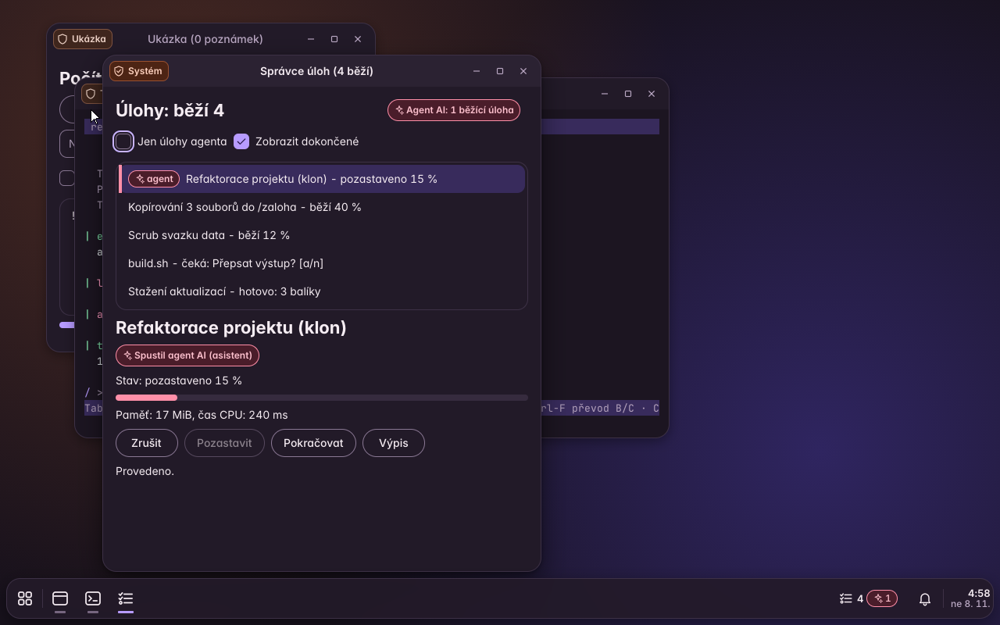
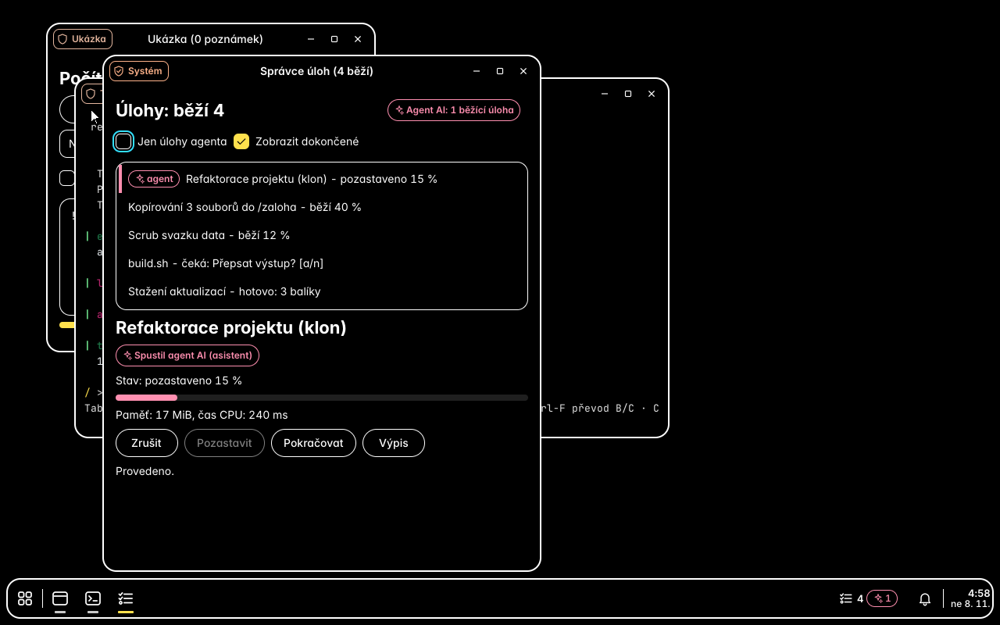

# Grafika a okna (GUI)

Milník 6c. Popisuje ovladače displeje (`virtio-gpu`, `fbdisplay`), kompozitor `compd`, protokol
okna (`libs/guiproto`), nativní knihovnu UI (`libs/ui`), písmo
(`libs/font`), kreslení (`libs/gfx`), systémové dialogy a API akcí.
Odsouhlasená rozhodnutí jsou v [Architektuře](architektura.md#rozhodnutí-k-milníkům-6a-6d-odsouhlaseno)
a v tabulce [Rozhodnutí 6c](#rozhodnutí-6c-odsouhlaseno) níže.

<figure class="diagram">
<svg viewBox="0 0 780 360" xmlns="http://www.w3.org/2000/svg" role="img" aria-label="Části GUI">
<defs><marker id="g1" viewBox="0 0 10 10" refX="9" refY="5" markerWidth="7" markerHeight="7" orient="auto"><path class="arrow" d="M0,0 L10,5 L0,10 z"/></marker></defs>
<rect class="box" x="10" y="20" width="170" height="70" rx="6"/><text class="t b" x="95" y="45" text-anchor="middle">aplikace</text><text class="m" x="95" y="64" text-anchor="middle">libs/ui: prvky, text</text><text class="m" x="95" y="80" text-anchor="middle">kreslí do svých bufferů</text>
<rect class="box" x="10" y="120" width="170" height="70" rx="6"/><text class="t b" x="95" y="145" text-anchor="middle">okno terminálu</text><text class="m" x="95" y="164" text-anchor="middle">nativní protokol 6b</text><text class="m" x="95" y="180" text-anchor="middle">jako obsah okna</text>
<rect class="box" x="10" y="220" width="170" height="70" rx="6"/><text class="t b" x="95" y="245" text-anchor="middle">shell, agent</text><text class="m" x="95" y="264" text-anchor="middle">volají akce aplikací</text><text class="m" x="95" y="280" text-anchor="middle">(capability actions)</text>
<rect class="acc" x="280" y="60" width="200" height="200" rx="6"/><text class="t b" x="380" y="88" text-anchor="middle">compd (kompozitor)</text><text class="m" x="380" y="110" text-anchor="middle">strom vrstev všech oken</text><text class="m" x="380" y="128" text-anchor="middle">transakce, takt snímků</text><text class="m" x="380" y="146" text-anchor="middle">dekorace, odznak důvěry</text><text class="m" x="380" y="164" text-anchor="middle">systémové dialogy</text><text class="m" x="380" y="182" text-anchor="middle">fokus, rozdělení vstupu</text><text class="m" x="380" y="200" text-anchor="middle">strom přístupnosti</text><text class="m" x="380" y="218" text-anchor="middle">směrování akcí</text>
<path class="ln" d="M180 55 L278 100" marker-end="url(#g1)"/><text class="m" x="190" y="62">okno: vrstvy, a11y</text>
<path class="ln" d="M180 155 L278 160" marker-end="url(#g1)"/>
<path class="ln" d="M180 255 L278 220" marker-end="url(#g1)"/>
<rect class="box" x="580" y="20" width="190" height="70" rx="6"/><text class="t b" x="675" y="45" text-anchor="middle">inputd</text><text class="m" x="675" y="64" text-anchor="middle">fokus = compd</text><text class="m" x="675" y="80" text-anchor="middle">bezpečná zkratka</text>
<rect class="box" x="580" y="140" width="190" height="70" rx="6"/><text class="t b" x="675" y="165" text-anchor="middle">virtio-gpu (ovladač)</text><text class="m" x="675" y="184" text-anchor="middle">displayproto: snímek,</text><text class="m" x="675" y="200" text-anchor="middle">poškozené oblasti, flush</text>
<rect class="box" x="580" y="260" width="190" height="70" rx="6"/><text class="t b" x="675" y="285" text-anchor="middle">init</text><text class="m" x="675" y="304" text-anchor="middle">identita a oprávnění</text><text class="m" x="675" y="320" text-anchor="middle">aplikací, dialogy</text>
<path class="ln" d="M578 55 L482 100" marker-end="url(#g1)"/><text class="m" x="500" y="62">Record</text>
<path class="ln" d="M482 170 L578 175" marker-end="url(#g1)"/><text class="m" x="500" y="164">Present</text>
<path class="ln" d="M578 290 L482 240" marker-end="url(#g1)"/><text class="m" x="490" y="290">connect, dialog</text>
<rect class="ok" x="280" y="290" width="200" height="50" rx="6"/><text class="t b" x="380" y="312" text-anchor="middle">QEMU virtio-gpu</text><text class="m" x="380" y="329" text-anchor="middle">2D teď, virgl 3D další krok</text>
<path class="ln" d="M675 212 L482 305" marker-end="url(#g1)"/>
</svg>
<figcaption>Části GUI a kdo s kým mluví. Aplikace nikdy nevidí cizí okna ani obrazovku.</figcaption>
</figure>

## Rozhodnutí 6c (odsouhlaseno)

| # | Otázka | Rozhodnutí |
|---|---|---|
| 1 | vykreslování | **softwarové skládání nad virtio-gpu 2D** jako kompatibilní vrstva všude (x86_64 i aarch64); hned potom **virgl 3D** jako druhý backend kompozitoru (stejný strom vrstev) |
| 2 | buffery | **sdílený objekt paměti (VMO)**: alokuje ho aplikace (platí její job), kompozitoru předá handle jen s právy `READ`, `MAP`, `WAIT`, `DUPLICATE`, `TRANSFER`; kreslení bez kopírování |
| 3 | snímky | **takt kompozitoru + transakce**: termín snímku podle obnovovací frekvence výstupu, aplikace dostane `Frame` jen na požádání; transakce jsou atomické i přes více oken a aplikací (synchronizovaná změna velikosti) |
| 4 | písmo | **vlastní parser a rasterizér TrueType** (`libs/font`): cmap, glyf, hmtx, kern, plošné vyhlazení, bez hintingu a shapingu |

⚠️ **Rizika (řečená předem):**

- **virgl 3D v QEMU** potřebuje displej s OpenGL (`-display sdl,gl=on`,
  `gtk,gl=on` nebo `egl-headless`). Testy běží bez okna, takže 3D jde
  testovat jen s `egl-headless`; když ho hostitel nemá, test 3D se přeskočí
  a ověří se jen 2D. Venus (Vulkan) potřebuje port Mesy a v QEMU pro
  Windows chybí, proto je to až pozdější krok.
- **Bez IOMMU** smí `virtio-gpu` přes DMA zapsat kamkoli do paměti
  (stejně jako ostatní ovladače). S IOMMU (`iommu_platform=on`) jen do
  svých bufferů.
- **Aplikace smí svůj buffer měnit i během čtení.** Nejhorší důsledek je
  roztržený obsah jejího vlastního okna; kompozitor obsahu bufferu nikdy
  nevěří (rozměry kontroluje při vytvoření, čtení je omezené na VMO).
- **Softwarové skládání** stojí CPU: při 1280x800 a 60 Hz je to ~250 MB/s
  zápisu. Proto se skládají jen poškozené oblasti a nic se nekreslí, když
  se nic nemění. **4K při 120 Hz a víc** (celá obrazovka 4K = 33 MB na
  snímek, 120 Hz = 4 GB/s) jde na CPU jen s malými poškozenými oblastmi
  (kurzor, text, malé okno). Celoplošné efekty a plné překreslení patří na
  GPU (`vkcomp`, Venus); na stroji s GPU má být skládání na GPU výchozí
  cesta. **[navrženo]** (dnes se GPU zapíná příkazem `backend gpu`)
- **Konzole jádra a GOP firmwaru (vyřešeno v loaderu):** firmware
  (edk2/OVMF) má ovladač `VirtioGpuDxe` a z virtio-gpu udělá také GOP. Jeho
  framebuffer je obyčejná RAM, kterou na obrazovku posílají příkazy virtio -
  po ExitBootServices by ho nikdo neobnovoval a konzole jádra by byla
  prázdná, dokud obraz nepřevezme `compd`. Loader proto projde všechny GOP,
  přes `EFI_PCI_IO_PROTOCOL` zjistí výrobce a typ zařízení a **virtio-gpu
  (1af4:1050) vezme jen tehdy, když jiný GOP není** (pak varuje v logu).
  Log loaderu vypíše všechny GOP (`GOP na zarizeni PCI 1234:1111`, `GOP mimo
  PCI`) a vybraný framebuffer: x86_64 karta VGA, aarch64 ramfb.
- **Napodobení systémového dialogu** v celoobrazovkové aplikaci nejde
  úplně vyloučit pohledem. Ochrana je v tom, že dialog oprávnění přijme
  jen fyzický vstup (umělý vstup ne), obsahuje bezpečnostní frázi
  uživatele, kterou aplikace nezná, a bezpečná zkratka vždy ukáže
  skutečný systémový dialog.

## Spuštění

```text
init
 ├─ devmgr ── najde PCI 1af4:1050 (virtio-gpu) ── spustí virtio-gpu
 │            initu pošle zprávu `display` + kanál (displayproto)
 ├─ fbdisplay ─ jen když `display` nepřišel: framebuffer z firmwaru
 │              (bootstrap FRAMEBUFFER, FB_CONTROL CLAIM), viz Displeje
 ├─ inputd
 └─ compd ─── init mu pošle `display` (kanál ovladače), `input`
              (nový kanál fokusu od inputd), `secure` (kanál zkratky)
              a pro každou aplikaci `connect <identita>` -> kanál okna
```

Kompozitor dostane fokus vstupu od `inputd` (příkaz `focus`), takže
klávesnici a myš vidí jen on a rozděluje je oknům. Bezpečnou zkratku
dostává také on (kanál `secure`) a ukáže na ni systémovou obrazovku.

## Kreslení a buffery

Pixel je `u32` v pořadí bajtů B, G, R, A (formát virtio-gpu
`B8G8R8A8_UNORM`, v registru `0xAARRGGBB`) s **předem vynásobenou alfou**
(premultiplied). Buffer má šířku, výšku a krok řádku (stride) **v pixelech**.

<figure class="diagram">
<svg viewBox="0 0 780 260" xmlns="http://www.w3.org/2000/svg" role="img" aria-label="Zivotni cyklus bufferu">
<defs><marker id="g2" viewBox="0 0 10 10" refX="9" refY="5" markerWidth="7" markerHeight="7" orient="auto"><path class="arrow" d="M0,0 L10,5 L0,10 z"/></marker></defs>
<rect class="box" x="10" y="30" width="160" height="60" rx="6"/><text class="t b" x="90" y="55" text-anchor="middle">aplikace kreslí</text><text class="m" x="90" y="74" text-anchor="middle">do bufferu A</text>
<rect class="acc" x="220" y="30" width="160" height="60" rx="6"/><text class="t b" x="300" y="55" text-anchor="middle">COMMIT</text><text class="m" x="300" y="74" text-anchor="middle">vrstva -> A, damage</text>
<rect class="box" x="430" y="30" width="160" height="60" rx="6"/><text class="t b" x="510" y="55" text-anchor="middle">compd čte A</text><text class="m" x="510" y="74" text-anchor="middle">při skládání</text>
<rect class="ok" x="620" y="30" width="150" height="60" rx="6"/><text class="t b" x="695" y="55" text-anchor="middle">RELEASED A</text><text class="m" x="695" y="74" text-anchor="middle">až vrstva ukáže B</text>
<path class="ln" d="M170 60 L218 60" marker-end="url(#g2)"/>
<path class="ln" d="M380 60 L428 60" marker-end="url(#g2)"/>
<path class="ln" d="M590 60 L618 60" marker-end="url(#g2)"/>
<rect class="box" x="10" y="150" width="160" height="60" rx="6"/><text class="t b" x="90" y="175" text-anchor="middle">mezitím kreslí</text><text class="m" x="90" y="194" text-anchor="middle">do bufferu B</text>
<rect class="acc" x="220" y="150" width="160" height="60" rx="6"/><text class="t b" x="300" y="175" text-anchor="middle">COMMIT</text><text class="m" x="300" y="194" text-anchor="middle">vrstva -> B</text>
<path class="ln" d="M170 180 L218 180" marker-end="url(#g2)"/>
<path class="ln dash" d="M380 180 L690 92" marker-end="url(#g2)"/>
<text class="m" x="10" y="245">Dvojitý buffer: aplikace nikdy nečeká na kompozitor, jen nesmí znovu použít buffer před RELEASED.</text>
</svg>
<figcaption>Buffer patří aplikaci, kompozitor ho jen čte mezi COMMIT a RELEASED.</figcaption>
</figure>

- Aplikace vytvoří VMO a pošle `BUFFER_CREATE` s handlem (jen s právy
  `READ`, `MAP` a základními). Kompozitor ho namapuje jen pro čtení
  (`stride * height * 4` bajtů - menší VMO mapování odmítne) a ověří
  rozměry (nejvýš 16384 px).
- Paměť bufferu platí job aplikace: aplikace nemůže vyčerpat paměť
  kompozitoru.
- Kompozitor buffer drží od `COMMIT`, který ho připojil k vrstvě, do zprávy
  `RELEASED`. Tu pošle, jakmile buffer neukazuje žádná vrstva (vrstva
  dostala jiný buffer nebo zanikla). Knihovna `ui` proto kreslí střídavě
  do dvou bufferů a na kompozitor nikdy nečeká.

## Strom vrstev

Okno je strom **vrstev**. Obsah vrstev kreslí aplikace, ale **posun,
průhlednost, ořez, scroll a animace dělá kompozitor**: posunout seznam
nebo rozsvítit tlačítko tak nevyžaduje nové vykreslení aplikací a funguje
plynule i tehdy, když aplikace zrovna počítá.

| Druh vrstvy | Obsah |
|---|---|
| `GROUP` | jen děti; volitelně ořez na svůj obdélník a posun obsahu (scroll) |
| `BUFFER` | obdélník z bufferu aplikace (zdrojový výřez se škáluje na cíl) |
| `SOLID` | jednobarevný obdélník (pozadí, oddělovače, výběr) |

Vlastnosti vrstvy (`LAYER_SET`, každá volitelná): obdélník v souřadnicích
rodiče, pořadí mezi sourozenci, průhlednost 0-255, viditelnost, ořez dětí,
posun obsahu `(sx, sy)`, buffer a zdrojový výřez, barva.

**Animace** (`ANIMATE`): vlastnost (průhlednost, posun x/y, scroll x/y),
cílová hodnota, délka v ms a křivka (`linear`, `ease-out`). Kompozitor ji
počítá v každém snímku sám; aplikace dostane `ANIMATION_DONE`.

<figure class="diagram">
<svg viewBox="0 0 780 300" xmlns="http://www.w3.org/2000/svg" role="img" aria-label="Strom vrstev a strom pristupnosti">
<defs><marker id="g3" viewBox="0 0 10 10" refX="9" refY="5" markerWidth="7" markerHeight="7" orient="auto"><path class="arrow" d="M0,0 L10,5 L0,10 z"/></marker></defs>
<text class="t b" x="20" y="24">strom vrstev</text>
<rect class="acc" x="20" y="36" width="160" height="40" rx="6"/><text class="t" x="100" y="61" text-anchor="middle">1 GROUP okno</text>
<rect class="box" x="20" y="100" width="150" height="40" rx="6"/><text class="t" x="95" y="125" text-anchor="middle">2 SOLID pozadí</text>
<rect class="box" x="190" y="100" width="170" height="40" rx="6"/><text class="t" x="275" y="125" text-anchor="middle">3 GROUP seznam (ořez)</text>
<rect class="box" x="190" y="170" width="170" height="40" rx="6"/><text class="t" x="275" y="195" text-anchor="middle">4 BUFFER řádky</text>
<rect class="box" x="20" y="170" width="150" height="40" rx="6"/><text class="t" x="95" y="195" text-anchor="middle">5 BUFFER tlačítko</text>
<path class="ln" d="M100 76 L95 98" marker-end="url(#g3)"/>
<path class="ln" d="M120 76 L270 98" marker-end="url(#g3)"/>
<path class="ln" d="M275 140 L275 168" marker-end="url(#g3)"/>
<path class="ln" d="M70 76 L70 168" marker-end="url(#g3)"/>
<text class="m" x="190" y="232">scroll = vlastnost vrstvy 3, aplikace nekreslí</text>
<text class="t b" x="440" y="24">strom přístupnosti</text>
<rect class="ok" x="440" y="36" width="190" height="40" rx="6"/><text class="t" x="535" y="61" text-anchor="middle">window "Poznámky"</text>
<rect class="ok" x="440" y="100" width="150" height="40" rx="6"/><text class="t" x="515" y="125" text-anchor="middle">list "Soubory"</text>
<rect class="ok" x="610" y="100" width="160" height="40" rx="6"/><text class="t" x="690" y="125" text-anchor="middle">button "Uložit"</text>
<rect class="ok" x="440" y="170" width="150" height="40" rx="6"/><text class="t" x="515" y="195" text-anchor="middle">item "a.txt" ✓</text>
<path class="ln" d="M515 76 L515 98" marker-end="url(#g3)"/>
<path class="ln" d="M560 76 L680 98" marker-end="url(#g3)"/>
<path class="ln" d="M515 140 L515 168" marker-end="url(#g3)"/>
<path class="ln-acc dash" d="M360 190 L438 190"/>
<path class="ln-acc dash" d="M170 190 Q400 260 690 142"/>
<text class="m" x="440" y="240">uzel míří na vrstvu + obdélník: kompozitor ví,</text>
<text class="m" x="440" y="256">kde prvek je, i bez aplikace (čtečka, agent, test)</text>
</svg>
<figcaption>Dva stromy jednoho okna. Vrstvy určují, co je vidět; přístupnost, co to znamená.</figcaption>
</figure>

## Strom přístupnosti

Struktura okna je součást protokolu. Uzel (`A11Y_UPDATE`) nese:

| Pole | Význam |
|---|---|
| `id`, `parent` | identita a rodič (0 = kořen okna) |
| `role` | `window`, `titlebar`, `button`, `label`, `text-input`, `password-input`, `checkbox`, `switch`, `radio`, `slider`, `combo-box`, `list`, `list-item`, `table`, `row`, `cell`, `column-header`, `tab-list`, `tab`, `segmented`, `list-box`, `list-option`, `menu`, `menu-item`, `tooltip`, `scroll-area`, `group`, `image`, `progress`, `terminal` |
| `name` | text pro člověka („Uložit“) |
| `value` | hodnota (text pole, procenta průběhu) |
| `state` | bity: `focused`, `checked`, `disabled`, `selected`, `expanded`, `busy`, `hover`, `pressed`, `invalid` (text chyby je podřízený uzel `label`), `active` (aktivní položka seznamu návrhů, fokus zůstává v poli), `autocomplete` (pole nabízí seznam návrhů) |
| `bounds` | vrstva + obdélník v ní |
| `actions` | bity: `activate`, `focus`, `set-value`, `toggle`, `scroll` |

Kompozitor strom drží a slouží z něj:

- **čtečce obrazovky a lupě** (později) - přes capability, ne aplikaci,
- **testům a agentovi**: „klikni na tlačítko Uložit“ jde přes uzel,
  ne přes souřadnice; kompozitor pošle aplikaci `A11Y_ACTION`,
- **dekoracím**: vlastní titulek je přístupný stejně jako standardní
  (uzel `titlebar`).

## Snímky a transakce

Stav okna je dvojí: **rozpracovaný** (zprávy od posledního `COMMIT`)
a **platný** (ten se skládá). `COMMIT` převede rozpracovaný stav na platný
**atomicky**: nikdy není vidět polovina změny. Jedna transakce smí mít víc
zpráv (limit zprávy kanálu je 64 KiB).

<figure class="diagram">
<svg viewBox="0 0 780 290" xmlns="http://www.w3.org/2000/svg" role="img" aria-label="Takt snimku">
<defs><marker id="g4" viewBox="0 0 10 10" refX="9" refY="5" markerWidth="7" markerHeight="7" orient="auto"><path class="arrow" d="M0,0 L10,5 L0,10 z"/></marker></defs>
<path class="ln" d="M20 60 L760 60"/><text class="m" x="20" y="45">compd</text>
<path class="ln" d="M20 160 L760 160"/><text class="m" x="20" y="145">aplikace</text>
<path class="ln" d="M20 250 L760 250"/><text class="m" x="20" y="235">virtio-gpu</text>
<path class="ln-acc" d="M100 50 L100 70"/><text class="m" x="85" y="40">tik N</text>
<path class="ln-acc" d="M367 50 L367 70"/><text class="m" x="350" y="40">tik N+1</text>
<path class="ln-acc" d="M634 50 L634 70"/><text class="m" x="617" y="40">tik N+2</text>
<path class="ln" d="M104 64 L170 156" marker-end="url(#g4)"/><text class="m" x="120" y="100">FRAME seq, deadline</text>
<rect class="box" x="172" y="148" width="120" height="24" rx="4"/><text class="m" x="232" y="165" text-anchor="middle">kreslí, COMMIT</text>
<path class="ln" d="M292 156 L330 66" marker-end="url(#g4)"/>
<rect class="acc" x="370" y="48" width="90" height="24" rx="4"/><text class="m" x="415" y="65" text-anchor="middle">skládání</text>
<path class="ln" d="M460 66 L520 244" marker-end="url(#g4)"/><text class="m" x="490" y="140">PRESENT damage</text>
<path class="ln" d="M560 244 L600 70" marker-end="url(#g4)"/><text class="m" x="585" y="200">PRESENTED</text>
<path class="ln" d="M604 64 L680 156" marker-end="url(#g4)"/><text class="m" x="650" y="100">PRESENTED txn</text>
<text class="m" x="20" y="282">Vstup se doručuje hned (ne s taktem); skládání čeká jen na termín, ne na pomalou aplikaci.</text>
</svg>
<figcaption>Takt (zde 60 Hz): aplikace kreslí po FRAME, kompozitor skládá na tiku, ovladač potvrdí zobrazení.</figcaption>
</figure>

- **Takt:** perioda = 1 / obnovovací frekvence výstupu z režimu ovladače
  (60 Hz = 16,67 ms, 120 Hz = 8,33 ms, 240 Hz = 4,17 ms); bez údaje 60 Hz.
  Rezerva na skládání před koncem periody je čtvrtina periody (nejvýš
  4 ms), `FRAME` nese termín a periodu. **[implementováno]** (test
  `frame_period_follows_refresh_rate` v `libs/comp`) Odchylka: takt je
  jeden pro celý kompozitor (zatím skládá jeden výstup); takt pro každý
  výstup zvlášť a VRR (proměnná frekvence: snímek hned po změně, nejvýš
  maximální frekvencí) **[navrženo]**. Kompozitor tiká jen tehdy, když něco čeká
  (poškozená oblast, animace, žádost o snímek). Nic se nemění = žádné
  probuzení.
- **Žádost o snímek:** `COMMIT` s příznakem `FRAME` řekne „chci vědět, kdy
  kreslit další“. Na začátku příští periody přijde `FRAME { seq, deadline }`;
  aplikace, která stihne `COMMIT` do `deadline`, je v tom snímku.
- **Priorita vstupu:** kompozitor nejdřív vyřídí vstup (doručí ho oknu),
  teprve potom skládá. Vstup se nikdy nebatchuje do taktu.
- **Pomalá aplikace** nezdrží ostatní: skládá se její poslední platný stav.
- **`PRESENTED { txn, time }`** potvrdí zobrazení (čas od ovladače).

### Synchronizovaná změna velikosti

Kompozitor pošle `CONFIGURE { window, w, h, serial }`. Aplikace překreslí
a v `COMMIT` potvrdí `serial`. Rám okna (dekorace) a nový obsah se ukážou
**ve stejném snímku**. Když aplikace nestihne potvrdit do 200 ms, kompozitor
ukáže starý obsah v novém rámu (ořezaný nebo doplněný pozadím), takže
okno nikdy „neuteče“ z rámu.

Při tažení okraje je nejvýš jedna nepotvrzená žádost: pohyby mezi tím se
sloučí a po potvrzení (nebo termínu) dostane aplikace hned poslední
velikost. Aplikace tak nekreslí zastaralé velikosti a za snímek dostane
nejvýš jeden `CONFIGURE` (maximalizace a změna obrazovky jdou hned).
**[implementováno]** (test `resize_drag_coalesces_configures` v `libs/comp`)
Cenu kroku zapisuje trasování vstupu: `velikost okna <id> <w>x<h>
potvrzena aplikaci za N ms` (od první žádosti po potvrzení). Čísla z QEMU
a skutečného stroje zatím nejsou změřená. **[navrženo]**: ukázat starý
obsah u pevného rohu hned (bez čekání na potvrzení) a poškozovat jen
změněný pás okna a stínu.

### Kontext okna a požadovaná velikost

Každé okno dostane **svůj** kontext, nic globálního (víc výstupů s různou
škálou nic nemění):

```
WINDOW_CONTEXT { window, generation, output, screen, work_area, scale, refresh_mhz }
WINDOW_SIZE    { window, w, h, min_w, min_h, max_frac_w, max_frac_h }
```

- `WINDOW_CONTEXT` přijde **před prvním `CONFIGURE`** a pak při každé
  změně (rozlišení, lišta, později přesun na jiný výstup) s vyšší
  `generation`. `work_area` je obrazovka bez lišty, rozměry jsou logické px.
- `WINDOW_SIZE` je požadovaná velikost obsahu: přirozená `w` x `h`
  (0 = nechat na systému), nejmenší `min_w` x `min_h` a strop v promile
  pracovní plochy (`max_frac_w = 850` = nejvýš 85 % šířky; 0 = bez stropu).
  - **Před prvním commitem** určí velikost při otevření: kompozitor odpoví
    `CONFIGURE` s výsledkem a okno se ukáže rovnou správně, bez druhého
    `CONFIGURE` a bez probliknutí. `Window::request_size` v `libs/ui` na
    odpověď počká.
  - **Později** je to žádost o změnu (`CONFIGURE` jako při tažení okraje).
    Maximalizované okno a okno na celé obrazovce si ji zapamatuje jako
    velikost po obnovení.
- **Rozšíření pro tablet a televizi** (`guiproto::context::ContextExt`,
  verze protokolu 3; [Televize](../../design/televize.html),
  [Tablet](../../design/tablet.html)): `posture` (desktop, laptop, tablet,
  phone, tv), `distance` (blízko, stůl, místnost), `insets` (systémové
  lišty) a vedle nich `safe` (bezpečný okraj kvůli přesahu obrazu: text
  a fokus jen uvnitř), `pointers` (seznam: myš, touchpad, dotyk, pero,
  dálkový ovladač s přesností, najetím a tlakem; prázdný = jen fokus),
  `keyboard` (připojená klávesnice), `obscured` (překážky, např. klávesnice
  na obrazovce), `tile` (floating, full, left, right, top, bottom),
  `min_hit` (nejmenší cíl; tokeny `size.hit_min_fine` 32 a
  `size.hit_min_touch` 44) a `text_scale`. Kompozitor zatím posílá počítač
  s myší a klávesnicí a `tile` podle maximalizace a celé obrazovky (nová
  generace); tablet a televize dodají služby zařízení. Knihovna `ui`
  podle `min_hit` sama zvětší ovládací prvky a řádky, aplikace čte
  `cx.posture`, `cx.can_hover()`, `cx.focus_only()`.
- Terminál: `win.request_size(1040, 520, 850, 0)`, tedy 1040 px, ale nejvýš
  85 % šířky pracovní plochy.
- Verze protokolu 4 (`guiproto::VERSION`; 4 = sériové číslo gesta
  v `InputRecord`): kompozitor a aplikace se sestavují spolu, `HELLO`
  vyžaduje shodu.

**[implementováno]** (testy `context_first_and_initial_size_without_flicker`,
`request_size_later_and_while_maximized`, `resize_sends_new_context_generation`
v `libs/comp`)

### Transakce přes víc oken a aplikací

Pro změny, které se musí ukázat zároveň v různých oknech (okno terminálu
s obsahem z jiného procesu, rozdělení obrazovky dvou aplikací):

1. Koordinátor (aplikace nebo kompozitor) si řekne o skupinu:
   `SYNC_GROUP { count }` -> `SYNC_TOKEN { token }` (128bitové náhodné číslo).
2. Token předá ostatním účastníkům (svým kanálem).
3. Každý účastník pošle `COMMIT` s `token`. Kompozitor drží platné stavy
   všech, dokud nepřijde `count` commitů (nebo nevyprší 200 ms - pak je
   uplatní všechny a skupinu zruší, aby se nic nezaseklo).

## Okna a dekorace

`WINDOW_CREATE { id, mode, w, h, title }`. Rám, titulek a tlačítka kreslí
kompozitor podle režimu ([Vlastní vzhled okna](architektura.md#vlastní-vzhled-okna-vlastní-titulek)):

| Režim | Aplikace kreslí | Systém si nechá |
|---|---|---|
| `STANDARD` | jen obsah | rám, titulek, odznak, tlačítka |
| `CUSTOM_TITLE` | i plochu titulku | odznak na pevném místě, tlačítka (aplikace volí stranu a barvu), přesun a resize přes deklarované oblasti |
| `FRAMELESS`, `FULLSCREEN` | vše | odznak u horního okraje při najetí myší a vždy při změně oprávnění (3 s); bezpečná zkratka a dialogy vždy |

<figure class="diagram">
<svg viewBox="0 0 780 250" xmlns="http://www.w3.org/2000/svg" role="img" aria-label="Rezim vlastni titulek">
<rect class="box" x="20" y="20" width="740" height="200" rx="8"/>
<rect class="acc" x="20" y="20" width="740" height="36" rx="8"/>
<rect class="ok" x="28" y="26" width="150" height="24" rx="5"/><text class="m" x="103" y="43" text-anchor="middle">odznak: Poznámky · síť</text>
<rect class="box" x="196" y="26" width="110" height="24" rx="5"/><text class="m" x="251" y="43" text-anchor="middle">karta 1</text>
<rect class="box" x="312" y="26" width="110" height="24" rx="5"/><text class="m" x="367" y="43" text-anchor="middle">karta 2</text>
<rect class="warn" x="430" y="24" width="230" height="28" rx="4"/><text class="m" x="545" y="43" text-anchor="middle">oblast DRAG (deklarovaná)</text>
<rect class="err" x="672" y="26" width="24" height="24" rx="4"/><rect class="err" x="700" y="26" width="24" height="24" rx="4"/><rect class="err" x="728" y="26" width="24" height="24" rx="4"/>
<text class="m" x="680" y="76">tlačítka: systém</text>
<text class="m" x="200" y="76">karty: aplikace (vlastní titulek)</text>
<text class="t" x="390" y="140" text-anchor="middle">obsah aplikace</text>
<text class="m" x="20" y="242">Přesun okna funguje i se zaseknutou aplikací: kompozitor zná oblasti a nemusí se aplikace ptát.</text>
</svg>
<figcaption>Vlastní titulek: aplikace kreslí karty, systém odznak a tlačítka.</figcaption>
</figure>

**Deklarované oblasti** (`REGIONS`): seznam obdélníků s druhem `DRAG`
(táhne okno), `NO_DRAG` (výjimka uvnitř `DRAG`, např. karta) a `RESIZE`
(okraje). Kompozitor podle nich přesouvá a mění velikost sám, bez dotazu
na aplikaci.

**Odznak důvěry** ukazuje identitu aplikace (jméno z manifestu, které
předal init, ne aplikace) a co právě smí (síť, složky, kamera). Aplikace
ho nemůže překreslit: kompozitor ho skládá až nad obsahem okna.

**Limity na klienta** (ochrana kompozitoru před aplikací): buffer nejvýš
64 MiB a všechny buffery 256 MiB, 256 bufferů, 8192 vrstev, 32 oken,
4096 uzlů přístupnosti na okno, rozpracované zprávy do `COMMIT` nejvýš
16 MiB, titulek 256 znaků, 4 skupiny transakcí. Zprávy, které se
aplikaci nevejdou do fronty kanálu, kompozitor odloží (pohyb myši a ping
smí vypadnout, `RELEASED`, `FRAME` a `CONFIGURE` ne); kdo nevyčte 4096
odložených zpráv, je odpojen.

**Nereagující aplikace:** kompozitor posílá `PING`; bez `PONG` do 3 s
ztlumí okno a nabídne zavření. Přesun, minimalizace a zavření fungují
dál.

## Vzhled podle návrhu (fáze 1)

> **Změna proti předchozímu stavu:** dekorace, lišta, dialogy, prvky UI
> a terminál měly pevné tmavé barvy a rozměry v kódu a písmo Tuffy.
> Teď berou vše z tokenů `design/tokens.toml` a kreslí Interem
> a JetBrains Mono podle prototypů v `design/` ([Vzhled](vzhled.md)).
> Důvod: jeden zdroj pravdy pro prototypy i systém; změna barvy nebo
> rozestupu nevyžaduje zásah do kódu.

<figure class="diagram">
<svg viewBox="0 0 760 200" xmlns="http://www.w3.org/2000/svg" role="img" aria-label="Tok tokenu do systemu">
<defs><marker id="vf1" viewBox="0 0 10 10" refX="9" refY="5" markerWidth="7" markerHeight="7" orient="auto"><path class="arrow" d="M0,0 L10,5 L0,10 z"/></marker></defs>
<rect class="acc" x="10" y="70" width="160" height="60" rx="6"/><text class="t b" x="90" y="96" text-anchor="middle">design/tokens.toml</text><text class="m" x="90" y="114" text-anchor="middle">vložený při překladu</text>
<path class="ln" d="M170 100 L218 100" marker-end="url(#vf1)"/>
<rect class="box" x="220" y="70" width="150" height="60" rx="6"/><text class="t b" x="295" y="96" text-anchor="middle">libs/theme</text><text class="m" x="295" y="114" text-anchor="middle">libs/conf, kontrast</text>
<path class="ln" d="M370 85 L438 40" marker-end="url(#vf1)"/><path class="ln" d="M370 100 L438 100" marker-end="url(#vf1)"/><path class="ln" d="M370 115 L438 160" marker-end="url(#vf1)"/>
<rect class="ok" x="440" y="15" width="310" height="50" rx="6"/><text class="t b" x="595" y="37" text-anchor="middle">compd: okna, lišta, dialogy</text><text class="m" x="595" y="54" text-anchor="middle">libs/comp/style.rs, render.rs</text>
<rect class="ok" x="440" y="75" width="310" height="50" rx="6"/><text class="t b" x="595" y="97" text-anchor="middle">libs/ui: prvky aplikací</text><text class="m" x="595" y="114" text-anchor="middle">look.rs (trust_*, ai_* nenabízí)</text>
<rect class="ok" x="440" y="135" width="310" height="50" rx="6"/><text class="t b" x="595" y="157" text-anchor="middle">gui-term: barvy term_*, JetBrains Mono</text><text class="m" x="595" y="174" text-anchor="middle">mřížka z type.mono</text>
</svg>
<figcaption>Tokeny jsou data: kompozitor, knihovna UI i terminál čtou stejný soubor.</figcaption>
</figure>

**Snímky z QEMU** (test `compd: vzhled podle navrhu`, `screendump` přes
QMP, 1280x800; porovnání s `design/plocha.html` a `design/okna.html`):







**Tokeny jako data.** `libs/theme` přečte `design/tokens.toml` přes
`libs/conf` (nově umí desetinná čísla, např. `frame_ms = 16.7`) a dá
hodnoty pro režim světlý, tmavý a vysoký kontrast: barvy (premultiplied),
typografickou škálu, rozestupy, rozměry, zaobleni, stíny, pohyb
(křivky `cubic-bezier`) a vrstvy. Test `contrast_pairs_pass` ověří
všechny povinné dvojice kontrastu ze sekce `[contrast]` stejně jako
`design/tools/build-tokens.mjs`. Výchozí motiv je vložený při překladu;
`Tokens::parse` přečte i jiný text (uživatelské motivy později).
Kompozitor přepíná režim příkazem `theme light|dark|contrast`.

**Okna** (`design/okna.html`): titulek 40 px (`size.title_h`), zaoblení
18 px (`radius.window`), rám 1 px `border`, stín podle stavu
(`shadow.window` / `window_inactive`, dvě vrstvy), aktivní titulek
`surface_2` a jméno váhy 600, neaktivní `surface` a váha 500 vedlejší
barvou. Tlačítka okna jsou pilulky 28 px s ikonou z design systému;
cíl kliknutí 40 px (`size.hit_min`), překryvy rozhoduje nejbližší
střed. Najetí zvýrazní tlačítko (`surface_3`, zavřít `danger`).
Odznak důvěry 26 px: štít, jméno z manifestu a ikony oprávnění,
barvy `trust_*`; systémová aplikace (`[app] system = true` v manifestu,
posoudí init, `ConnectInfo.system`) má odznak „Systém“ se štítem
s fajfkou. Init klíč čte jen z manifestu v initfs (obraz systému);
aplikace odjinud se za systém vydávat nemůže, o tom rozhodne podpis
a cesta, ne její manifest. Okno bez fokusu má odznak se sytostí 0,6. Rám je 1 px, ve
vysokém kontrastu 2 px. Nové okno se umístí do pracovní plochy
(obrazovka bez lišty) celé i na šířku: kaskáda dalších oken ho na malé
obrazovce (800 × 600) nevysune za pravý okraj
(`cascade_keeps_wide_window_on_screen`); pod lištu se dostane jen tažením.

**Prvky aplikací** (`libs/ui`): agent AI má vyhrazené barvy `ai_*`
a vždy ikonu agenta a slovo „agent“ (štítek `.agent()`, řádek seznamu
s levým pruhem a štítkem, průběh v barvě `ai`; ve stromu přístupnosti
jméno začíná „agent:“). Nedostupné tlačítko je stejné tlačítko s krytím
`opacity.disabled`. Vybraný řádek má pozadí `accent_soft` a normální
písmo. Rámeček fokusu se kreslí jen v aktivním okně (prvek si fokus
pamatuje). Neviditelný okraj `size.resize_edge` vně okna (v oblasti stínu)
mění velikost na všech čtyřech stranách a v rozích (roh v délce zaoblení);
tah za levý nebo horní okraj posouvá i polohu, protější okraj zůstává
(po potvrzení CONFIGURE). Nad okrajem kurzor dvojité šipky (vodorovná,
svislá, šikmé), nejmenší velikost okna platí. Zóna tlačítek titulku je
kruh tlačítka a 4 px (`space.s2`), takže zvýraznění odpovídá tomu, co je
vidět; jen u maximalizovaného okna čtverec `size.hit_min` až k hornímu
okraji a zavřít až do rohu obrazovky (Fittsův zákon). Mimo rám má přednost
okraj. **[implementováno]** (testy `close_button_zone_does_not_cover_edge`,
`close_button_zone_is_round_except_maximized_corner`,
`resize_from_left_and_top_keeps_opposite_edge` v `libs/comp`)
Nereagující aplikace: obsah ztlumený a karta „… nereaguje“.

**Lišta** (`design/plocha.html`, poloha „dole, odsazená“): 52 px,
odsazení 8 px, zaoblení 18 px, pod ní **rozmazané pozadí** (`blur(16px)`
jako v prototypu) a přes něj `surface` s krytím `opacity.bar`, stín
`shadow.bar`. Rozmazání se počítá v polovičním rozlišení a jen když se
pod lištou něco změní (pohyb okna, obsah, motiv), jinak se bere
z mezipaměti; najetí myší, hodiny ani kurzor ho nepřepočítají. Vlevo
spouštěč, oddělovač a tlačítka oken (ikona podle aplikace, značka
běží / aktivní), vpravo pilulka „Vstup ovládá automat“, úlohy se
štítkem agenta, **síť a hlasitost ze skutečného stavu** (`netd`: linka
a adresa, `audiod`: hlasitost a ztlumení; bez spojení nebo ztlumeno
přeškrtnutá ikona), zvonek oznámení (zatím zástupná ikona) a hodiny
(čas a datum v pásmu, které init pošle s příkazem `display`).

Stav pro lištu dává init příkazem `sources net audio` s handly: relace
sítě jen s právem `INFO` (bez spojení kamkoli) a kanál ke zvukové službě.
Kompozitor se ptá každé 2 s a odpověď čte bez blokování (zaseknutá
služba lištu nezdrží).

**Plocha:** barva `bg` a dva měkké radiální přechody `wall_a`,
`wall_b` jako `.desk` v prototypu; spočítá se jednou pro velikost
obrazovky, s jemným rozptylem proti pruhům.

**Systémový dialog:** šířka 440 px, rám 2 px `trust_border`, pruh
„Systém“ s frází, nadpis, blok aplikace, upozornění „jen fyzický
vstup“, tlačítka jako pilulky s rámečkem fokusu 2 px.

**Kreslení (`libs/gfx`):**

| Modul | Co |
|---|---|
| `shape.rs` | zaoblený obdélník a rám ze vzdálenostního pole (stejný vzorec jako shader), rohové záplaty okna |
| `shadow.rs` | Gaussův stín předpočítaný do masky z 9 dílů (3 krabičkové průchody), kreslení jen čte tabulku |
| `icon.rs` | sada ikon (226) přímo z `design/assets/mo.js` (podmnožina SVG: `path` včetně oblouků, `rect`, `circle`), tah vzdálenostním polem |
| `backdrop.rs` | radiální přechody plochy |
| `text.rs` | rodina řezů (výběr váhy jako v CSS), jemné umístění po 1/4 px, gama tmavého textu |

**Stejné pixely na CPU i GPU:** okno se kreslí jako čtverec, rohy se
dopočítají „záplatou“ (okno přes uložené pozadí s pokrytím zaobleného
tvaru); vícevrstvý stín se složí do jedné barvy a prolne jednou; vrstva
nad okny (lišta, dialog, kurzor) jde i na CPU přes mezibuffer. Proto
test `gpu_list_matches_cpu_frame` dál porovnává snímek pixel po pixelu.

⚠️ **Rizika a odchylky (řečená předem):**

- Písma jsou vložená do programů (každý jen řezy, které kreslí): `compd`
  +1,7 MB, aplikace s `libs/ui` +1,25 MB, `gui-term` +0,55 MB. Sdílená
  paměť s písmy od kompozitoru je úkol G5.
- Rozmazání pod lištou počítá CPU i v GPU backendu (stejné pixely).
  Navazující krok pro Venus: rozmazání shaderem ve `vkcomp`.
- Stíny ze statických masek.
- Velikost písma 200 % (Přístupnost) přijde s G4; motiv systému
  aplikace dostávají zprávou `THEME` (knihovna UI i terminál se
  přebarví).
- Hodnoty, které byly jen v `mo.css` (krytí lišty, ztlumení, šířka
  dialogu, ikony 14 px, značka v liště), jsou nově v tokenech
  (`[size]`, `[opacity]`) a kód je čte odtud.

**Cena snímku na CPU:** `compd` píše do logu čas skládání celé obrazovky
s rozpadem po částech (`libs/comp/src/prof.rs`) a po 300 snímcích průměr
a maximum:

```
compd: snimek cele obrazovky 1280x800: 5820 us (cpu; plocha 279 us, stiny 1359 us,
okna 1479 us, rozmazani listy 0 us, nad okny 2667 us, z toho lista 2451 us, z toho dialog 0 us)
```

**Programy jsou bez FPU** (soft-float, [architektura.md](architektura.md)):
každá operace `f32` je volání funkce. Na hostiteli (s FPU) to vidět není,
ve WHPX (rychlost blízká HW) a v emulaci ano. Proto se v `gfx` na pixel
počítá jen celočíselně **[ověřeno v QEMU]**:

- zaoblené tvary počítají vzdálenost v `f32` jen v rohových čtvercích
  (`shape::round_rect_coverage`; jinde je pokrytí přesně 0 nebo 255, test
  `round_rect_coverage_matches_float` hlídá stejné hodnoty),
- rozmazání pod lištou je v pevné řádové čárce 8.8 (`blur.rs`, nejvýš
  ±1 úroveň proti `f32`, test `blur_int_matches_float`),
- body mřížky plochy jsou celočíselné (`backdrop.rs`, test
  `backdrop_int_matches_float`).

**Vynechání zakrytých oblastí** **[ověřeno v QEMU]**: tělo okna je
neprůhledné (výplň `surface` pod obsahem), takže pod jádrem okna (bez
zaoblených rohů) se plocha ani nižší okna nekreslí
(`Comp::visible_parts`). Test `culling_keeps_pixels` porovná snímek
s kreslením všeho odspodu nahoru pixel po pixelu. Stín lišty se nekreslí
pod jejím tělem, které celé překryje neprůhledné rozmazané pozadí.

Měřeno sadou `gui` (16 snímků celé obrazovky 1280x800 během testu:
start, dialogy, motivy, okna, restart kompozitoru), před = revize
3e5f791, po = 170a035:

| Kde | Před (min / medián / max) | Po (min / medián / max) | Poznámka |
|---|---|---|---|
| QEMU na Windows s `--accel whpx`, release | 40 / 96 / 205 ms | 5,8 / 18 / 116 ms | běžný snímek plochy s okny 40 ms -> 6-15 ms (rozpočet 16 ms); lišta 36 ms -> 2,5 ms (`3e5f791` -> `170a035`) |
| QEMU na Windows (emulace TCG), debug | 470 / 1246 / 2465 ms | 78 / 280 / 508 ms | test vzhledu 57 s -> 29 s, test Souborů 170 s -> 63 s (`3e5f791` -> `170a035`) |
| hostitel, test `bench_frame` | debug 4,9 ms, release 3,9 ms | debug 5,2 ms, release 3,1 ms | hostitel má FPU, soft-float tu nevadil (`3e5f791` -> `170a035`) |
| hostitel, 800x600 (test `look_snapshots`) | 3,5 ms, první 11 ms | - | první s výpočtem plochy, stínů a rozmazání |

Měření na hostiteli: `cargo test -p comp [--release] bench_frame -- --ignored --nocapture`.
V QEMU: `cargo xtask test --only gui [--release] [--accel whpx]` a řádky
`compd: snimek cele obrazovky` v `target/serial-test-*.log`.

⚠️ **Co je pořád nad rozpočtem 16 ms** (WHPX, release, revize `170a035`):

- otevření systémového dialogu 21-50 ms (`170a035`): ztlumení a mezibuffer přes celou obrazovku, zalamování textu se šířkami v `f32`,
- změna motivu 12-24 ms (`170a035`): nový obraz plochy,
- první snímky po startu nebo restartu kompozitoru 30-116 ms (`170a035`): glyfy a ikony se rasterizují v `f32` do mezipaměti.

Kopie do zadního bufferu se neměří v `compd`: virtio-gpu i `fbdisplay`
kopírují jen poškozené obdélníky a jednou, takže stáří bufferu
([rozhrani-zarizeni.md](rozhrani-zarizeni.md#displej-bez-zbytečné-kopie))
tu nic neušetří. Největší zbývající páka je překládat programy s SSE/NEON
(jádro stav FPU už ukládá); to je rozhodnutí milníku jazyků, ne
kompozitoru.

Kompozitor se proto při připojení displeje nejdřív ukáže jen barvou
pozadí a celý snímek složí v dalším taktu (start nečeká na skládání).

## Vstup v oknech

Kompozitor dostává události od `inputd` ([Vstup](vstup.md)) - z kanálu
fokusu i z kanálu `secure` (v bezpečném režimu jde vstup jen tam) - a
rozděluje je:

- **klávesnice** (`Key`, `Text`) -> okno s fokusem; nové okno jiné
  aplikace dostane fokus jen tehdy, když uživatel aspoň 1,5 s nepsal
  (jinak by si okno na pozadí mohlo „vzít“ rozepsané heslo),
- **myš** -> okno pod ukazatelem (přepočet na souřadnice okna); stisk
  tlačítka mimo oblasti dekorace okno aktivuje a dá mu fokus,
- **kolečko** -> okno pod ukazatelem,
- **bezpečná zkratka** (`secure`) -> systémová obrazovka,
- událost s příznakem `SYNTHETIC` (umělý vstup) jde oknu jen s příznakem;
  systémový dialog ji **ignoruje**,
- **nové vstupní zařízení** (`NewDevice`, ochrana proti BadUSB): kompozitor
  ukáže systémový dialog „Povolit zařízení?“ a do rozhodnutí události
  z toho zařízení zahazuje - zařízení se tedy nemůže povolit samo
  (vypsat Enter). Odpověď pošle `inputd` jako `trust <id>` / `reject <id>`.

Okno dostane `INPUT` se záznamy `InputRecord` (32 B): klávesa (kód
nezávislý na rozložení, akce, znak), vložený text, ukazatel v souřadnicích
okna, opuštění okna, tlačítko s polohou, kolečko a fokus; k tomu
modifikátory, třída zdroje, čas a sériové číslo gesta (`serial`: každý
stisk klávesy a tlačítka z místního fyzického vstupu dostane od
kompozitoru nové číslo, jinak 0; viz schránka). Pohyb a uvolnění tlačítka jdou
oknu, které dostalo stisk, i když ukazatel z okna odjede.

### Celá obrazovka a Nerušit

Systémová funkce pro každé okno; aplikace dostane jen `CONFIGURE`
s velikostí obrazovky a příznakem `FULLSCREEN`, nic nemusí umět.
**[implementováno]** (testy `fullscreen_toggle_hides_bar_dnd_and_exit_button`,
`maximize_hover_menu_snaps_and_fullscreens` v `libs/comp`)

- **Spuštění:** zkratka **Super+Shift+F** (F11 patří aplikacím), položka
  palety „Celá obrazovka“, nebo nabídka po 400 ms nad tlačítkem
  maximalizace (Maximalizovat / Celá obrazovka / Připnout vlevo / Připnout
  vpravo; připnutí = polovina pracovní plochy).
- **Stav:** okno přejde do režimu `FULLSCREEN`; původní režim, obdélník
  a maximalizace se uloží a při návratu obnoví. Lišta se skryje (její
  panely se zavřou).
- **Ukončení:** stejná zkratka, položka palety „Opustit celou obrazovku“,
  **Esc držený 1 s** (klávesa jde dál i aplikaci), nebo tlačítko **Ukončit
  celou obrazovku** vedle odznaku důvěry: vysune se při najetí do 24 px od
  horního okraje a zmizí 2,5 s po odjetí (okna.html). **[implementováno]**
  (test `title_double_click_maximizes_and_esc_hold_leaves_fullscreen`)
- **Bezpečnost:** odznak důvěry u horního okraje při najetí; bezpečná
  zkratka a systémové dialogy fungují vždy (kreslí se nad vším).
- **Nerušit:** při celé obrazovce automaticky zapnuto (schválil
  uživatel); zvonek v liště je přeškrtnutý a jeho panel to říká. Vypnutí
  příkazem kompozitoru `dnd-fullscreen off`. **[implementováno]** Systém
  oznámení zatím není: tiché ukládání oznámení a jejich ukázání po návratu,
  výjimky (hovory, baterie, bezpečnost) a konfigurační klíč v Nastavení
  **[navrženo]**.

### Ovládací prvky: akce až při puštění, bubliny, dvojklik

- **Akce až při puštění** nad stejným prvkem pro všechny systémové prvky
  (lišta, spouštěč, panely, tlačítka okna, paleta, nabídka maximalizace,
  tlačítka systémových dialogů) i v `libs/ui`: stisk = jen stav
  „stisknuto“ (v liště pozadí `accent_soft`), odjetí s drženým tlačítkem
  akci zruší a stav zmizí, návrat ho obnoví. Jedno místo v kompozitoru
  (`Comp::sys_key_at`). Výjimky: tažení titulku a okraje (začne stiskem),
  obsah okna (řeší aplikace), zavření panelu klikem mimo. Klávesnice:
  Enter a mezerník na tlačítku a zaškrtávacím poli jednají až při
  puštění. **[implementováno]** (testy
  `system_controls_act_on_release_over_same_element`, `enter_and_space_activate_on_release`)
- **Bubliny** u všech prvků lišty (bubliny-panely.html): po 500 ms,
  hned do 300 ms po předchozí, zmizí při odjetí nebo kliku; text okna /
  aplikace, „spustit“, stav sítě a zvuku, Oznámení, počet úloh, datum
  u hodin. Systémový materiál bez šipky, nejvýš 280 px. Skrytí se
  zpožděním 100 ms a bubliny při fokusu z klávesnice **[navrženo]**.
  **[implementováno]** (test `tasks_icon_tooltip`)
- **Ikona úloh:** klik spustí nebo aktivuje Správce úloh (počet ukazuje
  bublina); změna počtu překreslí i bublinu (dřív zůstalo staré číslo).
- **Dvojklik na titulek** (do 400 ms, do 4 px) maximalizuje / obnoví.

### Víc oken jedné aplikace a fokus nových oken

- **Manifest:** `[window] instances = "single" | "multi"` (výchozí
  `single`). Single (Správce úloh, Ukázka, později Nastavení): spuštění =
  vždy jen fokus existujícího okna, „Nové okno“ se nenabízí. Multi
  (Terminál, později Soubory, editor): nové okno jen výslovnou akcí. Init
  pošle příznak kompozitoru ve třetím sloupci seznamu `apps`.
- **Lišta** má jedno tlačítko na aplikaci, víc oken = počet vpravo nahoře.
  Klik: žádné okno = spustit; jedno okno = fokus (když už ho má,
  minimalizovat); víc oken = seznam oken nad ikonou (titulky) a na konci
  „+ Nové okno“ (jen multi). Pravý klik ukáže tentýž seznam.
- **Nové okno** (jen multi): prostřední klik nebo Shift+klik na ikonu,
  „+ Nové okno“ v seznamu, v paletě Ctrl+Enter na řádku aplikace nebo klik
  na „+ nové okno“ vpravo, zkratka **Ctrl+Shift+N** v okně aplikace (u
  single jde klávesa aplikaci). Kompozitor požádá init (`launch <id>`),
  ten spustí další instanci; terminál = nová relace (vlastní termd).
- **Paleta:** řádek aplikace, Enter = přepnout na otevřené okno (nebo
  spustit, když neběží); pod ním její otevřená okna jako podřádky.
- **Fokus:** okno spuštěné uživatelem (lišta, spouštěč, paleta, zkratka;
  do 30 s od žádosti) dostane fokus hned. Okno, které se otevře samo na
  pozadí, fokus jinému oknu neukradne (ochrana při psaní) - jen se
  zvýrazní značka jeho ikony v liště, dokud ho uživatel nevybere; když
  žádné okno fokus nemá, fokus dostane.

**[implementováno]** (testy `multiple_windows_per_app_and_user_launch_focus`,
`pointer_keyboard_routing_and_focus` v `libs/comp`)

### Paleta příkazů (v2)

**Vzhled je prozatímní**, cílový podle `design/prostredi-menu.html`
(varianta D: ikony aplikací ve stylu F, sekce s ikonou a jménem aplikace,
štít u Systém, zkratky jako „klávesy“, tlačítko ⊕ Nové okno, materiál B
s rozmazáním až s blur shaderem, typografie a rozestupy z tokenů).
Sladění vzhledu přijde po kontextových nabídkách a menu ☰ jedním průchodem
pro paletu, kontextové nabídky i menu (stejné komponenty). **[navrženo]**

Systémová zkratka **Ctrl+K** nebo **Super+K** (jen fyzická klávesnice)
otevře nahoře uprostřed obrazovky paletu podle `design/prostredi-menu.html`.
Kreslí ji kompozitor nad všemi okny: aplikace ji nepřekryje a dokud je
otevřená, nedostane žádnou klávesu. Psaním se hledá (malá písmena bez
diakritiky, „sprav“ najde „Správce úloh“), šipky mění výběr, Enter
provede, Esc nebo klik mimo zavře, klik na řádek provede.
**[implementováno]** (test `command_palette_search_run_and_recent`
v `libs/comp`)

| skupina | položky v1 | provede |
|---|---|---|
| nedávné | posledních 8 použitých, nahoře | jako původní položka |
| Okno | otevřená okna (shora dolů) | přepnutí (i z minimalizace) |
| Aplikace | aplikace plochy ze seznamu `apps` | spuštění initem / aktivace |
| Systém | Diagnostický snímek, Restartovat, Vypnout | snímek v kompozitoru; restart a vypnutí initem (`system reboot\|shutdown` na kanálu `launcher`, jako příkaz shellu) |

**Akce aplikace (v2)**: aplikace pošle menu zprávou `MENU_UPDATE`
(`guiproto::menu`: nabídky, položky s id akce z manifestu a pevnými
argumenty, role Zpět/Kopírovat/Vložit... se systémovým textem a zkratkou,
zaškrtnutí, zakázáno s důvodem, zkratka, klíčová slova, podmenu do hloubky
3, nejvýš 256 položek). V `libs/ui` metoda `App::menu()`, posílá se jen
při změně; Ukázka má nabídky Počítadlo a Poznámky. Spuštění jde stejnou
cestou jako volání `actions` (ověření argumentů, potvrzení u `confirm`).
Sekce, rozsah a pravidla viz [Pravidla palety příkazů](#pravidla-palety-příkazů).
**[implementováno]** Zamknutí a celá obrazovka přibudou, až budou
v systému. **[navrženo]**

### Paleta a spouštěč nad knihovnou komponent

Paletu příkazů a spouštěč kreslí kompozitor knihovnou `libs/ui` (jádro
bez OS; modul `libs/comp/src/sysui.rs`). Pole hledání je tedy totéž
textové pole jako v aplikacích (výběr, Ctrl+Z, diakritika, schránka)
a seznam je tabulka s nadpisy sekcí (`Cells::header`). Data dává dál
katalog palety (`palette.rs`: sekce, řazení, nedávné, četnost, rozsahy);
šipky, Enter, Esc a Tab řídí katalog, editaci pole a kliky knihovna.

**Spouštěč** (varianta D z [návrhu spouštěče](../../design/spoustec.html),
zvoleno 12. 11. 2026) je tatáž paleta jinde a jinak prázdná: otevře ho
tlačítko mřížky v liště nebo samotná klávesa Super (stisk a puštění bez
jiné klávesy, jen místní fyzická klávesnice). Leží vlevo nad lištou,
šířka token `size.launcher_w` (300). Prázdný dotaz ukáže sekce Běží
(spuštěné aplikace, vpravo počet oken), Aplikace a Systém; skupina Nedávné
je připravená, zatím nemá zdroj. Psaní dá stejné výsledky a řazení jako
paleta (Ctrl+K). Pata: stav přihlášení a tlačítko napájení s nabídkou
Zamknout, Odhlásit (zatím zakázané s důvodem), Restartovat a Vypnout
(systémové potvrzení).

- **Rozpočet:** otevření se vejde do jednoho snímku; test
  `palette_open_budget` měří otevření a zavření se složením snímku (na
  hostiteli v debug kolem 13 ms, revize `9a6720f`).
- **Robustnost:** popisky z manifestů a menu aplikací se před předáním
  pohledu oříznou na 120 znaků, počet řádků omezuje katalog
  (`palette::ROWS`), žádné `unwrap` na datech zvenku.
- **Bezpečnost:** pohled dostává třídu zdroje vstupu jako aplikace; Super
  a zkratky palety jen z místní fyzické klávesnice.
- **Snímkové testy** palety a spouštěče ve světlém, tmavém a vysokém
  kontrastu (`libs/comp/tests/shots/`, test `shot_palette_and_launcher`),
  přepis `cargo xtask test --update-shots` jako u komponent.

### Spouštění aplikací z lišty

Init pošle kompozitoru seznam aplikací plochy (`apps`, id a jméno
z manifestu: Terminál, Ukázka, Správce úloh, [Soubory](spravce-souboru.md)) a kanál `launcher`. Aplikace
bez okna má v liště ztlumenou ikonu bez značky; klik na ni, nebo na řádek
ve spouštěči (ikona mřížky vlevo), pošle initu `launch <id>`. Init ji
spustí pod supervisorem se stejnými handly jako při startu plochy (terminál
kanál k termd, Správce úloh klienta přehledu úloh, Soubory relaci FS uživatele, kanál k `files-copy` a službě „otevři cestu“). Kompozitor sám nic
nespouští. Běžící aplikaci klik aktivuje (i z minimalizace).
**[implementováno]** (test `bar_launches_closed_apps_and_activates_running`
v `libs/comp`; spuštění initem zatím bez testu v QEMU)

### Panely nad lištou

Klik na ikonu sítě, hlasitosti nebo oznámení v liště otevře nad ikonou
kartu se stavem (síť: pevná síť připojena / čeká na adresu / kabel
odpojen / bez sítě; zvuk: hlasitost nebo ztlumeno; oznámení: zatím jen
„Žádná oznámení“). Ikona úloh přepne na Správce úloh; když neběží, ukáže
počet úloh. Druhý klik na tutéž ikonu, klik jinam nebo Esc kartu zavře.
Po najetí na ikonu úloh popisek „Úlohy: 20 běží, z toho agent AI 1“; číslo
i Správce úloh berou stejný pohled `taskd` (všechny úlohy, Správce úloh
řídí jen úlohy uživatele: klient `own`). **[implementováno]** (testy
`bar_icons_open_flyouts`, `tasks_icon_tooltip` v `libs/comp`)

Ikona sítě: pevná síť (`ethernet`), bez síťové karty (netd hlásí nulovou
MAC, např. e1000 ve VMware, kterou zatím neumíme) přeškrtnutá ikona
`network`, odpojený kabel přeškrtnutý `ethernet`. Wi-Fi zatím není:
`netproto::Info` nemá typ rozhraní a ovladač Wi-Fi chybí; s ním přibude
ikona `wifi`. **[implementováno]**

### Trasování vstupu (cíl logu `vstup`)

Každý stisk a puštění tlačítka myši i klávesy jde do logu jako řádky
`vstup: id=<čas v µs> ...` napříč službami. Id je čas záznamu z `inputd`,
takže jeden klik jde sledovat celou cestou:

| krok | co zapíše |
|---|---|
| `inputd` | tlačítko / klávesa, stisk nebo puštění, zdroj, modifikátory, počet pohybů v dávce, kam jde (fokus, `secure`) |
| `compd` | poloha na obrazovce, okno a zóna (obsah, titulek, tlačítko, okraj), přesun fokusu, nebo proč událost zahodil (modální dialog, neověřený zdroj, mimo okna, puštění bez stisku) |
| `libs/ui` | prvek z hit testu, akce (klik tlačítka, přepnutí zaškrtávacího pole, výběr řádku) nebo proč aktivace nebyla, počet zpráv aplikaci |
| `libs/ui` (klient) | `nakresleno a odeslano kompozitoru +N ms` a `kompozitor slozil snimek se zmenou (FRAME) +N ms` od kliku (celá cesta klik -> obraz) |
| `gui-tasks` | požadavek na `taskd` vyvolaný klikem |
| `taskd` | požadavek klienta a druhy odpovědí (bez id: spojí je pořadí) |

Řádky trasování jdou **jen do paměťového bufferu logu jádra** (a odtud
přes `logd` do `/system/log` a na MO-LOGY), ne na sériovou linku: zápis na
ni stojí při 115 200 Bd asi 10 ms na řádek a blokoval by vstupní cestu
(ve VMware klik zpožděný o 10-100 ms). Na sériovou linku je vypíše až
[diagnostický snímek](#diagnostický-snímek-print-screen) (posledních 60
řádků jako `snimek <id>:   ... vstup: ...`). **[ověřeno v QEMU]** (test
`diag_snapshot`)

Kód klávesy ani hodnota textového pole se nezapisuje (hesla). Pohyb myši
se nezapisuje, jen jako počet v dávce s tlačítkem. Řádky stejného tvaru
omezí jádro na 10 za sekundu na proces. Ve výchozím stavu je trasování
**zapnuté**; vypne ho `loglevel vstup warn` (`LOG_CONTROL`, cíl `vstup`
pro všechny procesy, viz [Syscally](syscally.md)), zapne `loglevel vstup vychozi`
zpět.

Pořadí v rámci jednoho hlášení zařízení: `inputd` pošle tlačítka až za
pohybem a polohou ze stejného hlášení (do `SYN_REPORT` platí vše zároveň).
Dřív šlo tlačítko první a klik dopadl na předchozí místo ukazatele; tablet
VMware posílá polohu i stisk v jednom hlášení, takže se kliky na malé prvky
(zaškrtávací pole Správce úloh) ztrácely. Test `task_manager` to ověřuje
fyzickým klikem z QMP (pohyb a stisk v jednom snímku).

### Diagnostický snímek (Print Screen)

Snímek vzniká **jen na vyžádání**, nikdy průběžně. Spouštěče:

| spouštěč | výchozí stav |
|---|---|
| zkratka **Print Screen** a záložní **Ctrl+Alt+Shift+S** (přes VMware a vzdálenou plochu Print Screen často neprojde); jen fyzická klávesnice, aplikaci nejde, umělý vstup ji nespustí | zapnuto **[ověřeno v QEMU]** (test `diag_snapshot`, Print Screen) |
| příkaz `snapshot` kompozitoru: init ho pošle na žádost `powerproto::Request::Snapshot` z relace shellu (příkaz `diag snap`) | init a kompozitor **[ověřeno v QEMU]** (test `diag_snapshot`); příkaz shellu **[navrženo]**, doplní vlákno shellu (`libs/shlang`, `user/shsess`) |
| automaticky, když aplikace přestane odpovídat (ztlumené okno „nereaguje“) | **vypnuto** **[implementováno]** |
| automaticky po pádu procesu (`logd` dostane `proc-crash` od supervisoru a požádá kompozitor) | **vypnuto** **[implementováno]** |

Nastavení je v `/system/log/snimek.conf` (`klíč = hodnota`, `#` komentář;
chybí-li, `logd` ho vytvoří s výchozími hodnotami a vysvětlením). Načte ho
`logd` při spojení s kompozitorem a pošle mu ho:

| klíč | hodnoty | výchozí |
|---|---|---|
| `zkratka` | `obe`, `print`, `ctrl+alt+shift+s`, `vypnuto` | `obe` |
| `auto_nereaguje` | `0`/`1` | `0` |
| `auto_pad` | `0`/`1` | `0` |
| `interval` | nejmenší odstup automatických snímků v sekundách | `60` |
| `max_souboru` | nejvíc obrázků v `/system/log` (starší se smažou) | `10` |

Snímek má id z data a času UTC (`20261108-171502`, bez reálného času čas
od startu `t162.345`), které spojí blok v logu s obrázkem.

- **Blok stavu v logu** (sériová linka i `logd`): řádky `snimek <id>: ...`
  od `zacatek` po `konec`. Obsahuje polohu ukazatele, okno s drženým
  tlačítkem a tažení, fokus, modální dialog (druh, aplikace, text, volby),
  okna shora dolů (id, aplikace, titulek, obdélník, z-pořadí, režim, stav)
  a pro každé okno strom přístupnosti s obdélníky v souřadnicích obrazovky
  (role, jméno, stav `checked`/`disabled`/`focused`/`selected`/`hover`/
  `pressed`, akce). U okna: obdélník obsahu i s rámem, fokus, `v popredi`,
  minimalizované/maximalizované, `nereaguje` a čím je zakryté (okno
  a procento plochy). U každého prvku viditelnost: `viditelny`, `orezany
  na ...` (rodičem nebo scrollem), `mimo pohled`, `castecne zakryty
  (okno ..., N %)`, `zakryty (okno ...)`. U každé posuvné oblasti (vrstva
  s ořezem a obsahem: seznam, terminál, posuvná skupina) `scroll
  340/1200, vyrez 400` (posun, výška obsahu, výška výřezu). Na konci je
  posledních 20 kroků [trasování vstupu](#trasování-vstupu-cíl-logu-vstup)
  z `compd` s id. **[ověřeno v QEMU]** (test `diag_snapshot`)
- **Obrázek obrazovky** (BMP 24 bitů, otevře ho i Windows): `compd` ho
  pošle `logd` kanálem, který propojí init (příkaz `snapshots`), a `logd`
  ho uloží do `/system/log/snimek-<boot>-<id>-<revize>.bmp` (nejvýš 10
  souborů, starší smaže). Revize je commit z řádku jádra `sestaveni`.
  **[ověřeno v QEMU]** (test `diag_snapshot`, kontroluje soubor a hlavičku
  BMP). Na živém USB i kopie `MAGNUMOS/SNIMnn.BMP` na oddílu MO-LOGY (8
  míst dokola, jména 8.3); řádek `logd: snimek <id>: ...` říká, kam obrázek
  šel. **[implementováno]**
- Blok končí řádky trasování vstupu z paměti (`logd`, posledních 60,
  i z `inputd` a aplikací), takže na sériové lince je celá cesta kliku.
- Řádky bloku jádro neomezuje (jinak platí nejvýš 10 podobných řádků za
  sekundu na proces): výjimka jen pro proces `compd` a řádky `snimek `,
  snímek vzniká jen na vyžádání.
- Při skládání na GPU obrazovka v `compd` namapovaná není: zapíše se jen
  blok stavu a řádek, proč obrázek chybí. **[implementováno]**
- Po pádu a restartu `compd` kanál do `logd` chybí (init ho posílá jen při
  startu plochy, stejně jako zdroje stavu lišty): dál se zapisuje jen blok
  stavu. **[implementováno]**
- **Cena snímku** (revize `ec7f710*`, x86_64 v QEMU bez KVM na hostiteli
  s Windows, obrazovka 1280x800, 3 okna, test `diag_snapshot`): sestavení
  stavu 5,9 ms, zápis bloku 57 řádků (8 064 B) do logu 1 027 ms, obrázek
  BMP 3 072 054 B do VMO 595 ms; `logd` ho uloží do souboru zhruba za
  1,5 s. Kompozitor po dobu snímku (~1,6 s) nekreslí; skoro celý čas je
  zápis řádků přes `DEBUG_LOG` (sériová linka v emulaci) a převod pixelů.
  Na skutečném stroji neměřeno.

⚠️ **Soukromí:** snímek ukládá obsah oken všech aplikací (obrázek, jména
uzlů stromu přístupnosti, texty dialogů) do **místního** logu systému
(`/system/log`, MO-LOGY), nikam se neposílá. Zkratka je jen systémová,
aplikace ji nespustí ani nezachytí. Hodnoty textových polí a heslo
v dialogu se do bloku nezapisují. Balíček pro vývojáře (`report`) z logu
bere i tyto řádky, proto ho před sdílením projděte.

## Systémové dialogy

Dialog (oprávnění, heslo, potvrzení akce) kreslí kompozitor ve **zvláštní
vrstvě nad ztlumenými okny**. Do té vrstvy nesmí kreslit žádná aplikace.

- Požádat o dialog smí jen služba s capability `dialog` (init ji dá
  zprostředkovateli oprávnění), nikdy aplikace sama.
- Dialog ukazuje identitu žádající aplikace, text otázky, volby
  a **bezpečnostní frázi** uživatele.
- Klávesnice a myš jdou během dialogu jen do něj; umělý vstup je
  ignorován.
- Výsledek `ANSWER { id, choice }` nebo `ANSWER { id, text }` (heslo)
  jde jen žadateli.
- U potvrzení akce dialog ukazuje skutečné parametry (cestu, příjemce,
  seznam souborů) a potvrzení se váže přesně na ně (viz [API akcí](#api-akcí)).

Zprávy kanálu `dialog` jsou binární (`guiproto::control`):

| Zpráva | Pole |
|---|---|
| `Ask` | id, druh (`permission`, `confirm`, `password`, `elevate`), aplikace, text, volby (1-8) |
| `Cancel` | id |
| `Phrase` | bezpečnostní fráze (nejvýš 64 znaků) |
| `Answer` (odpověď) | id, index volby, text (heslo) |
| `Cancelled` (odpověď) | id |

**Zvýšení práv** (`elevate`, **[implementováno]**, podle
`design/dialogy.html`): nadpis „<aplikace> chce změnit systém“, text se
skutečnými parametry úkonu a tím, kdo potvrzuje, pole „Heslo nebo PIN“,
zaškrtávátko „Dalších 5 minut úkony správy nepotvrzovat“ (výchozí
vypnuto; v pořadí Tab za tlačítky, Enter ho přepne) a tlačítka „Povolit
změnu“ / „Zrušit“. Odpověď: volba 0 = povolit, **2 = povolit a režim
správy**, 1 = zrušit; text = tajemství. Používá ho jen služba účtů (viz
[Uživatelské účty](ucty.md#správa-počítače)).

**Přihlašovací a zamykací obrazovka** (**[implementováno]**) je vrstva
kompozitoru přes celou obrazovku nad vším (i nad lištou); popis
v [Uživatelské účty](ucty.md#přihlašovací-a-zamykací-obrazovka). Řídicí
zprávy initu: `login` + handle (kanál ke službě účtů), `session open
<id> <uid> <jméno>`, `session lock|unlock|close <id>`. Bezpečná obrazovka
(Ctrl+Alt+Delete) nabídne s přihlášeným uživatelem i **Zamknout**.

Klávesy v dialogu: Tab a šipky mění volbu, Enter potvrdí, Esc vybere
poslední volbu (zamítnutí). Myš: klik na tlačítko. Prvních 300 ms po
zobrazení dialog vstup ignoruje - druhý klik dvojkliku nebo klávesa
napsaná do jiného okna tak nepotvrdí dialog, který právě vyskočil.
Doba běží od chvíle, kdy displej ukázal první snímek s dialogem, ne od
požadavku aplikace: při pomalém skládání na CPU (snímek i přes 1 s) by
jinak ochrana skončila dřív, než dialog vůbec uvidíš. Do zobrazení dialog
nepřijme nic.

**Bezpečná obrazovka:** Ctrl+Alt+Delete (zachytí `inputd`, ne aplikace)
ukáže systémovou obrazovku přes všechno. Zavře ji jen fyzický vstup;
kompozitor pak pošle `inputd` zprávu `release` a fokus se vrátí.

## Menu aplikací a paleta příkazů (odsouhlaseno 2026-11-08)

Prototyp a porovnání variant: `design/prostredi-menu.html` (varianta D).

- **Jedna spodní lišta** zůstává. Globální horní lišta (styl macOS) se
  **nedělá**: víc možností vzhledu = víc kombinací k testování, dokumentaci
  a podpoře, a jednotné prostředí má přednost. Menu jsou data, takže ji jde
  doplnit později bez změny API, kdyby to bylo potřeba. **[navrženo]**
- **Titulek patří aplikaci** (`CUSTOM_TITLE`: karty, nástroje, adresa).
  Systém kreslí na pevném místě jen odznak důvěry (s barevnými kolečky
  soukromí), tlačítko menu ☰ hned za ním a tlačítka okna; aplikace je
  nepřekryje ani nenapodobí. **[navrženo]**
- **Menu**: aplikace ho jen deklaruje (skupiny, položky jako akce z
  [API akcí](#api-akcí), role Zpět/Kopírovat/Vložit s jednotnými texty
  a zkratkami, zaškrtnutí, zakázáno, podmenu), kreslí ho systém. Klik na ☰
  nebo Alt: ☰ zmizí a menu se rozbalí na jeho místě; přejetí myší přepíná
  nabídky; Esc, klik mimo nebo výběr položky ho zavře. Volba **Připnout
  menu** (pro aplikaci nebo globálně) ho nechá trvale rozbalené.
  První položka každé nabídky je „Hledat příkaz…“; volitelný panel
  **Příkazy** ukáže strom všech akcí. **[navrženo]**
- **Paleta příkazů je kontextová**: bez psaní sekce Nedávné, Tato
  aplikace (několik nejčastějších akcí), Systém; při psaní výsledky
  seskupené pod nadpisy (aktivní aplikace, Okna, Aplikace, Systém), nejvýš
  ~5 na sekci s „další…“, akce aktivní aplikace mají přednost. Tab
  přepíná rozsah (vše / tato aplikace / systém). Sekci aplikace kreslí
  systém s ikonou a jménem aplikace, sekce Systém má štít důvěry - položka
  aplikace se nemůže vydávat za systémovou. v1 (aplikace, okna, systémové
  akce, nedávné) i akce aplikací z jejich menu (v2) **[implementováno]**; menu v titulku (☰) a kolečka soukromí v odznaku **[navrženo]**.

### Pravidla palety příkazů

**Paleta je brána do systému**: jedno místo, odkud jde spustit aplikaci,
přepnout okno, provést akci aplikace i systému, otevřít nastavení a najít
soubor - bez znalosti, kde co je. Každá nová funkce systému proto má mít
akci, kterou paleta najde; co v paletě není, uživatel nenajde. Stejná
data používají agenti AI.


Stav je u každého pravidla. Testy: `command_palette_search_run_and_recent`, `command_palette_v2_app_menu_actions` (`libs/comp`), `menu_update_roundtrip_and_limits` (`libs/guiproto`).

1. **Otevření**: Ctrl+K a Super, z jakéhokoli okna; nad vším kromě
   systémových dialogů. Esc zavře, fokus se vrátí do původního okna.
   **[implementováno]** (paleta fokus nemění)
2. **Rozsah**: výchozí *vše*; Tab přepíná *vše / tato aplikace /
   systém*; předpona `>` = jen akce aktivní aplikace. Rozsah se ukazuje
   v poli hledání. **[implementováno]**
3. **Sekce a pořadí**: bez psaní Nedávné (nejvýš 5), Tato aplikace (5
   nejčastějších), Systém. Při psaní sekce aktivní aplikace, Okna,
   Aplikace, Systém; nejvýš 5 v sekci a „další…“. Uvnitř sekce podle
   shody, pak podle četnosti použití. **[implementováno]** (četnost jen
   v paměti kompozitoru)
4. **Hledání**: bez ohledu na velikost písmen a **diakritiku** („ulozit“
   najde „Uložit“), shoda začátků slov a zkratek („nzk“ = „Nová záložka“),
   klíčová slova a synonyma z deklarace akce (aplikace je smí přidat).
   **[implementováno]**
5. **Položka** ukazuje: ikonu, název, zkratku vpravo, u akcí aplikace
   jméno aplikace. Zakázaná akce je šedá s důvodem (z deklarace), nespouští
   se. **[implementováno]** (jméno aplikace je v nadpisu sekce)
6. **Bezpečnost**: sekce aplikace kreslí systém s ikonou a jménem
   aplikace, sekce Systém se štítem důvěry. Aplikace nesmí přidat položku
   do sekce Systém ani použít vyhrazené názvy (Vypnout, Restartovat,
   Odhlásit, Zamknout, Oprávnění...). Nevratné akce (vypnutí, smazání)
   vyžadují potvrzení stejně jako z menu. **[implementováno]**: položka
   menu smí odkazovat jen na akci z manifestu (jinak se zahodí), vyhrazené
   názvy se zahodí, akce s `confirm` i Vypnout a Restartovat se potvrzují
   systémovým dialogem.
7. **Soukromí**: napsaný text se nikam neposílá ani neloguje; historie
   Nedávné je per uživatel, jde smazat a vypnout. Text se neposílá ani
   neloguje **[implementováno]**; historie je zatím jen v paměti
   kompozitoru, smazání a vypnutí **[navrženo]**.
8. **Výkon**: výsledky v rámci jednoho snímku výstupu (rozpočet podle
   obnovovací frekvence); seznam akcí aplikace se drží v kompozitoru
   (aplikace ho pošle při změně, `MENU_UPDATE`), hledání se aplikace
   neptá. Menu v kompozitoru **[implementováno]**; čas výsledků neměřen.
9. **Agenti AI** používají stejná data (seznam akcí s popisem a stavem)
   přes API akcí, ne simulované klikání do palety. **[navrženo]** (seznam
   menu agentům zatím API akcí nedává)
10. **Přístupnost**: celá paleta je ve stromu přístupnosti (role,
    názvy, počet výsledků), ovládá se jen klávesnicí, čtečka obrazovky
    hlásí vybranou položku. Klávesnice **[implementováno]**, strom
    přístupnosti palety **[navrženo]**.

### Zásada: málo voleb

Jedno dobře promyšlené výchozí chování a málo voleb. Volby jsou hlavně pro
přístupnost (velikost písma, kontrast, omezení animací), motiv a drobnosti
jako připnutí menu - ne alternativní rozložení prostředí. Každá volba
vzhledu násobí testy, dokumentaci a podporu.

## API akcí

Aplikace v manifestu deklaruje **akce** s typovanými parametry
a oprávněními. Volá je shell, průzkumník, asistent i agent - vždy přes
kompozitor, který parametry ověří proti manifestu dřív, než je aplikace
dostane.

```toml
[[action]]
id = "note.create"
title = "Nová poznámka"
needs = ["fs:write"]
confirm = false          # true = potvrdit systémovým dialogem

[[action.param]]
name = "title"
type = "text"            # text, int, bool, path, paths, choice
required = true

[[action.param]]
name = "color"
type = "choice"
choices = ["zluta", "modra"]
```

| Zpráva | Směr | Obsah |
|---|---|---|
| `List` | volající -> compd | odpověď `Actions`: akce běžících aplikací (id aplikace, deklarace) |
| `Call` | volající -> compd | id volání, aplikace, akce, argumenty (typované hodnoty), příznak automatu |
| `ACTION_INVOKE` | compd -> aplikace | ověřené argumenty, id volání, kdo volá |
| `ACTION_RESULT` | aplikace -> compd | `ok` + hodnota, nebo text chyby |
| `Result` | compd -> volající | výsledek s id volání volajícího |

Akce s `confirm = true` nebo volaná z umělého zdroje (agent) se před
předáním potvrdí systémovým dialogem. Volající vidí jen akce, ne okna.

**Potvrzuje se to, co je vidět.** Dialog kreslí systém a ukazuje
**skutečné argumenty** podle jejich typu z manifestu, ne jen název akce:

| Typ | V dialogu |
|---|---|
| `path` | celá cesta (dlouhá se zalomí po znacích, nic se neschová) |
| `paths` | počet položek a náhled prvních 8 celých cest, „... a dalších N“ |
| `text` | hodnota v uvozovkách (příjemce, cíl v síti, zpráva), nejvýš 300 znaků |
| `int`, `bool`, `choice` | hodnota (`ano`/`ne` u `bool`) |

Kompozitor si při zobrazení dialogu uloží zakódované argumenty (celé,
porovnávají se bajt po bajtu - otisk by šel úmyslně zkolidovat) a aplikaci po potvrzení předá **přesně ty argumenty,
které uživatel viděl**. Když by se mezi zobrazením a potvrzením změnily,
volání se odmítne („argumenty se po zobrazení změnily“) a aplikace nic
nedostane. Volající nemá zprávu, kterou by argumenty po potvrzení změnil.

```text
Systém: potvrzení
asistent (automat) chce v aplikaci Pošta provést akci „Odeslat přílohu“.
Akce potřebuje: síť, soubory.
Parametry:
recipient: "jana@example.com"
file (cesta): /home/michal/Dokumenty/rozpocet-2027-final.xlsx
                                        [Povolit]  [Zamítnout]
```

## Řídicí příkazy kompozitoru

Init mluví s `compd` po bootstrap kanálu textovými příkazy (jako s
`inputd`); odpověď je `ok`, `ok <data>` nebo `err <KÓD>`.

| Příkaz | Handly | Odpověď |
|---|---|---|
| `display [pásmo]` | kanál ovladače grafiky | `ok <w> <h>`; pásmo IANA pro hodiny v liště |
| `input` | kanál fokusu od `inputd` | `ok` |
| `secure` | kanál bezpečné zkratky od `inputd` | `ok` |
| `connect` + identita aplikace (binárně) | - | `ok` + kanál okna |
| `dialog` | - | `ok` + kanál systémových dialogů |
| `actions <volající> [automat]` | - | `ok` + kanál volání akcí; `automat` = kanál agenta, každé volání se potvrzuje dialogem (příznak ve zprávě volající neobejde) |
| `inspect` | - | `ok` + kanál inspekce |
| `status` | - | `ok clients=1 windows=2 frames=.. presented=.. dialogs=0 secure=0` |
| `tasks <běží> <agent>` | - | `ok` (ikona úloh v panelu) |
| `theme light\|dark\|contrast` | - | `ok` (režim barev z tokenů) |
| `sources [net] [audio]` | relace sítě (`INFO`), kanál zvuku | `ok` (stav v liště) |
| `apps` + řádky `<id>\t<jméno>\t<single\|multi>` | - | prázdná (spustitelné aplikace v liště) |
| `dnd-fullscreen on\|off` | - | prázdná (Nerušit při celé obrazovce) |
| `launcher` | kanál k initu | prázdná (žádosti `launch <id>`) |
| `snapshots` | kanál na `logd` | prázdná (obrázky [diagnostického snímku](#diagnostický-snímek-print-screen)) |

**Inspekce** (`inspect`, pro testy, později čtečku obrazovky a lupu):
seznam oken, strom přístupnosti okna v souřadnicích obrazovky, akce přes
uzel, barva pixelu obrazovky a „počkej na ustálení“: odpověď, až je vše,
co čekalo před dotazem, složené a zobrazené (další celý snímek po dotazu)
a nečeká nepotvrzený `CONFIGURE`, transakce ani skupina. Průběžně kreslící
aplikace (animace, běžící úloha v terminálu) ustálení neblokuje; dřív se
čekalo na úplně nečinný kompozitor a test terminálu pod zátěží vypršel.
Když ustálení čeká přes 5 s, kompozitor zapíše, co ho drží.
**[ověřeno v QEMU]** (test `settle_answers_even_while_app_redraws_continuously`
v `libs/comp`, testy GUI v `cargo xtask test`)

## Protokol okna (`libs/guiproto`)

Zpráva = kód operace `u32` + pole kódovaná `libs/wire` (little-endian,
řetězec = délka `u16` + UTF-8). Neznámá operace je chyba `NOT_SUPPORTED`
(odpověď `ERROR`), špatná data `INVALID_ARGS`; kompozitor zprávu zahodí
a klienta neodpojí, dokud chyb nepřibývá (limit 64).

Aplikace -> kompozitor:

| Op | Jméno | Pole |
|---|---|---|
| 1 | `HELLO` | verze |
| 2 | `WINDOW_CREATE` | okno, režim, w, h, titulek |
| 3 | `WINDOW_SET` | okno, titulek, min. velikost, strana a barva tlačítek |
| 4 | `WINDOW_DESTROY` | okno |
| 5 | `BUFFER_CREATE` | buffer, w, h, stride (v pixelech) + handle VMO |
| 6 | `BUFFER_DESTROY` | buffer |
| 7 | `LAYER_CREATE` | vrstva, okno, rodič, druh |
| 8 | `LAYER_SET` | vrstva, maska vlastností, hodnoty |
| 9 | `LAYER_DESTROY` | vrstva (i s dětmi) |
| 10 | `DAMAGE` | buffer, obdélník |
| 11 | `ANIMATE` | vrstva, vlastnost, cíl, délka, křivka |
| 12 | `A11Y_UPDATE` | uzly |
| 13 | `A11Y_REMOVE` | id uzlů |
| 14 | `REGIONS` | okno, obdélníky s druhem |
| 15 | `COMMIT` | transakce, příznaky (`FRAME`), serial z `CONFIGURE`, token skupiny |
| 16 | `SYNC_GROUP` | počet účastníků |
| 17 | `PONG` | serial |
| 18 | `ACTION_RESULT` | volání, výsledek |

Kompozitor -> aplikace:

| Op | Jméno | Pole |
|---|---|---|
| 100 | `WELCOME` | verze, w a h obrazovky, škála v procentech |
| 101 | `CONFIGURE` | okno, w, h, stav (fokus, maximalizace), serial |
| 102 | `FRAME` | seq, deadline (ns), perioda |
| 103 | `PRESENTED` | transakce, čas |
| 104 | `RELEASED` | buffer |
| 105 | `INPUT` | okno, záznamy vstupu |
| 106 | `CLOSE` | okno (uživatel klikl na zavřít) |
| 107 | `PING` | serial |
| 108 | `SYNC_TOKEN` | token |
| 109 | `ANIMATION_DONE` | vrstva |
| 110 | `A11Y_ACTION` | uzel, akce, hodnota |
| 111 | `ACTION_INVOKE` | volání, akce, argumenty |
| 112 | `ERROR` | op, kód |
| 113 | `THEME` | režim barev u8 (0 světlý, 1 tmavý, 2 vysoký kontrast); po `WELCOME` a při změně |

Příklad (okno s jedním bufferem):

```text
-> HELLO 1
<- WELCOME 1 1280 800 100
-> WINDOW_CREATE 1 STANDARD 400 300 "Ukázka"
-> BUFFER_CREATE 1 400 300 400         + handle VMO
-> LAYER_CREATE 1 okno=1 rodič=0 BUFFER
-> LAYER_SET 1 rect=0,0,400,300 buffer=1
-> A11Y_UPDATE [1 window "Ukázka"] [2 button "OK" vrstva 1 (150,250,100,30)]
-> COMMIT 1 FRAME
<- CONFIGURE 1 400 300 focused serial=1
<- PRESENTED 1
<- FRAME 1 deadline=...
```

## Protokol displeje (`guiproto::display`)

Kompozitor <-> ovladač grafiky. Ovladač je jednoduchý: kompozitor kreslí
celý obraz do své VMO a říká, které obdélníky se změnily.

| Op | Směr | Pole |
|---|---|---|
| `INFO` | compd -> ovladač | - |
| `MODES` | ovladač -> compd | výstupy: w, h, zapnutý; schopnosti (`VIRGL`, `VENUS`) |
| `ATTACH` | compd -> ovladač | výstup, w, h, stride (v bajtech) + handle VMO (jen čtení) |
| `PRESENT` | compd -> ovladač | seq, obdélníky |
| `PRESENTED` | ovladač -> compd | seq, čas (ns) |
| `SYNC` | compd -> ovladač | token (u64) - značka po restartu kompozitoru |
| `SYNCED` | ovladač -> compd | token; vše před ní patří předchozí instanci ([Obnova](#obnova-po-pádu-kompozitoru)) |
| `OPEN_RENDER` | vlastník displeje -> ovladač | - |
| `RENDER` | ovladač -> vlastník | + handle kanálu render uzlu ([Venus](venus.md#render-uzel-gpuproto)) |

Ovladač zkopíruje poškozené obdélníky do svých bufferů DMA (s IOMMU jediná
paměť, kam smí zařízení zapisovat a číst), pošle `TRANSFER_TO_HOST_2D`
a `RESOURCE_FLUSH` a po dokončení odpoví `PRESENTED`.

## Ovladač virtio-gpu

Inicializace jako u ostatních virtio ([Vstup](vstup.md#ovladač-virtio-input)):
vlastnosti `VERSION_1`, `ACCESS_PLATFORM` (a `VIRGL`, když ho zařízení
nabídne), přerušení MSI-X a fronta 0 (řízení); fronta kurzoru se zatím
nepoužívá (kurzor kreslí kompozitor). Příkazy 2D:

1. `GET_DISPLAY_INFO` - velikost výstupů,
2. `RESOURCE_CREATE_2D` (formát `B8G8R8X8_UNORM`, výstup alfu nepotřebuje),
3. `RESOURCE_ATTACH_BACKING` - seznam kusů DMA paměti (každý nejvýš
   4 MiB souvislé paměti, vždy celé řádky),
4. `SET_SCANOUT`,
5. pro každý snímek `TRANSFER_TO_HOST_2D` po obdélnících + jeden
   `RESOURCE_FLUSH`.

Ovladač spouští `devmgr` pro PCI `1af4:1050` s limitem 40 MiB DMA paměti
a initu hlásí zprávu `display`. V QEMU je zařízení
`virtio-gpu-pci,iommu_platform=on,xres=1280,yres=800` na x86_64
i aarch64.

## Displeje: virtio-gpu a fbdisplay

Kompozitor kreslí celý snímek do své VMO a ovladači displeje posílá jen
poškozené obdélníky (`guiproto::display`). Ovladač tak jde vyměnit bez
změny kompozitoru. Jsou dva:

| | `virtio-gpu` | `fbdisplay` |
|---|---|---|
| kde | QEMU (a jiné hypervizory s virtio-gpu) | cokoli s UEFI GOP: VMware, Hyper-V gen2, VirtualBox, skutečné PC; v QEMU `--gpu none` |
| kdo spouští | `devmgr` (PCI `1af4:1050`), zpráva `display` | `init`, když `display` nepřijde |
| rozlišení | z `GET_DISPLAY_INFO` (zatím pevné po startu) | **pevné**: režim, který nastavil firmware (loader ho nemění) |
| kopie | do bufferů DMA + `TRANSFER_TO_HOST_2D` + `RESOURCE_FLUSH` | přímý zápis do paměti obrazovky (write-combining), po řádcích |
| formát | `B8G8R8X8_UNORM` (jako kompozitor) | RGB nebo BGR podle firmwaru; převod a odstranění alfy při kopii |
| akcelerace, vsync | virgl/Venus jako další krok; `PRESENTED` po flush | **žádná**; `PRESENTED` hned po kopii (bez čekání na vsync) |
| víc monitorů | víc výstupů (scanout) | jeden (výstup 0) |

**Přednost má virtio-gpu.** Loader proto už při startu vybírá GOP, který
není virtio-gpu (`loader/src/pci_id.rs`): na QEMU x86_64 VGA, na aarch64
ramfb. Bez GOP (nebo s nepodporovaným formátem, např. `PixelBitMask`)
framebuffer není a bez virtio-gpu GUI nenaběhne (`init: grafika
(virtio-gpu ani framebuffer) neni`).

<figure class="diagram">
<svg viewBox="0 0 780 300" xmlns="http://www.w3.org/2000/svg" role="img" aria-label="Výběr ovladače displeje">
<defs><marker id="fbd1" viewBox="0 0 10 10" refX="9" refY="5" markerWidth="7" markerHeight="7" orient="auto"><path class="arrow" d="M0,0 L10,5 L0,10 z"/></marker></defs>
<rect class="box" x="10" y="20" width="200" height="70" rx="6"/><text class="t b" x="110" y="45" text-anchor="middle">loader (UEFI)</text><text class="m" x="110" y="64" text-anchor="middle">vybere GOP mimo virtio-gpu</text><text class="m" x="110" y="80" text-anchor="middle">fyz. adresa, w, h, stride, RGB/BGR</text>
<rect class="box" x="10" y="130" width="200" height="80" rx="6"/><text class="t b" x="110" y="155" text-anchor="middle">jádro</text><text class="m" x="110" y="174" text-anchor="middle">log do fb do FB_CONTROL CLAIM</text><text class="m" x="110" y="190" text-anchor="middle">bootstrap FRAMEBUFFER initu</text><text class="m" x="110" y="204" text-anchor="middle">(VMO write-combining)</text>
<path class="ln" d="M110 90 L110 128" marker-end="url(#fbd1)"/>
<rect class="acc" x="290" y="130" width="200" height="80" rx="6"/><text class="t b" x="390" y="155" text-anchor="middle">init</text><text class="m" x="390" y="174" text-anchor="middle">devmgr hlásí display?</text><text class="m" x="390" y="190" text-anchor="middle">ano: virtio-gpu</text><text class="m" x="390" y="204" text-anchor="middle">ne: spustí fbdisplay</text>
<path class="ln" d="M210 170 L288 170" marker-end="url(#fbd1)"/>
<rect class="box" x="570" y="20" width="200" height="70" rx="6"/><text class="t b" x="670" y="45" text-anchor="middle">virtio-gpu</text><text class="m" x="670" y="64" text-anchor="middle">DMA + TRANSFER + FLUSH</text><text class="m" x="670" y="80" text-anchor="middle">(přednost)</text>
<rect class="box" x="570" y="130" width="200" height="80" rx="6"/><text class="t b" x="670" y="155" text-anchor="middle">fbdisplay</text><text class="m" x="670" y="174" text-anchor="middle">kopie obdélníků do fb</text><text class="m" x="670" y="190" text-anchor="middle">převod RGB/BGR, bez alfy</text><text class="m" x="670" y="204" text-anchor="middle">pevné rozlišení</text>
<path class="ln" d="M490 150 L568 70" marker-end="url(#fbd1)"/><text class="m" x="500" y="100">display</text>
<path class="ln" d="M490 175 L568 175" marker-end="url(#fbd1)"/><text class="m" x="500" y="168">jinak</text>
<rect class="ok" x="290" y="240" width="200" height="50" rx="6"/><text class="t b" x="390" y="262" text-anchor="middle">compd</text><text class="m" x="390" y="279" text-anchor="middle">stejný protokol pro oba</text>
<path class="ln" d="M390 210 L390 238" marker-end="url(#fbd1)"/><text class="m" x="398" y="228">kanál displeje (gui::DISPLAY)</text>
</svg>
<figcaption>Výběr ovladače displeje. Kompozitor neví, který z nich běží.</figcaption>
</figure>

### Kdo vlastní framebuffer

Se startovní obrazovkou ([Startovní obrazovka](start.md)) jádro do
framebufferu nekreslí ani ho nemaže, obraz drží init a předá ho displeji.
Při ladicím startu (a bez obrazu) platí:
jádro dá initu framebuffer ve startovní zprávě (druh `FRAMEBUFFER`, viz
[Syscally](syscally.md#framebuffer-z-firmwaru)) a kreslí do něj log, dokud
ho vlastník výslovně nepřevezme ([`FB_CONTROL`](syscally.md#fb_control)
`CLAIM`). Po `RELEASE` nebo pádu vlastníka jádro obrazovku smaže a kreslí
log dál; panika jádra kreslí vždy.

O vlastníkovi rozhoduje init na jednom místě (`gui::display`):

| Situace | Vlastník framebufferu |
|---|---|
| virtio-gpu je | nikdo z GUI (obraz jde přes virtio-gpu); framebuffer zůstává pro záchrannou konzoli |
| virtio-gpu není | `fbdisplay` pod kompozitorem (init mu dá duplikát handlu) |
| GUI neběží nebo spadne | záchranná konzole `user/console` (příkaz `display`), viz [Shell](navrh-shell.md) |

Kompozitor skončí -> `fbdisplay` dostane zavřený kanál a skončí; jádro mu
obrazovku vezme zpět při konci procesu (i při pádu), ale jen když ji pořád
drží. Výslovný `RELEASE` `fbdisplay` nevolá: jádro neověřuje volajícího
a po pádu kompozitoru už obrazovku mohla převzít záchranná konzole. `Startup::framebuffer`
initu zůstává, takže ji init může hned předat konzoli.

### Ovladač fbdisplay

`user/fbdisplay` dostane od initu objekt paměti framebufferu a kanál
displeje (kind USER). Geometrii zjistí sám (`FB_CONTROL` `INFO`),
framebuffer namapuje a pak obrazovku převezme (`CLAIM`). Protokol:

1. `INFO` -> `MODES` s jediným výstupem o rozlišení firmwaru, schopnosti 0,
2. `ATTACH` s VMO kompozitoru (jen čtení); jiná velikost než framebuffer
   = `NOT_SUPPORTED`, po připojení se překreslí celá obrazovka,
3. `PRESENT` -> obdélníky se ořežou na obrazovku (`normalize_rects`)
   a zkopírují po řádcích (`fbcopy::copy_rect`): u BGR jen vynulovaná
   alfa, u RGB prohozené R a B; pak bariéra (vyprázdní buffery
   write-combining) a `PRESENTED` s časem.

Framebuffer se mapuje **write-combining** (x86_64: položka PAT 1, kterou
jádro přepíše z WT na WC; aarch64: Normal Non-cacheable). Zápisy se
slučují do celých řádků sběrnice, čtení je pomalé - proto ovladač
z framebufferu nikdy nečte.

**Výkon a omezení:**

- celá obrazovka 1920 x 1080 = 8 MiB na snímek; s write-combining to
  skutečné PC zvládne za jednotky ms (jde o rychlost sběrnice ke grafice).
  Mapování bez cache (UC) by bylo řádově pomalejší - proto WC.
- ⚠️ **Rozlišení je pevné**: GOP po `ExitBootServices` režim měnit nedovolí.
  Jiné rozlišení jen volbou ve firmwaru nebo (později) v loaderu před
  startem jádra.
- ⚠️ **Bez vsync**: snímek se může roztrhnout (kopie běží v době
  vykreslování monitoru). Firmware nedává žádné přerušení snímku.
- ⚠️ **Mapování framebufferu i v přímé mapě jádra** má typ cache podle MTRR
  firmwaru, proces ho má WC. Dvě mapování s různým typem jsou na x86
  formálně nedefinovaná; jádro po `CLAIM` přes svoje mapování nepíše
  (jen při panice), takže v praxi nevadí.

## Nativní knihovna UI (`libs/ui`)

Jedna knihovna pro všechny aplikace, deklarativní v Rustu:

```rust
impl App for Poznamky {
    type Msg = Msg;
    fn title(&self) -> String { "Poznámky".into() }
    fn view(&self, _cx: &Context) -> Node<Msg> {
        column([
            label("Poznámky").heading(),
            text_input(&self.title).placeholder("Název").on_change(Msg::Title),
            row([
                checkbox("Důležitá", self.important).on_toggle(Msg::Important),
                spacer(),
                button("Uložit").on_click(Msg::Save),
            ]),
            scroll(list(self.items.clone(), self.selected).on_select(Msg::Select)).height(150),
        ])
    }
    fn update(&mut self, m: Msg) { /* změna stavu */ }
}

ui::client::run(kanal_okna, Poznamky::default(), Mode::Standard, 420, 380)
```

Knihovna z popisu sestaví prvky, rozvrhne je (sloupce, řádky, pružné
prvky `grow` a `spacer`), vykreslí je do bufferů (`libs/gfx`, `libs/font`)
a odvodí z nich **strom vrstev i strom přístupnosti** - aplikace nic
z toho nepíše ručně. Vstup (klávesy, text, myš, akce přístupnosti)
převede na zprávy `Msg`.

**Rozvržení v řádku** **[implementováno]** (host `libs/ui/src/tests/layout.rs`):
kontejnery (`column`, `scroll`, `table`, `list`) bez pevné výšky se
natáhnou na celou výšku řádku (jako CSS `align-items: stretch`), takže
postranní panel, obsah a náhled vedle sebe začínají nahoře a jdou do konce
okna. Listy (tlačítko, štítek, pole) a vnořené řádky zůstávají svisle na
středu; pevná výška `.height(h)` má přednost (prvek je na středu).

| Prvek | Myš | Klávesnice | Přístupnost |
|---|---|---|---|
| `label` | - | - | `label` |
| `button` | klik | Enter, mezerník | `button`, `activate` |
| `text_input`, `text_area` | klik, tah, dvojklik, trojklik | viz [Textová pole a schránka](#textová-pole-a-schránka) | `text-input`, `set-value` |
| `password_input` | jako `text_input` | jako `text_input` | `password-input` bez hodnoty |
| `checkbox` | klik | mezerník, Enter | `checkbox`, `toggle` |
| `list` | klik na položku | šipky nahoru a dolů | `list` a `list-item` |
| `table` | výběr, řazení, tažení, posuvník | viz [Tabulka a seznam](#tabulka-a-seznam-virtualizace) | `table`, `column-header`, `row` |
| `progress` | - | - | `progress` (hodnota v procentech) |
| `busy` | - | - | `progress` se stavem `busy` (neurčitý průběh, animace po snímcích) |
| `select` | klik, výběr ze seznamu | Enter, mezerník, Alt+dolů, F4; zavřený šipky | `combo-box`, `menu`, `menu-item` |
| `image` | - | - | `image` s popisem `alt` (pixely sdílené přes `Rc`, zmenšení se zachováním poměru stran, nezvětšuje se) |
| `segments` | - | - | `list` s položkami `list-item` (celý popisek každého úseku) |
| `switch` | klik | mezerník, Enter (při puštění) | `switch`, `checked`, `toggle` |
| `radio` | klik | mezerník, Enter | `radio`, `checked` |
| `slider` | klik do dráhy, tah, kolečko | šipky (krok `.step`), PgUp, PgDn (10 kroků), Home, End | `slider`, hodnota „40 (0-100)“, `set-value` |
| `segmented` | klik na segment | šipky vlevo a vpravo, Home, End | `segmented` s podřízenými `radio` |
| `tabs` | klik, křížek nebo prostřední tlačítko zavře (`on_close`) | šipky; Ctrl+Tab a Ctrl+Shift+Tab odkudkoli v okně | `tab-list` s podřízenými `tab` |
| `column`, `row`, `spacer` | - | - | `group` |
| `scroll` | kolečko | - | `scroll-area`, `scroll` |

Fokus se posouvá klávesou Tab (Shift+Tab zpět). **Posouvaná oblast**
(`scroll`) je vlastní vrstva: kolečko změní jen vlastnost vrstvy
`scroll` a obsah posune kompozitor, aplikace nic nepřekresluje.

**Zalamování štítků** **[implementováno]**: `label` se zalamuje po slovech
podle šířky, kterou mu dá rozvržení; výška štítku je počet řádků krát
výška řádku, takže se prvky pod ním posunou. `\n` je vynucený konec řádku.
Slovo širší než řádek (cesta, adresa) se rozdělí, nejraději za oddělovačem
(`/`, `\`, `-`, `_`, `.`, `:`). V řádku (`row`) se zalamovaný štítek zúží, aby se
vešly ostatní prvky. `.lines(n)` omezí počet řádků a delší text skončí
`...`; `.lines(1)` je jeden řádek bez zalamování. Výrazný štítek (`.warn()`)
a štítek agenta zůstávají na jednom řádku (pilulka). Kód: `libs/ui/src/wrap.rs`
(zalamování bez písma), `layout.rs` (`label_size`, `row_sizes`), testy
`libs/ui/src/tests/wrap.rs`.

### Klíče, stav a přístupnost prvků

Aplikace po každé změně vrátí nový strom a knihovna ho znovu rozvrhne.
Aby se přitom neztratil fokus, kurzor, stisk ani posun, drží knihovna
stav prvků **podle stabilního klíče**, ne podle pořadí:

- `Node::key("jmeno")` dá prvku vlastní klíč (stačí jedinečný mezi
  sourozenci). Bez něj se klíč odvodí z klíče rodiče, druhu prvku
  a pořadí mezi sourozenci stejného druhu. To stačí pro pevný formulář;
  **řádky dat** (soubory, úlohy) a prvky, před které se něco vkládá, mají
  mít klíč z dat (id, cesta).
- Dva sourozenci se stejným klíčem (chyba aplikace) dostanou různé klíče,
  jejich stav se nemíchá.
- Podle klíče má prvek i **stabilní id uzlu přístupnosti** a stabilní
  vrstvy posouvané oblasti. Uvolněné id se znovu použije až po oběhu
  čítače, takže akce poslaná čtečkou na zmizelý uzel netrefí jiný prvek.
- Klíč je hash FNV-1a: stejný na x86_64 i aarch64.

<figure class="diagram">
<svg viewBox="0 0 760 200" xmlns="http://www.w3.org/2000/svg" role="img" aria-label="Stav prvku podle klice">
<defs><marker id="uk1" viewBox="0 0 10 10" refX="9" refY="5" markerWidth="7" markerHeight="7" orient="auto"><path class="arrow" d="M0,0 L10,5 L0,10 z"/></marker></defs>
<rect class="box" x="20" y="30" width="200" height="140" rx="8"/><text class="t" x="120" y="55" text-anchor="middle">view() před</text>
<text class="m" x="40" y="85">0 pole „jmeno“</text><text class="m" x="40" y="110">1 tlačítko „ok“</text>
<rect class="acc" x="280" y="60" width="200" height="80" rx="8"/><text class="t" x="380" y="85" text-anchor="middle">stav podle klíče</text>
<text class="m" x="380" y="110" text-anchor="middle">fokus, kurzor, id uzlu, posun</text>
<rect class="box" x="540" y="30" width="200" height="140" rx="8"/><text class="t" x="640" y="55" text-anchor="middle">view() po</text>
<text class="m" x="560" y="85">0 tlačítko „Nové“</text><text class="m" x="560" y="110">1 pole „jmeno“</text><text class="m" x="560" y="135">2 tlačítko „ok“</text>
<path class="ln" d="M220 100 L278 100" marker-end="url(#uk1)"/><path class="ln" d="M480 100 L538 100" marker-end="url(#uk1)"/>
</svg>
<figcaption>Indexy prvků se po vložení posunou, stav jde za klíčem.</figcaption>
</figure>

**Jednotný stav** (`ui::State`) počítá jádro a každý prvek podle něj jen
kreslí; strom přístupnosti hlásí totéž:

| Stav | Kdy |
|---|---|
| `hover` | ukazatel nad prvkem (ne u nedostupného) |
| `pressed` | tlačítko myši stisknuté na prvku a ukazatel nad ním (odjetí stav zruší, návrat obnoví) nebo držený Enter / mezerník |
| `focused`, `focus_visible` | prvek má fokus; rámeček je vidět jen v aktivním okně |
| `disabled` | `Node::disabled(true)` |
| `error` | `Node::error("Heslo je příliš krátké")`: červený okraj, stav `invalid` a text chyby jako podřízený uzel `label` |
| `selected`, `checked` | vybraná položka, zaškrtnuté pole |

**Pole s heslem** (`password_input`) kreslí tečky se stálým krokem (šířka
písmen by prozradila znaky), do stromu přístupnosti nedává hodnotu ani
délku (role `password-input`) a trasování vstupu hodnoty polí nevypisuje
nikdy. Kompozitor obdélníky uzlů `password-input` zobrazených oken přidá
k `secure_fields`, takže je diagnostický snímek zakryje stejně jako pole
přihlášení.

`Node::skip_tab(true)` vynechá prvek z pořadí klávesy Tab (fokus jen
klikem), třeba pomocné tlačítko, které má i klávesovou zkratku.

```rust
column([
    text_input(&s.jmeno).placeholder("Jméno").on_change(Msg::Jmeno).key("jmeno"),
    password_input(&s.heslo).placeholder("Heslo").on_change(Msg::Heslo)
        .error(if s.kratke { "Heslo je příliš krátké" } else { "" }).key("heslo"),
    button("Nápověda").on_click(Msg::Napoveda).skip_tab(true).key("napoveda"),
    button("Přihlásit").on_click(Msg::Prihlasit).key("ok"),
])
```

### Adaptivní rozvržení (kontext ve `view`)

`App::view(&self, cx: &Context)` dostane kontext **svého okna**: velikost,
třídu šířky `cx.class` (`Compact`, `Medium`, `Expanded`), obrazovku,
pracovní plochu a škálu. Aplikace přepíná rozvržení podle šířky okna, ne
obrazovky. Prahy jsou tokeny `breakpoint.*` v `design/tokens.toml`
(compact &lt; 600, medium 600 až 839, expanded &ge; 840, hystereze 24: zpět
do menší třídy až pod prahem minus 24 px), stejné jako v [Mobilním
prostředí](vzhled.md#mobilní-prostředí-návrh-etapa-a). `Ui::resize` vrací,
zda se třída změnila.

```rust
fn view(&self, cx: &Context) -> Node<Msg> {
    match cx.class {
        SizeClass::Compact => self.seznam(),
        _ => row([self.seznam().width(280), self.detail().grow()]),
    }
}
```

### Textová pole a schránka

`text_input`, `password_input` a `text_area` (víceřádkové, `.rows(n)`)
sdílejí jeden editor `ui::text::TextEdit`:
text, kurzor a výběr podle klíče prvku, historie zpět a znovu. Zdroj
pravdy je aplikace: každou změnu dostane zprávou `on_change` a když hodnotu
upraví (třeba převede na velká písmena), pole ji převezme a kurzor zůstane
na hranici znaku.

| Ovládání | Co dělá |
|---|---|
| klik, Shift+klik, tah | kurzor, rozšíření výběru, výběr tahem |
| dvojklik, trojklik | slovo, řádek (heslo: dvojklik vybere vše) |
| šipky, Ctrl+šipky, Shift | po grafémech, po slovech, s výběrem |
| Home, End, Ctrl+Home, Ctrl+End | začátek a konec řádku a textu |
| nahoru, dolů, PgUp, PgDn | jen `text_area`: viditelné řádky, pamatuje si polohu x |
| Backspace, Delete, Ctrl+ | znak (i s kombinačními znaky), slovo |
| Ctrl+A, Ctrl+Z, Ctrl+Shift+Z, Ctrl+Y | vybrat vše, zpět, znovu (psaní slova je jeden krok) |
| Ctrl+C, Ctrl+X, Ctrl+V, Ctrl+Insert, Shift+Delete, Shift+Insert | schránka |
| Enter | odeslat (`on_submit`); v `text_area` nový řádek, Ctrl+Enter odeslat |
| kolečko | v `text_area` posune obsah pole, ne okno |

- **Grafémy:** kurzor a mazání nikdy nerozdělí písmeno s kombinačním
  háčkem (`C` + U+030C), emoji s barvou pleti, rodinu přes ZWJ ani vlajku.
  Hranice slov znají diakritiku („Žluťoučký“ je jedno slovo).
- **Zkratky podle rozložení:** Ctrl+Z je klávesa se znakem `z` v aktivním
  rozložení (na české QWERTZ jiná fyzická klávesa než na US).
- **Zalamování** v `text_area` podle slov na šířku pole; slovo delší než
  řádek se zalomí po grafémech. Jednořádkové pole posouvá text tak, aby
  byl kurzor vidět; vložené konce řádků nahradí mezerou.
- **Heslo:** kopírovat ani vyjmout nejde (ani Ctrl+Insert), Ctrl+šipky
  skáčou na začátek a konec (slova by prozradila mezery).
- **Vlastní překlad kláves** `text_input(..).key_map(|kód, modifikátory|
  Some('z'))`: pole píše podle jiného rozložení než systém (zkouška
  rozložení vybraného v instalátoru). Znak od systému ignoruje, editační
  klávesy a zkratky s Ctrl zůstanou.
- `ui::text` nezávisí na kreslení: terminál z něj používá hranice slov
  a grafémů pro výběr v mřížce.

**Schránka** je samostatný modul kompozitoru (`libs/comp/src/clipboard.rs`)
s vlastním protokolem `libs/clipproto`. Zprávy zatím jdou v obálce
okenního protokolu (`CLIPBOARD`), takže schránka půjde později přestěhovat
do vlastní služby beze změny zpráv.

<figure class="diagram">
<svg viewBox="0 0 760 300" xmlns="http://www.w3.org/2000/svg" role="img" aria-label="Prubeh schranky">
<defs><marker id="cb1" viewBox="0 0 10 10" refX="9" refY="5" markerWidth="7" markerHeight="7" orient="auto"><path class="arrow" d="M0,0 L10,5 L0,10 z"/></marker></defs>
<text class="t" x="110" y="30" text-anchor="middle">aplikace A</text><text class="t" x="380" y="30" text-anchor="middle">compd</text><text class="t" x="650" y="30" text-anchor="middle">aplikace B</text>
<path class="ln" d="M110 40 L110 290"/><path class="ln-acc" d="M380 40 L380 290"/><path class="ln" d="M650 40 L650 290"/>
<path class="ln" d="M110 70 L378 70" marker-end="url(#cb1)"/><text class="m" x="120" y="62">Offer [text] (Ctrl+C)</text>
<path class="ln" d="M380 100 L112 100" marker-end="url(#cb1)"/><text class="m" x="130" y="94">Send (kopie pro dobu po skončení A)</text>
<path class="ln" d="M110 130 L378 130" marker-end="url(#cb1)"/><text class="m" x="130" y="124">Data</text>
<path class="ln" d="M650 170 L382 170" marker-end="url(#cb1)"/><text class="m" x="400" y="162">Request (Ctrl+V)</text>
<path class="ln" d="M380 200 L112 200" marker-end="url(#cb1)"/><text class="m" x="130" y="194">Send</text>
<path class="ln" d="M110 230 L378 230" marker-end="url(#cb1)"/><text class="m" x="130" y="224">Data</text>
<path class="ln" d="M380 260 L648 260" marker-end="url(#cb1)"/><text class="m" x="400" y="254">Deliver</text>
</svg>
<figcaption>Líný přenos: data jdou až při vložení; text si kompozitor vyžádá hned a drží kopii.</figcaption>
</figure>

| Pravidlo | Jak |
|---|---|
| jen na akci uživatele | nabídnout i vyžádat smí jen okno s fokusem a jen s číslem gesta (`gesture` v `Offer` / `Request`), jako serial ve Waylandu: kompozitor přidělí číslo každému stisku klávesy a tlačítka z místního fyzického vstupu, který doručí oknu (`InputRecord::serial`), a aplikace pošle číslo události, která akci vyvolala. Přijme se jen číslo doručené tomuto oknu, jen jednou (jedno gesto = jedna akce), jen z posledních 8 stisků okna (`GESTURES`) a nejvýš 10 s po doručení (`GESTURE_MAX`). Pomalé zpracování (emulace) nevadí; podvržené, cizí a znovu použité číslo neprojde (testy `forged_and_foreign_gesture_refused`, `gesture_survives_slow_app_until_backstop` v `libs/comp`) |
| líný přenos | vlastník nabídne formáty (`Offer`), data pošle až na žádost (`Send` -> `Data` -> `Deliver`) |
| po skončení vlastníka | všechny formáty si kompozitor vyžádá hned po nabídce a drží jejich kopii (do 256 KiB); čekající vložení selže (`Denied: Unavailable`) |
| zabezpečená pole | knihovna heslo do schránky nedá; kompozitor navíc odmítne nabídku z okna, jehož uzel s fokusem je `password-input` |
| velká data | do 60 KiB ve zprávě; větší přes sdílenou paměť (další krok) |
| historie | zatím ne |

Okno s fokusem dostane `Changed` s formáty ve schránce (při změně obsahu
a při získání fokusu), aby mohlo povolit položku „Vložit“. Aplikace, které
kreslí samy, volají `Window::copy_text`, `Window::request_paste`
a `Window::clipboard_event`; číslo gesta přiloží klient sám (poslední
událost se stiskem z `Window::next`, `Window::gesture`).

**Pruhový graf podílů** `segments(vec![Segment::new(váha, popisek, tón)])`
(`.dbar` v `design/instalace.html`): oddíly disku v instalátoru, obsazení
disku, kvóty. Úseky mají šířku podle vah a dělí je čára `border_strong`
(ne jen barva), popisek je v úseku jen tehdy, když se vejde, a celý vždy ve
stromu přístupnosti. `.legend(true)` přidá legendu pod pruh. Tóny jsou jen
dvojice barev s ověřeným kontrastem textu:

| `Tone` | Pozadí / text | Použití |
|---|---|---|
| `Accent` | `accent` / `on_accent` | hlavní (nový oddíl systému) |
| `Neutral` | `surface_3` / `ink` | běžný obsah |
| `Other` | `accent_soft` / `accent_ink` | jiný obsah (jiný systém) |
| `Muted` | `surface_2` / `ink_muted` | méně důležité (EFI, obnova) |
| `Free` | šrafy `surface_3` a `surface` / `ink_muted` | volné místo |

Prototyp má pro oddíly pevné barvy; systém je nahrazuje těmito tóny.

### Výběr, nabídky a bubliny

- **Rozbalovací výběr** `select(volby, vybraná).on_pick(Msg::X)`: otevře se
  klikem, Enter, mezerníkem, Alt+dolů nebo F4; zavřený mění volbu šipky
  nahoru a dolů přímo. Přístupnost: `combo-box` s hodnotou a stavem
  `expanded`, otevřený seznam jako `menu` s `menu-item`.
- **Kontextová nabídka** `Node::context_menu(vec![menu_item("Kopírovat",
  Msg::Copy).shortcut("Ctrl+C"), menu_separator(), ...])`: pravé tlačítko,
  Shift+F10 nebo klávesa Menu; nabídku má prvek nebo jeho nejbližší předek.
  Položka může být zakázaná s důvodem (`.disabled("Schránka je prázdná")`,
  čtečka přečte i důvod) nebo zaškrtnutá. `menu_from(&app.menu())` udělá
  kontextovou nabídku se stejnými položkami jako menu okna (akce z
  manifestu, klient je zavolá přes `App::action`). U tabulky pravé tlačítko
  nejdřív vybere řádek a pošle `on_context`, pak otevře nabídku.
- **Ovládání nabídky:** šipky přeskočí oddělovače a zakázané položky,
  Home/End, Enter a mezerník vyberou, Esc a Tab zavřou, psaní skočí na
  položku; myš: najetí, klik, stisk-tah-puštění; klik mimo nabídku ji jen
  zavře (prvek pod ní nic nedostane).
- **Bublina** `Node::tooltip("Nastavení")`: po 500 ms nad prvkem (klient
  se probudí podle `Ui::next_deadline`, `Ui::timer`), klik a klávesa ji
  skryjí. Tlačítku jen s ikonou dá i jméno pro čtečku; zobrazená bublina
  je uzel `tooltip`.
- Vzhled podle `.popover` a `.menu` v návrhu (karta `surface`, rám
  `border`, ve vysokém kontrastu 2 px, položky výšky `control_h`, najetí
  `accent_soft`).
- **Popover:** nabídka a bublina se kreslí do vlastní kořenové vrstvy okna
  s vlastností `POPOVER` (bit masky `LAYER_SET`). Kompozitor ji skládá nad
  všemi okny a pod lištou a kurzorem (CPU i GPU stejně), okno ji
  neořezává a vstup v její ploše patří oknu (souřadnice obsahu okna, klidně
  mimo jeho obdélník). Popover kreslí jen okno s fokusem. Aby se nabídka
  vešla do pracovní plochy, dostane aplikace polohu okna zprávou
  `WINDOW_PLACE { window, rect }` (po zobrazení a po každém přesunu nebo
  změně velikosti, během tahu až na konci); `cx.window`.

### Seznam návrhů u pole (doplňování) **[implementováno]**

Combobox podle `#compl` v `design/terminal.html`: pole si nechá fokus
klávesnice a dál se do něj píše, šipky jen hýbou výběrem v seznamu (na
rozdíl od nabídky, která si klávesnici bere). Používá ho terminál, adresní
řádek a hledání ve správci souborů a pole instalátoru.

- **Ve stromu `Ui`:** `text_input(&q).on_change(Msg::Q).suggest(suggest("Cesty",
  položky, Msg::Doplnit).on_select(Msg::Náhled).on_close(Msg::Zavřeno))`,
  položka `Suggestion::new("/home/", "složka").icon("folder")`, zakázaná
  `.disabled("bez práv")`; `.above()` = seznam nad polem. Seznam je
  otevřený, když má pole fokus a aplikace dala aspoň jednu položku; výběr,
  najetí a posun drží knihovna. Esc, přijetí a stisk mimo ho zavřou
  (`on_close`), dokud aplikace nepředá jiné položky (napsaný znak = nový
  seznam). Pole s heslem seznam nikdy nemá. Písmo jmen: mono, když ho
  aplikace dá (`Ui::set_mono_fonts`), jinak písmo UI.
- **Samostatně** (`ui::complete::Completion`, např. gui-term s vlastní
  mřížkou): stav (`header`, `items`, `selected`, `hover`, `scroll`,
  `anchor`, `prefer` nad/pod), `key(&ev, mods)` a `pointer(&ev)` vrátí
  `Outcome { Ignored, Moved, Accept(i), Close }`, `place(theme, min_hit,
  plocha)` spočítá obdélník u kotvy (otočí se, když se nevejde), `hit(x, y)`,
  `draw(platno, počátek, Paint { theme, fonts, mono, icons })` nakreslí
  obsah do dodaného plátna (např. vrstvy popoveru) a `a11y(rodič, id_seznamu,
  id_položky, vrstva)` vrátí uzly přístupnosti s id od volajícího.
- **Klávesy:** nahoru a dolů (dokola, zakázané přeskočí), PgUp/PgDn,
  Home/End, Enter a Tab přijmou vybranou, Esc zavře; ostatní klávesy,
  Shift+Tab a zkratky s Ctrl/Alt jdou do pole. **Myš:** najetí zvýrazní,
  klik přijme, kolečko posouvá, stisk mimo seznam ho zavře a jde dál.
- **Vzhled z tokenů:** karta popoveru, záhlaví `caption` v `ink_muted`
  (váha `body_strong`), řádek ikona (`icon_m`) | jméno (mono, váha
  `body_strong`) | typ (`caption`, `ink_muted`), výška `control_h` (dotyk
  `min_hit`), zaoblení `xs`, výběr `accent_soft`, šířka
  `size.completion_w` (380), nejvýš `size.completion_max_h` (260). Kreslí
  se ve vrstvě popoveru, takže smí přesahovat okno.
- **Přístupnost:** pole má stav `autocomplete` a při otevřeném seznamu
  `expanded`; seznam je uzel `list-box` (jméno = záhlaví) pod polem,
  položky `list-option`, vybraná má `selected` a `active` (aktivní potomek,
  fokus zůstává v poli). Akce `activate` na položce ji přijme.
- **Robustnost:** položky jsou data zvenku: nejvýš `MAX_ITEMS` (1000),
  texty oříznuté na `MAX_TEXT` (200 znaků), žádný `unwrap` na datech.
- Testy: `libs/ui/src/tests/suggest.rs`, snímek `navrhy-*.png`
  (`shot_suggest`).

### Tabulka a seznam (virtualizace)

`table(sloupce, počet, id, řádek)` je tabulka i jednosloupcový seznam
(`.header(false)`: výběr disku, rozložení klávesnice v instalátoru).
Data čte **líně**: `id(i)` (stabilní id řádku, levné) a `row(i)`
(`Cells` s textem buněk a ikonou) se volají jen pro viditelné řádky. Deset
tisíc souborů tak stojí stejně jako dvacet. Data může aplikace sdílet přes
`Rc`, ať je `view` nekopíruje.

<figure class="diagram">
<svg viewBox="0 0 760 230" xmlns="http://www.w3.org/2000/svg" role="img" aria-label="Virtualizace tabulky">
<rect class="box" x="20" y="20" width="200" height="190" rx="8"/><text class="t" x="120" y="45" text-anchor="middle">data aplikace</text>
<text class="m" x="40" y="75">0 ... 9 999</text><text class="m" x="40" y="100">id(i), row(i)</text><text class="m" x="40" y="125">čte se líně</text>
<rect class="acc" x="300" y="70" width="200" height="90" rx="8"/><text class="t" x="400" y="95" text-anchor="middle">viditelné řádky</text>
<text class="m" x="400" y="120" text-anchor="middle">first..last</text><text class="m" x="400" y="140" text-anchor="middle">podle posunu</text>
<rect class="box" x="560" y="20" width="180" height="190" rx="8"/><text class="t" x="650" y="45" text-anchor="middle">výstup</text>
<text class="m" x="580" y="80">kreslení</text><text class="m" x="580" y="105">uzly row</text><text class="m" x="580" y="130">výběr = id</text>
<path class="ln" d="M220 115 L298 115"/><path class="ln" d="M500 115 L558 115"/>
</svg>
<figcaption>Tabulka čte obsah jen viditelných řádků; výběr a kurzor drží podle id, takže přežijí řazení i změnu dat.</figcaption>
</figure>

| Ovládání | Co dělá |
|---|---|
| klik, Ctrl+klik, Shift+klik | vybere řádek, přepne, rozsah od kotvy (Ctrl+Shift přidá rozsah) |
| šipky, PgUp, PgDn, Home, End | posun kurzoru s výběrem; Shift = rozsah, Ctrl = jen kurzor |
| mezerník, Ctrl+mezerník, Ctrl+A | vybere řádek s kurzorem, přepne ho, vybere vše |
| psaní | skok na řádek, jehož první buňka začíná napsaným textem (mezi písmeny nejvýš 1 s) |
| dvojklik, Enter | `on_activate` (otevřít) |
| pravé tlačítko | vybere řádek, pokud nebyl vybraný, a pošle `on_context` (kontextová nabídka) |
| klik na záhlaví | `on_sort(sloupec, vzestupně)`, znovu opačně; šipka v záhlaví podle `.sorted` |
| tah za okraj záhlaví | šířka sloupce (stav knihovny podle klíče, nejméně `size.hit_min`) |
| tah vybraných řádků | po 6 px `on_drag(id)`; puštění na tabulku s `on_drop(cíl, id)` ve stejném okně (`Some(id)` řádek, `None` prázdné místo, na sebe sama nic), cílový řádek má během tahu rám `accent`; tažení mezi aplikacemi je další krok |
| kolečko | plynulé rolování: cíl hned, posun po snímcích (`Ui::tick`); na kraji kolečko dostane oblast pod tabulkou |
| posuvník | tažení jezdce, klik do dráhy o stránku |

- **Výběr drží aplikace** (`.selection(ids)`), tabulka pošle nový celý výběr
  (`on_selection`). Kurzor a kotva jsou v knihovně podle id, takže přežijí
  řazení i změnu dat. `.multi_select(false)` = nejvýš jeden řádek.
- **Přístupnost:** uzel `table` s hodnotou „N řádků“, `column-header`
  s hodnotou „vzestupně / sestupně“ a uzly `row` jen pro viditelné řádky
  (stav `selected`, `focused`); akce `activate` na řádku vybere, na
  záhlaví seřadí. Strom tak zůstane malý i u velkých seznamů.
- **Vzhled podle `.tbl` v návrhu:** záhlaví `caption` s vahou
  `body_strong` v `ink_muted`, čára `border` pod řádkem, výběr
  `accent_soft`, najetí `surface_3`, čísla (`col(..).numeric()`) vpravo,
  kurzor jako rámeček fokusu v aktivním okně.
- **Posuvník** `ui::scrollbar::Scrollbar` (překryvný, šířka
  `size.scrollbar`, jezdec nejméně `hit_min / 2`) nezávisí na stromu
  prvků: geometrie, zásah, tažení a kreslení použije i terminál.

### Zkratky, účinky a další kanály aplikace

- **Zkratky:** klávesu, kterou nespotřeboval prvek s fokusem (ani textové
  pole), dostane `App::key(code, ch, mods) -> Option<Msg>`. Tabulka tak
  pustí aplikaci F2, Delete, Backspace, Ctrl+C/X/V, Ctrl+N nebo
  Alt+šipky; šipky, mezerník a Enter s `on_activate` si nechá. Textové pole
  si nechá vše, co edituje (Ctrl+C v poli kopíruje text). `ch` je znak
  podle rozložení, takže Ctrl+Z na QWERTZ je klávesa se Z.
- **Účinky:** `update` jen mění stav; schránku aplikace žádá přes
  `App::effects() -> Vec<Effect>`, které klient vybere po každé dávce
  zpráv: `Effect::Copy { formats }` (třeba `text/uri-list` a text zároveň)
  a `Effect::Paste { formats }` (první formát, který schránka má; data
  přijdou do `App::pasted(format, data)`). Co je ve schránce, ukazuje
  `cx.clipboard` / `cx.clipboard_has(f)` ve `view` (položka Vložit).
  Kompozitor drží kopii všech malých formátů (do 256 KiB), takže
  zkopírované cesty přežijí zavření okna.
- **Další kanály:** `client::run_channels(.., extras)` čte zprávy z více
  kanálů (služba, pomocný proces kopírování) a předá je
  `App::external_from(index, data)`; `run_with` s jedním kanálem dál
  volá `App::external`.

### Prostorová navigace fokusu

Dálkový ovladač a gamepad nemají Tab ani myš (`cx.focus_only()`), proto
knihovna posouvá fokus šipkami prostorově ([Televize](../../design/televize.html)):

- **Šipka**, kterou prvek s fokusem nespotřeboval (tabulka, pole,
  posuvník, záložky si šipky nechají), přesune fokus na nejbližší
  zaměřitelný prvek v daném směru: vzdálenost ve směru plus dvojnásobek
  kolmé odchylky. Když v tom směru nic není, šipku dostane aplikace
  (`App::key`).
- **Skupina fokusu** `Node::focus_group(Axis::Horizontal | Vertical |
  Grid)`: šipky podél osy zůstanou ve skupině (na kraji se fokus nehne),
  kolmé ze skupiny vystoupí. Při návratu do skupiny dostane fokus
  naposledy vybraný prvek, ne nejbližší (návrat do řady na stejnou
  dlaždici).
- **Výchozí fokus** `Node::default_focus()`: při startu obrazovky a vždy,
  když prvek s fokusem zmizí; fokus je tak vždy někde.
- Pořadí Tab zůstává lineární pro klávesnici a čtečku obrazovky.

### Třída zdroje vstupu

Každý záznam vstupu nese třídu zdroje (`InputRecord::class`, příznaky
`inputproto::event::flags::SYNTHETIC` a `REMOTE`):

| Třída | Odkud | Co smí |
|---|---|---|
| místní fyzický | klávesnice, myš, spárovaný ovladač | vše |
| vzdálený | telefon jako ovladač, vzdálená plocha | aplikace ano; systémové dialogy, přihlášení, bezpečná zkratka, zkratky systému a schránka ne (nedostane číslo gesta) |
| syntetický | automatizace, agent, test | jako vzdálený |

- Kompozitor posílá aplikacím třídu u každé události a důvěryhodné akce
  dělá jen z místního fyzického vstupu (dřív „ne syntetický“).
- Knihovna `ui`: pole s heslem (i PIN) přijme psaní, mazání a vložení jen
  z místního fyzického vstupu (vložení podle třídy gesta Ctrl+V); akce
  přístupnosti `set-value` heslo nenastaví. Běžná pole píší z každého
  zdroje. Klient předá třídu přes `Ui::set_input_class`.

### Galerie komponent a snímkové testy

**Galerie** `gui-komponenty` (aplikace plochy ve spouštěči, bez akcí
a oprávnění) ukazuje komponenty po skupinách v záložkách: Pole, Volby,
Tabulka (5000 řádků, řazení, tažení, kontextová nabídka), Nabídky a Grafy;
dole je výpis událostí (co komponenta poslala, hodnoty polí ne). Slouží ke
kontrole vzhledu a chování okem. Výchozí velikost si říká přes
`App::size_hint` (760 x 600, nejvýš 90 % pracovní plochy), počet řádků
výpisu se řídí třídou šířky okna.

**Snímkové testy vzhledu** (`libs/ui/src/tests/shots.rs`) vykreslí stejné
skupiny na hostiteli ve světlém, tmavém a vysokém kontrastu a porovnají je
s referenčními PNG v `libs/ui/tests/shots/` (15 souborů po 8-15 kB):

- **Tolerance:** kanál se smí lišit o 24, lišit se smí nejvýš 2 promile
  pixelů (vyhlazování písma). Při selhání se do `target/shots/` uloží
  `<jméno>-actual.png` a `<jméno>-diff.png` (červeně rozdíl).
- **Determinismus:** každý snímek se kreslí dvakrát a musí vyjít stejně;
  geometrie je celočíselná (zaoblení přes `isqrt`), písmo se rasterizuje
  v f32 bez FMA, takže výsledek je stejný na x86_64 i aarch64.
- **Změna referencí jen výslovně:** `cargo xtask test --update-shots`
  (proměnná `UPDATE_SHOTS=1`) snímky přepíše a skončí; chybějící reference
  je chyba testu, ne nový snímek. Nové snímky se kontrolují okem v
  `git diff` před commitem.
- PNG zapisuje a čte `gfx::png` s vlastní kompresí deflate
  (`gfx::deflate`: LZ77 a pevný Huffmanův kód, čtení i dynamického kódu),
  bez další závislosti.

Běhové prostředí `ui::client` (vlastnost `os`) drží okno: dvojité buffery
ve VMO, vrstvy, celý strom přístupnosti po každé změně, `COMMIT`
s potvrzením `CONFIGURE`, odpovědi na `PING` a akce. Nižší vrstva
`ui::client::Window` slouží aplikacím, které kreslí samy (okno terminálu).

## Písmo (`libs/font`)

Vlastní čtení TrueType (`.ttf`): tabulky `head`, `hhea`, `maxp`, `cmap`
(formáty 4 a 12), `loca`, `glyf` (jednoduché i složené glyfy), `hmtx`,
`kern` (formát 0), párový kerning z `GPOS` (lookup typu 2, formáty 1 a 2,
i v rozšíření typu 9) a jednoduché záměny z `GSUB` pro zapnuté vlastnosti
(`tnum` tabulkové číslice, `cv11`). Rasterizér převede kvadratické křivky na úsečky
a spočítá **plošné pokrytí pixelu** (vyhlazení bez hintingu). Glyfy se
ukládají do mezipaměti podle velikosti (`gfx::text`).

Soubor písma je nedůvěryhodný vstup: každé čtení kontroluje meze, vadný
glyf je prázdný glyf, nikdy panika (test přepisuje náhodné bajty souboru).
Bez shapingu (arabština, indická písma) a bez hintingu.

Písma systému (`libs/font/fonts/`, licence v `THIRD-PARTY.md`):
**Inter** 300-700 (SIL OFL 1.1) pro UI, **JetBrains Mono** 400 a 600
(SIL OFL 1.1) pro terminál a **Tuffy** (public domain) jako záloha.
Program si cargo vlastnostmi `inter-*`, `mono-*` vloží jen řezy, které
kreslí. Váha z tokenů se mapuje na řez jako v CSS (650 -> 700).
Statické řezy (ne proměnné písmo), protože rasterizér čte `glyf`.

## Okno terminálu

Terminál 6b je v GUI oknem `gui-term` nad svým nativním protokolem:
**vlastní titulek** (aplikace kreslí karty relací „Relace N“ a deklaruje oblast `DRAG` přes celý titulek s výjimkami `NO_DRAG` jen pro jednotlivé karty, tlačítko + a přepínač zápisu; volné místo mezi nimi se chová jako titulek: tah přesune okno, dvojklik maximalizuje; oblasti posílá znovu, když se karty změní; **[ověřeno v QEMU]** tahem fyzické myši, test `gui_term.rs`;
odznak a tlačítka kreslí systém), obsah je mřížka znaků `term::screen`
(písmo JetBrains Mono, barvy `term_*` z tokenů, titulek 40 px s kartou
relace) a strom přístupnosti má
uzel `terminal` s viditelným textem. Řádek jde zadat klávesnicí, akcí
přístupnosti `set-value` nebo akcí `terminal.run` (vyžaduje potvrzení).

Obsah je interaktivní terminál `term::ui` (editor se zvýrazněním,
doplňování, bloky výstupu, tabulky, průběhy, výzvy) nad službou relací
`termd`. Kanál k ní okno nedostane přímo: init mu dá kanál připojení a na
`connect` spustí termd; po pádu termd se okno připojí znovu ke stejné
relaci (viz [Init: Terminál](init.md#terminál)). Když init termd spustit
nemůže a opakování nepomůže (`NO_MEMORY`, `NO_RESOURCES` po limitu
restartů), okno i záložní konzole to přestanou zkoušet, ukážou chybu
a znovu to zkusí až na Enter **[ověřeno v QEMU]**.

## Správce úloh

Okno se stejnými daty jako příkaz `tasks` v terminálu (viz [Přehled
úloh](architektura.md#přehled-úloh-odsouhlaseno)) a ikona „běží N úloh“
v panelu kompozitoru.

| Část | Kde | Co dělá |
|---|---|---|
| protokol | `libs/taskproto` (návrh, odsouhlasuje vlákno shellu, které dělá `taskd`) | seznam úloh, odběr změn se snímkem a pořadovým číslem (navázání po výpadku), akce zrušit, pozastavit, pokračovat, výpis; registrace úloh producenty |
| model a okno | `libs/taskview` (testy na hostiteli), program `gui-tasks` | seznam (úlohy agenta nahoře), filtr „jen agent“ a „dokončené“, detail s průběhem a spotřebou z jobu, tlačítka akcí |
| ikona v panelu | `libs/comp` | „Úlohy: N“, oranžově „Úlohy: N (agent M)“, když běží úloha agenta AI; klik dá správce úloh do popředí |

- **Úlohy agenta AI** jsou výrazně označené: štítek „[AGENT AI]“ v seznamu,
  oranžový štítek „Spustil agent AI (kdo)“ v detailu, počet v záhlaví
  a oranžová ikona v panelu.
- **Oprávnění:** tlačítko je aktivní jen tehdy, když akci `taskd`
  volajícímu povolil (bity `actions` úlohy) a dovoluje ji stav úlohy.
  Rozhoduje vždy `taskd` (odpověď `ACCESS_DENIED`); systémová úloha bez
  práva má všechna tlačítka neaktivní a okno to řekne.
- **Teď:** dokud `taskd` není v systému, okno běží nad testovacími daty
  (`TestBackend` se chová jako taskd: kontrola práv, změny stavu
  událostmi) a počet pro ikonu posílá init řídicím příkazem
  `tasks <běží> <agent>`. Až bude `taskd`, dostane init od něj kanál
  (`connect`) pro okno a kompozitor (jen čtení).

```text
Úlohy: běží 4                         [Agent AI: 1 běžících úloh]
[x] Jen úlohy agenta   [x] Zobrazit dokončené
[AGENT AI] Refaktorace projektu (klon) - běží 15 %
Kopírování 3 souborů do /zaloha - běží 40 %
Scrub svazku data - běží 12 %
build.sh - čeká: Přepsat výstup? [a/n]
Stažení aktualizací - hotovo: 3 balíky
```

## 3D: Venus a virgl (stav)

Cílové API systému je Vulkan, ve virtuálním stroji tedy **Venus** (Vulkan
přes virtio-gpu). Přechodně **virgl** (Gallium/OpenGL hostitele) jen pro
skládání kompozitoru.

| Co | Stav |
|---|---|
| `cargo xtask run/test --gpu 2d\|gl\|venus\|none` | volba zařízení: `virtio-gpu-pci`, `virtio-gpu-gl-pci` (virgl), `virtio-gpu-gl-pci,venus=on,blob=on,hostmem=256M`; bez okna displej `egl-headless`; `none` = bez virtio-gpu (GUI přes `fbdisplay`). **`run` s oknem bez `--gpu` = `none`:** okno QEMU ukazuje první kartu (VGA) a na ni je navázaný vstup; s virtio-gpu by kompozitor kreslil na druhou konzoli (v okně QEMU View → virtio-gpu-pci) |
| ovladač | vyjedná `VIRGL`, `RESOURCE_BLOB`, `CONTEXT_INIT` a vypíše capsety, např. `virgl(v1) virgl2(v2)` |
| `vgpu::virgl` | vlastní kodér proudu příkazů virgl (stavové objekty, shadery TGSI, vrcholy, kreslení, scissor) a příkazy 3D virtio-gpu, testy na hostiteli |
| skládání přes GPU | čeká: na tomto hostiteli (QEMU 11.1 pro Windows) se se zapnutým OpenGL (`egl-headless`, `gtk,gl=on`, `sdl,gl=es`) virtuální stroj po startu jádra zastaví |
| Venus | QEMU pro Windows ho nemá („Render server support was not enabled in virglrenderer“). **Funguje ve WSL2:** `cargo xtask run --qemu-wsl --gpu venus` (QEMU 10.1 a virglrenderer s render serverem přeložené v `~/venus/prefix`, Vulkan hostitele lavapipe, displej GTK pod Xvfb); ovladač hlásí capset `venus(v0)` |
| vlastní ovladač Venus | kroky 1-4 hotové (skládání kompozitoru na GPU: `backend gpu`); dřív krok 1: render uzel v ovladači, knihovna `libs/venus` (generovaná z vk.xml), test vypíše jméno fyzického zařízení - viz [Vulkan přes Venus](venus.md) |

⚠️ **Kde testovat Venus:** Linux s fyzickou GPU a QEMU + virglrenderer
s render serverem (nebo crosvm). WSL2 jen s Vulkanem přeloženým přes
D3D12 (nejisté). VMware ne - jeho SVGA3D je jiný protokol. Na skutečném
hardwaru Vulkan přinese port Mesy (milník 7).

## Obnova po pádu kompozitoru

Když `compd` spadne, supervisor initu ho spustí znovu (společný protokol
[Obnova služeb](obnova-sluzeb.md)) a **okna se vrátí sama** se stejnou
identitou (odznak důvěry, id aplikace). Aplikace nic dělat nemusí:
obnovu dělá `ui::client`.

<figure class="diagram">
<svg viewBox="0 0 760 300" xmlns="http://www.w3.org/2000/svg" role="img" aria-label="Obnova oken po pádu kompozitoru">
<defs><marker id="gr1" viewBox="0 0 10 10" refX="9" refY="5" markerWidth="7" markerHeight="7" orient="auto"><path class="arrow" d="M0,0 L10,5 L0,10 z"/></marker><marker id="gr1a" viewBox="0 0 10 10" refX="9" refY="5" markerWidth="7" markerHeight="7" orient="auto"><path class="arrow-acc" d="M0,0 L10,5 L0,10 z"/></marker></defs>
<rect class="box" x="10" y="20" width="210" height="120" rx="6"/><text class="t b" x="115" y="45" text-anchor="middle">aplikace (ui::client)</text><text class="m" x="115" y="66" text-anchor="middle">záznam stavu okna</text><text class="m" x="115" y="84" text-anchor="middle">(guiproto::replay)</text><text class="m" x="115" y="102" text-anchor="middle">VMO bufferů drží aplikace</text><text class="m" x="115" y="120" text-anchor="middle">kanál okna + lístek</text>
<rect class="err" x="290" y="20" width="180" height="50" rx="6"/><text class="t b" x="380" y="50" text-anchor="middle">compd gen 1 (spadl)</text>
<rect class="ok" x="290" y="110" width="180" height="60" rx="6"/><text class="t b" x="380" y="135" text-anchor="middle">compd gen 2</text><text class="m" x="380" y="155" text-anchor="middle">SYNC, ATTACH, fokus</text>
<rect class="acc" x="550" y="20" width="200" height="150" rx="6"/><text class="t b" x="650" y="45" text-anchor="middle">supervisor (init)</text><text class="m" x="650" y="68" text-anchor="middle">adaptér CompdService</text><text class="m" x="650" y="86" text-anchor="middle">recept = ConnectInfo</text><text class="m" x="650" y="104" text-anchor="middle">z manifestu</text><text class="m" x="650" y="122" text-anchor="middle">Kept: konec k ovladači</text><text class="m" x="650" y="140" text-anchor="middle">Dep::notify(inputd)</text>
<rect class="box" x="550" y="220" width="200" height="60" rx="6"/><text class="t b" x="650" y="245" text-anchor="middle">ovladač displeje</text><text class="m" x="650" y="264" text-anchor="middle">pád nepozná</text>
<path class="ln dash" d="M220 45 L288 45" marker-end="url(#gr1)"/><text class="m" x="225" y="35">1. PEER_CLOSED</text>
<path class="ln-acc" d="M150 140 C 250 260, 480 250, 548 160" marker-end="url(#gr1a)"/><text class="m" x="230" y="245">2. RECONNECT na lístku</text>
<path class="ln" d="M548 140 L472 140" marker-end="url(#gr1)"/><text class="m" x="480" y="190">3. connect(recept)</text>
<path class="ln-acc" d="M290 150 L222 120" marker-end="url(#gr1a)"/><text class="m" x="225" y="175">4. HELLO + stav okna</text>
<path class="ln" d="M650 170 L650 218" marker-end="url(#gr1)"/><text class="m" x="656" y="200">duplikát konce</text>
</svg>
<figcaption>Pád kompozitoru: aplikace dostane přes lístek novou relaci se stejnou identitou a pošle znovu stav okna.</figcaption>
</figure>

| Krok | Kdo | Co |
|---|---|---|
| 1 | supervisor | adaptér `CompdService` (`user/init/src/gui.rs`) spustí novou instanci a pošle jí `display` s duplikátem konce kanálu k ovladači displeje (držák konců `Kept`) |
| 2 | `compd` | pošle ovladači `SYNC` s náhodným tokenem a zahodí vše, co přijde před `SYNCED` (pozdní odpovědi staré instance), pak `INFO` a znovu `ATTACH` (nová VMO snímku nahradí starou) |
| 3 | adaptér | odpověď na `display` = potvrzení startu; pak nový fokus a kanál `secure` od `inputd` (`take_input`) |
| 4 | aplikace | `ui::client` vidí `PEER_CLOSED`, zavolá `conn.recover()`: supervisor přes lístek vydá relaci podle receptu (`ConnectInfo` z manifestu - identitu dává init, ne aplikace) |
| 5 | aplikace | `HELLO` a poslední **potvrzený** stav okna ze záznamu (`guiproto::replay`): okno, buffery (VMO drží aplikace, pošle je znovu jen pro čtení), vrstvy s vlastnostmi, titulek, oblasti a strom přístupnosti; po `CONFIGURE` `COMMIT` (stejná velikost) nebo událost `Resized` |
| 6 | aplikace | událost `Restored { generation }`; `run` okno nakreslí znovu |

Restart `inputd` (`Dep::notify("inputd")`) kanál fokusu ani `secure`
nezavře: konce na straně `inputd` drží init v držáku konců a předá je nové
instanci. Kompozitor dostane `Focus(false)` (ukončí tažení, zapomene
stisk a oknu s fokusem pošle `Focus(false)` - aplikace pustí klávesy)
a pak `Focus(true)`. Okna zůstanou.

**Co se neobnoví** (pravidla obnovy, odsouhlaseno):

| Rozpracované | Výsledek |
|---|---|
| transakce (zprávy od posledního `COMMIT`) | zahodí se; volání vrátí `SERVICE_RESTARTED`, `run` okno nakreslí znovu (aplikace kreslící sama, např. `gui-term`, totéž) |
| `COMMIT` | záznam ho uplatní: po obnově je stav okna stejný, jako kdyby ho stará instance přijala |
| odpověď na akci (`ACTION_RESULT`) | `SERVICE_RESTARTED`: volající patřil staré instanci a odpověď nedostal; akce v aplikaci proběhla |
| skupina transakcí (`SYNC_GROUP`), animace | token skupiny patří staré instanci; animace skončí rovnou v cílové hodnotě |
| systémový dialog, bezpečná obrazovka | zmizí s instancí; volající (`dialog`, `actions`) vidí `PEER_CLOSED` |

**Pořadí handlů aplikace s oknem** (startovní zpráva, kind USER): 0 = kanál
okna, 1 = lístek, 2+ = handly aplikace (`gui-tasks`: kanál na `taskd`).
`ui::client::Link::from_handles` vezme první dva. Bez supervisoru (testy)
dostane aplikace lístek bez druhého konce: pád kompozitoru okno ukončí.

**Nikdy nevisí**: čekání na lístek má termín (`Conn`, výchozí 10 s), pozdrav
nové instanci 5 s, nejvýš 3 pokusy, když spadne i nová instance. Když to
supervisor vzdá (víc než 5 pádů za 60 s), aplikace dostane
`SERVICE_UNAVAILABLE` a skončí.

**Rizika**: obnova posílá celý stav okna (strom přístupnosti velkého okna
jsou desítky kB, buffery jen handly - pixely se nekopírují). Okno je po
obnově vidět s posledním potvrzeným obsahem, i když aplikace zrovna
kreslila nový (o snímek starší obraz). Kompozitor nové instance okno umístí
znovu (poloha se zatím nepamatuje).

## Stav a odchylky od návrhu

Tabulka jen shrnuje; podrobnosti a aktuální stav má vždy stránka dané části (odkaz ve třetím sloupci). Značky stavu viz [Psaní dokumentace](dokumentace.md).

| Co | Teď | Proč to nevadí / kdy jinak |
|---|---|---|
| vykreslování | výchozí softwarové skládání (CPU) nad ovladačem displeje **[ověřeno v QEMU]**; skládání na GPU přes Venus (`libs/vkcomp`) **[ověřeno v QEMU]**, zatím volitelné | podrobně v [Vulkan přes Venus](venus.md#kompozitor-na-gpu-krok-4) |
| QoS `interactive` pro kompozitor | třída `Interactive` podle jména služby (`libs/libos/src/sched.rs`) **[implementováno]** | podrobně v [Plánovač](planovac.md) |
| průhlednost skupiny | násobí se do dětí (bez mezibufferu) | překrývající se děti poloprůhledné skupiny se prolnou i mezi sebou; GPU backend to udělá správně |
| vsync | čas `PRESENTED` od ovladače (konec `RESOURCE_FLUSH`) | virtio-gpu 2D vsync nehlásí |
| kurzor | kreslí ho kompozitor do snímku | hardwarový kurzor (fronta 1) přijde s 3D |
| obnova oken po restartu | aplikace pošle znovu poslední potvrzený stav ([Obnova](#obnova-po-pádu-kompozitoru)) | poloha okna se nepamatuje; rozpracovaná transakce vrátí `SERVICE_RESTARTED` |
| restart kompozitoru | supervisor (adaptér `CompdService`, displej z držáku konců) | dialogy a skupiny transakcí staré instance zaniknou |
| commit držený ve skupině | uplatní se až s celou skupinou, i když klient mezitím poslal další běžný commit | klient ve skupině má čekat na `PRESENTED`; přísné pořadí commitů jednoho klienta přijde s GPU backendem |
| pád ovladače displeje | kompozitor běží dál (okna, dialogy, akce); ovladač restartuje supervisor initu | podrobně v [Nastavení obrazu](displej.md) |
| displej bez virtio-gpu | nativní `bochs-display` **[ověřeno v QEMU]** a `intel-display` (Gen9 až Xe2) **[implementováno]**; jinak `fbdisplay` s pevným rozlišením z firmwaru | podrobně v [Nastavení obrazu](displej.md) |

## Testy

- **hostitel** (součást `cargo xtask test`): `cargo test -p guiproto -p gfx
  -p font -p vgpu -p fbcopy -p comp -p ui` - kódování zpráv a odolnost proti
  vadným zprávám, barvy a prolínání, ořez, poškozené oblasti, text,
  rasterizér (přesné pokrytí čtverce, háček nad písmenem, náhodně poškozený
  soubor písma), příkazy virtio-gpu, převod RGB/BGR a kopie obdélníků
  s ořezem do framebufferu (`fbcopy`), transakce a jejich atomicita,
  skupiny transakcí (včetně termínu), synchronizovaná změna velikosti,
  rozdělení vstupu a fokus, přesun okna titulkem bez aplikace, deklarované
  oblasti vlastního titulku, odznak nad obsahem aplikace, odznak
  bezrámového okna, panel, dialogy jen z fyzického vstupu, heslo,
  bezpečná obrazovka, nové zařízení (BadUSB), akce (ověření, potvrzení,
  konec aplikace), inspekce, scroll a animace v kompozitoru, ping,
  rozvržení a ovládání prvků UI, editace textu s diakritikou. Testy
  kompozitoru a UI ukládají snímky `target/comp-scene.png`
  a `target/ui-window.png` pro kontrolu okem.
- **QEMU** (`cargo xtask test`, x86_64 i aarch64, sada `gui` poslední):
  kompozitor nad virtio-gpu, okno `gui-demo`, klik přes strom
  přístupnosti, barvy pixelů obrazovky (pozadí aplikace, odznak), klik
  umělým vstupem (`inject`), akce z manifestu (špatný argument odmítnut,
  `note.add`, akce agenta čeká na potvrzení), systémový dialog nepřijme
  umělý Enter a přijme fyzické klávesy z QEMU (QMP), bezpečná obrazovka
  po Ctrl+Alt+Del z QEMU, okno terminálu s vlastním titulkem, **pád
  kompozitoru uprostřed práce** (poslední: kompozitor pod supervisorem
  testu, `gui-demo` v jiném procesu s lístkem; po zabití se okno vrátí se
  stejnou identitou, odznakem a stavem, aplikace dál reaguje, jedno okno
  a jeden klient).
- **QEMU bez virtio-gpu** (`cargo xtask test --gpu none`, x86_64
  i aarch64): stejná sada `gui` nad `fbdisplay` (x86_64 VGA, aarch64
  ramfb). Pixely kontroluje inspekce kompozitoru, ne ovladač, takže sada
  ověří kompozitor a protokol displeje nad fbdisplay; obsah samotného
  framebufferu QEMU test nečte.
