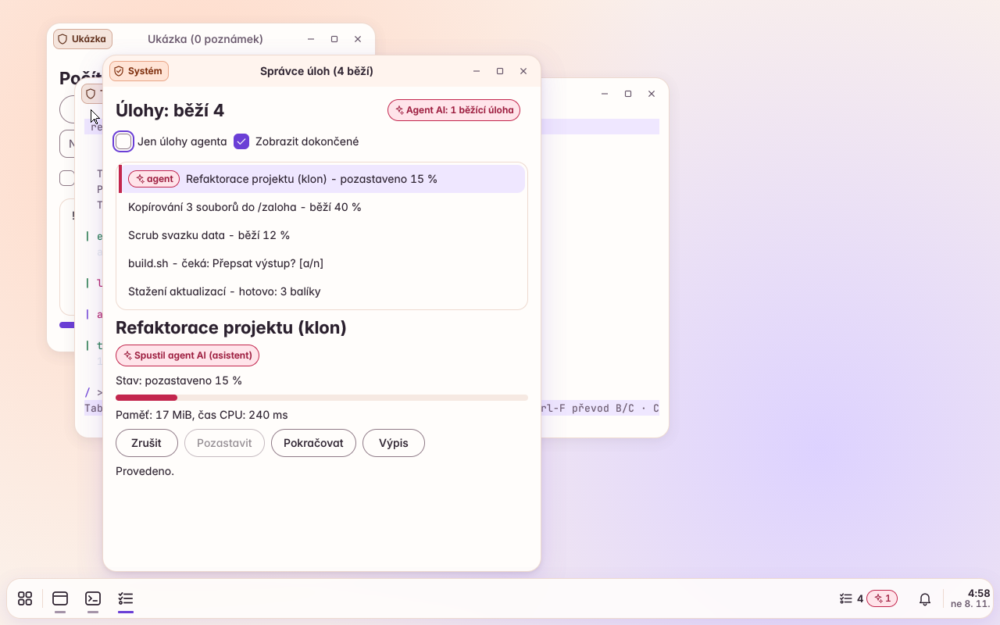
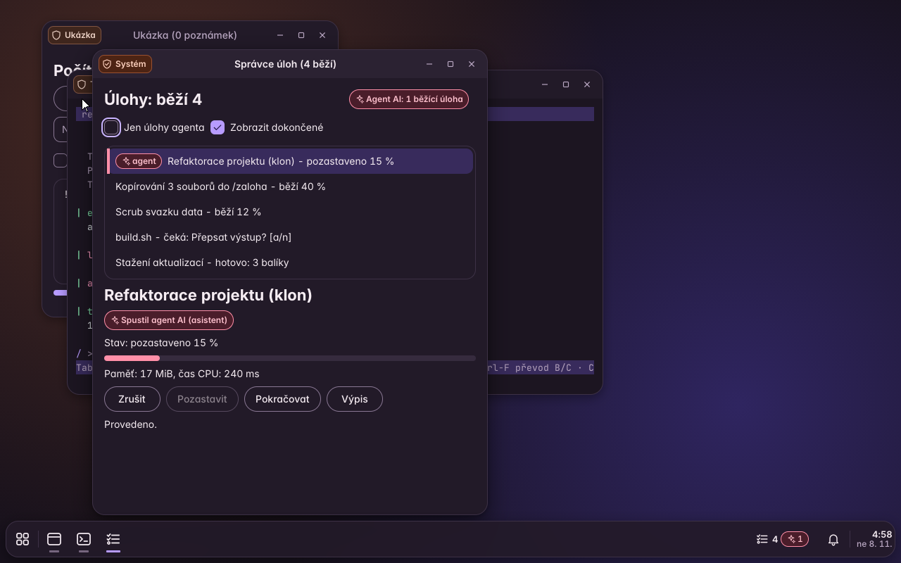
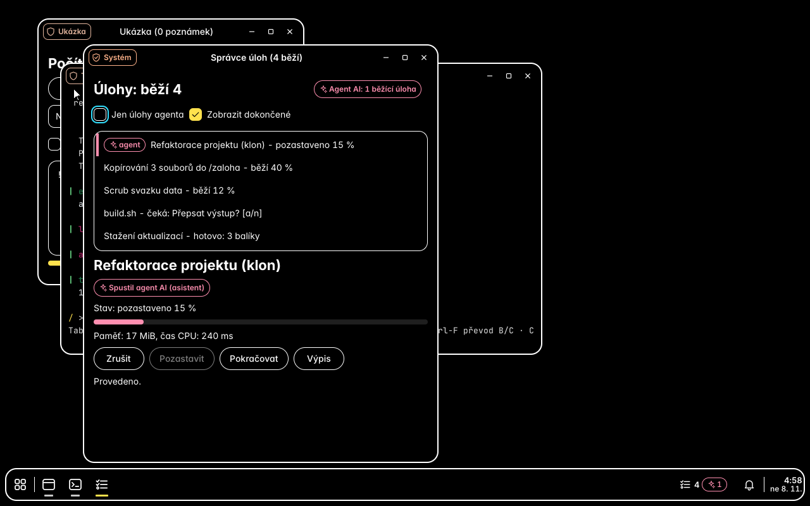

# Graphics and windows (GUI)

Milestone 6c. Describes the display drivers (`virtio-gpu`, `fbdisplay`), the `compd` compositor,
the window protocol (`libs/guiproto`), the native UI library (`libs/ui`),
fonts (`libs/font`), drawing (`libs/gfx`), system dialogs and the action
API. The agreed decisions are in the [Architecture](architecture.md#decisions-for-milestones-6a-6d-agreed)
and in the [6c decisions](#6c-decisions-agreed) table below.

<figure class="diagram">
<svg viewBox="0 0 780 360" xmlns="http://www.w3.org/2000/svg" role="img" aria-label="GUI parts">
<defs><marker id="g1" viewBox="0 0 10 10" refX="9" refY="5" markerWidth="7" markerHeight="7" orient="auto"><path class="arrow" d="M0,0 L10,5 L0,10 z"/></marker></defs>
<rect class="box" x="10" y="20" width="170" height="70" rx="6"/><text class="t b" x="95" y="45" text-anchor="middle">application</text><text class="m" x="95" y="64" text-anchor="middle">libs/ui: widgets, text</text><text class="m" x="95" y="80" text-anchor="middle">draws into its buffers</text>
<rect class="box" x="10" y="120" width="170" height="70" rx="6"/><text class="t b" x="95" y="145" text-anchor="middle">terminal window</text><text class="m" x="95" y="164" text-anchor="middle">native 6b protocol</text><text class="m" x="95" y="180" text-anchor="middle">as window content</text>
<rect class="box" x="10" y="220" width="170" height="70" rx="6"/><text class="t b" x="95" y="245" text-anchor="middle">shell, agent</text><text class="m" x="95" y="264" text-anchor="middle">call app actions</text><text class="m" x="95" y="280" text-anchor="middle">(capability actions)</text>
<rect class="acc" x="280" y="60" width="200" height="200" rx="6"/><text class="t b" x="380" y="88" text-anchor="middle">compd (compositor)</text><text class="m" x="380" y="110" text-anchor="middle">layer tree of all windows</text><text class="m" x="380" y="128" text-anchor="middle">transactions, frame clock</text><text class="m" x="380" y="146" text-anchor="middle">decorations, trust badge</text><text class="m" x="380" y="164" text-anchor="middle">system dialogs</text><text class="m" x="380" y="182" text-anchor="middle">focus, input routing</text><text class="m" x="380" y="200" text-anchor="middle">accessibility tree</text><text class="m" x="380" y="218" text-anchor="middle">action routing</text>
<path class="ln" d="M180 55 L278 100" marker-end="url(#g1)"/><text class="m" x="190" y="62">window: layers, a11y</text>
<path class="ln" d="M180 155 L278 160" marker-end="url(#g1)"/>
<path class="ln" d="M180 255 L278 220" marker-end="url(#g1)"/>
<rect class="box" x="580" y="20" width="190" height="70" rx="6"/><text class="t b" x="675" y="45" text-anchor="middle">inputd</text><text class="m" x="675" y="64" text-anchor="middle">focus = compd</text><text class="m" x="675" y="80" text-anchor="middle">secure attention</text>
<rect class="box" x="580" y="140" width="190" height="70" rx="6"/><text class="t b" x="675" y="165" text-anchor="middle">virtio-gpu (driver)</text><text class="m" x="675" y="184" text-anchor="middle">displayproto: frame,</text><text class="m" x="675" y="200" text-anchor="middle">damaged rects, flush</text>
<rect class="box" x="580" y="260" width="190" height="70" rx="6"/><text class="t b" x="675" y="285" text-anchor="middle">init</text><text class="m" x="675" y="304" text-anchor="middle">app identity and</text><text class="m" x="675" y="320" text-anchor="middle">permissions, dialogs</text>
<path class="ln" d="M578 55 L482 100" marker-end="url(#g1)"/><text class="m" x="500" y="62">Record</text>
<path class="ln" d="M482 170 L578 175" marker-end="url(#g1)"/><text class="m" x="500" y="164">Present</text>
<path class="ln" d="M578 290 L482 240" marker-end="url(#g1)"/><text class="m" x="490" y="290">connect, dialog</text>
<rect class="ok" x="280" y="290" width="200" height="50" rx="6"/><text class="t b" x="380" y="312" text-anchor="middle">QEMU virtio-gpu</text><text class="m" x="380" y="329" text-anchor="middle">2D now, virgl 3D next</text>
<path class="ln" d="M675 212 L482 305" marker-end="url(#g1)"/>
</svg>
<figcaption>GUI parts and who talks to whom. An application never sees other windows or the screen.</figcaption>
</figure>

## 6c decisions (agreed)

| # | Question | Decision |
|---|---|---|
| 1 | rendering | **software compositing on virtio-gpu 2D** as the compatibility layer everywhere (x86_64 and aarch64); right after that **virgl 3D** as a second compositor backend (same layer tree) |
| 2 | buffers | **shared memory object (VMO)**: allocated by the application (its job pays), the compositor gets a handle with only `READ`, `MAP`, `WAIT`, `DUPLICATE`, `TRANSFER`; drawing without copies |
| 3 | frames | **compositor clock + transactions**: frame deadline from the output's refresh rate, an application gets `Frame` only on request; transactions are atomic even across windows and applications (synchronized resize) |
| 4 | font | **own TrueType parser and rasterizer** (`libs/font`): cmap, glyf, hmtx, kern, area anti-aliasing, no hinting or shaping |

⚠️ **Risks (stated up front):**

- **virgl 3D in QEMU** needs a display with OpenGL (`-display sdl,gl=on`,
  `gtk,gl=on` or `egl-headless`). Tests run without a window, so 3D can
  only be tested with `egl-headless`; when the host lacks it, the 3D test
  is skipped and only 2D is verified. Venus (Vulkan) needs a Mesa port and
  is missing in QEMU for Windows, so it is a later step.
- **Without an IOMMU** `virtio-gpu` can DMA anywhere in memory (like the
  other drivers). With an IOMMU (`iommu_platform=on`) only into its buffers.
- **An application may change its buffer while it is being read.** The
  worst outcome is torn content of its own window; the compositor never
  trusts buffer contents (dimensions are checked at creation, reads are
  bounded by the VMO).
- **Software compositing** costs CPU: at 1280x800 and 60 Hz that is
  ~250 MB/s of writes. Therefore only damaged regions are composed and
  nothing is drawn when nothing changes. **4K at 120 Hz and above** (a full
  4K screen = 33 MB per frame, 120 Hz = 4 GB/s) works on the CPU only with
  small damaged regions (cursor, text, a small window). Full-screen effects
  and full redraws belong on the GPU (`vkcomp`, Venus); on a machine with a
  GPU, GPU composition should be the default path. **[designed]** (today
  the GPU is switched on by the `backend gpu` command)
- **Kernel console and firmware GOP (solved in the loader):** the firmware
  (edk2/OVMF) has the `VirtioGpuDxe` driver and turns virtio-gpu into a GOP
  as well. Its framebuffer is plain RAM pushed to the screen by virtio
  commands - after ExitBootServices nobody would refresh it and the kernel
  console would be blank until `compd` takes over. The loader therefore goes
  through all GOPs, reads the device vendor and type via
  `EFI_PCI_IO_PROTOCOL` and **takes virtio-gpu (1af4:1050) only when there
  is no other GOP** (then it warns in the log). The loader log lists all
  GOPs (`GOP na zarizeni PCI 1234:1111`, `GOP mimo PCI`) and the chosen
  framebuffer: on x86_64 the VGA card, on aarch64 ramfb.
- **Imitating a system dialog** in a fullscreen application cannot be
  ruled out by looks alone. The protection is that a permission dialog
  accepts only physical input (synthetic input does not count), shows the
  user's security phrase which applications do not know, and the secure
  attention shortcut always shows the real system screen.

## Start-up

```text
init
 ├─ devmgr ── finds PCI 1af4:1050 (virtio-gpu) ── starts virtio-gpu
 │            sends init the message `display` + channel (displayproto)
 ├─ fbdisplay ─ only when `display` did not arrive: firmware framebuffer
 │              (bootstrap FRAMEBUFFER, FB_CONTROL CLAIM), see Displays
 ├─ inputd
 └─ compd ─── init sends it `display` (driver channel), `input`
              (a new focus channel from inputd), `secure` (shortcut channel)
              and for each application `connect <identity>` -> window channel
```

The compositor receives the input focus from `inputd` (command `focus`),
so only it sees the keyboard and mouse and it routes them to windows. It
also receives the secure attention shortcut (channel `secure`) and shows
the system screen for it.

## Drawing and buffers

A pixel is a `u32` with byte order B, G, R, A (virtio-gpu format
`B8G8R8A8_UNORM`, `0xAARRGGBB` in a register) with **premultiplied
alpha**. A buffer has a width, height and row step (stride) **in pixels**.

<figure class="diagram">
<svg viewBox="0 0 780 260" xmlns="http://www.w3.org/2000/svg" role="img" aria-label="Buffer life cycle">
<defs><marker id="g2" viewBox="0 0 10 10" refX="9" refY="5" markerWidth="7" markerHeight="7" orient="auto"><path class="arrow" d="M0,0 L10,5 L0,10 z"/></marker></defs>
<rect class="box" x="10" y="30" width="160" height="60" rx="6"/><text class="t b" x="90" y="55" text-anchor="middle">app draws</text><text class="m" x="90" y="74" text-anchor="middle">into buffer A</text>
<rect class="acc" x="220" y="30" width="160" height="60" rx="6"/><text class="t b" x="300" y="55" text-anchor="middle">COMMIT</text><text class="m" x="300" y="74" text-anchor="middle">layer -> A, damage</text>
<rect class="box" x="430" y="30" width="160" height="60" rx="6"/><text class="t b" x="510" y="55" text-anchor="middle">compd reads A</text><text class="m" x="510" y="74" text-anchor="middle">while composing</text>
<rect class="ok" x="620" y="30" width="150" height="60" rx="6"/><text class="t b" x="695" y="55" text-anchor="middle">RELEASED A</text><text class="m" x="695" y="74" text-anchor="middle">once layer shows B</text>
<path class="ln" d="M170 60 L218 60" marker-end="url(#g2)"/>
<path class="ln" d="M380 60 L428 60" marker-end="url(#g2)"/>
<path class="ln" d="M590 60 L618 60" marker-end="url(#g2)"/>
<rect class="box" x="10" y="150" width="160" height="60" rx="6"/><text class="t b" x="90" y="175" text-anchor="middle">meanwhile draws</text><text class="m" x="90" y="194" text-anchor="middle">into buffer B</text>
<rect class="acc" x="220" y="150" width="160" height="60" rx="6"/><text class="t b" x="300" y="175" text-anchor="middle">COMMIT</text><text class="m" x="300" y="194" text-anchor="middle">layer -> B</text>
<path class="ln" d="M170 180 L218 180" marker-end="url(#g2)"/>
<path class="ln dash" d="M380 180 L690 92" marker-end="url(#g2)"/>
<text class="m" x="10" y="245">Double buffering: the app never waits for the compositor, it only must not reuse a buffer before RELEASED.</text>
</svg>
<figcaption>A buffer belongs to the application; the compositor only reads it between COMMIT and RELEASED.</figcaption>
</figure>

- The application creates a VMO and sends `BUFFER_CREATE` with the handle
  (only `READ`, `MAP` and the basic rights). The compositor maps it
  read-only (`stride * height * 4` bytes - a smaller VMO fails to map) and
  checks the dimensions (at most 16384 px).
- The buffer memory is paid by the application's job: an application
  cannot exhaust the compositor's memory.
- The compositor holds a buffer from the `COMMIT` that attached it to a
  layer until `RELEASED`, which it sends as soon as no layer shows the
  buffer (the layer got another buffer or was destroyed). The `ui` library
  therefore alternates between two buffers and never waits for the
  compositor.

### Buffers with a description and explicit synchronisation (video)

**[verified in QEMU]** step 6a-4 (test `compd: video NV12 a I420 s ploty
ziskani a uvolneni`, x86_64 and aarch64):

- **`BUFFER_CREATE_DESC`** carries a `bufdesc` description
  ([shared-buffers.md](shared-buffers.md)) and a VMO handle. The compositor
  takes `ARGB8888` and `XRGB8888` (BGRA, first plane at offset 0) and YUV
  4:2:0 `NV12` and `YU12` (I420), always with the `LINEAR` modifier; other
  formats are `NOT_SUPPORTED`.
- **Validation:** the description is validated (`validate`) and the VMO is
  mapped read-only exactly at the needed size. A smaller VMO fails to map
  and the client gets `ERROR`.
- **YUV:** the compositor keeps its own BGRA shadow buffer (compositor
  memory). It converts the frame into it at the commit that attached or
  damaged the buffer (`libs/yuv`: SIMD, BT.709 limited range). The YUV
  source is not read after that.
- **`SYNC_POINTS`** applies to the window's next `COMMIT`. The message
  handles are an acquire fence (the `WAIT` right) and a release fence (the
  `SIGNAL` right), each with a value ([fences.md](fences.md)).
  - **Acquire:** the compositor holds the commit (and all further client
    messages) until the fence reaches the value. Meanwhile it shows the
    window's previous state and other windows keep running. The deadline
    is 10 s, the same as for the render class. When the fence ends with an
    error, is abandoned or the deadline passes, the commit is applied
    anyway (the worst case is an unfinished frame of the client's own
    window) and the client gets `ERROR` (`COMMIT`, the fence code).
  - **Release:** the compositor advances the fence once it stops reading
    the buffers attached by that commit: YUV right after conversion, BGRA
    after `RELEASED`.
- **GPU conversion:** `vkcomp` can convert YUV with the `spirv::yuv`
  shader (bit-exact with the CPU, vk-probe test in WSL). The compositor
  does not use it yet, not even when composing on the GPU. With Venus the
  YUV data would be copied into a host blob anyway; the real gain comes
  with importing the buffer to the GPU (`IMPORT_BUFFER`,
  [render.md](render.md)) **[designed]**.

## Layer tree

A window is a tree of **layers**. Applications draw the layer contents,
but **offset, opacity, clipping, scrolling and animation are done by the
compositor**: moving a list or highlighting a button needs no redraw by the
application and stays smooth even while the application is busy.

| Layer kind | Content |
|---|---|
| `GROUP` | children only; optionally clipped to its rectangle with a content offset (scroll) |
| `BUFFER` | a rectangle from an application buffer (the source rectangle is scaled to the target) |
| `SOLID` | a single-colour rectangle (backgrounds, separators, selection) |

Layer properties (`LAYER_SET`, each optional): rectangle in the parent's
coordinates, order among siblings, opacity 0-255, visibility, clipping of
children, content offset `(sx, sy)`, buffer and source rectangle, colour.

**Animation** (`ANIMATE`): a property (opacity, offset x/y, scroll x/y),
target value, duration in ms and curve (`linear`, `ease-out`). The
compositor computes it every frame itself; the application gets
`ANIMATION_DONE`.

<figure class="diagram">
<svg viewBox="0 0 780 300" xmlns="http://www.w3.org/2000/svg" role="img" aria-label="Layer tree and accessibility tree">
<defs><marker id="g3" viewBox="0 0 10 10" refX="9" refY="5" markerWidth="7" markerHeight="7" orient="auto"><path class="arrow" d="M0,0 L10,5 L0,10 z"/></marker></defs>
<text class="t b" x="20" y="24">layer tree</text>
<rect class="acc" x="20" y="36" width="160" height="40" rx="6"/><text class="t" x="100" y="61" text-anchor="middle">1 GROUP window</text>
<rect class="box" x="20" y="100" width="150" height="40" rx="6"/><text class="t" x="95" y="125" text-anchor="middle">2 SOLID background</text>
<rect class="box" x="190" y="100" width="170" height="40" rx="6"/><text class="t" x="275" y="125" text-anchor="middle">3 GROUP list (clip)</text>
<rect class="box" x="190" y="170" width="170" height="40" rx="6"/><text class="t" x="275" y="195" text-anchor="middle">4 BUFFER rows</text>
<rect class="box" x="20" y="170" width="150" height="40" rx="6"/><text class="t" x="95" y="195" text-anchor="middle">5 BUFFER button</text>
<path class="ln" d="M100 76 L95 98" marker-end="url(#g3)"/>
<path class="ln" d="M120 76 L270 98" marker-end="url(#g3)"/>
<path class="ln" d="M275 140 L275 168" marker-end="url(#g3)"/>
<path class="ln" d="M70 76 L70 168" marker-end="url(#g3)"/>
<text class="m" x="190" y="232">scroll = property of layer 3, no app redraw</text>
<text class="t b" x="440" y="24">accessibility tree</text>
<rect class="ok" x="440" y="36" width="190" height="40" rx="6"/><text class="t" x="535" y="61" text-anchor="middle">window "Notes"</text>
<rect class="ok" x="440" y="100" width="150" height="40" rx="6"/><text class="t" x="515" y="125" text-anchor="middle">list "Files"</text>
<rect class="ok" x="610" y="100" width="160" height="40" rx="6"/><text class="t" x="690" y="125" text-anchor="middle">button "Save"</text>
<rect class="ok" x="440" y="170" width="150" height="40" rx="6"/><text class="t" x="515" y="195" text-anchor="middle">item "a.txt" ✓</text>
<path class="ln" d="M515 76 L515 98" marker-end="url(#g3)"/>
<path class="ln" d="M560 76 L680 98" marker-end="url(#g3)"/>
<path class="ln" d="M515 140 L515 168" marker-end="url(#g3)"/>
<path class="ln-acc dash" d="M360 190 L438 190"/>
<path class="ln-acc dash" d="M170 190 Q400 260 690 142"/>
<text class="m" x="440" y="240">a node points to a layer + rectangle: the compositor</text>
<text class="m" x="440" y="256">knows where it is even without the app (reader, agent, test)</text>
</svg>
<figcaption>Two trees of one window. Layers decide what is visible; accessibility what it means.</figcaption>
</figure>

## Accessibility tree

The structure of a window is part of the protocol. A node (`A11Y_UPDATE`)
carries:

| Field | Meaning |
|---|---|
| `id`, `parent` | identity and parent (0 = window root) |
| `role` | `window`, `titlebar`, `button`, `label`, `text-input`, `password-input`, `checkbox`, `switch`, `radio`, `slider`, `combo-box`, `list`, `list-item`, `table`, `row`, `cell`, `column-header`, `tab-list`, `tab`, `segmented`, `list-box`, `list-option`, `menu`, `menu-item`, `tooltip`, `scroll-area`, `group`, `image`, `progress`, `terminal` |
| `name` | text for humans ("Save") |
| `value` | value (text field, progress percent) |
| `state` | bits: `focused`, `checked`, `disabled`, `selected`, `expanded`, `busy`, `hover`, `pressed`, `invalid` (the error text is a child `label` node), `active` (active item of a suggestion list, focus stays in the field), `autocomplete` (the field offers a suggestion list) |
| `bounds` | layer + rectangle in it |
| `actions` | bits: `activate`, `focus`, `set-value`, `toggle`, `scroll` |

The compositor keeps the tree and serves it to:

- **a screen reader and magnifier** (later) - via a capability, not the app,
- **tests and the agent**: "click the Save button" goes through a node,
  not coordinates; the compositor sends the application `A11Y_ACTION`,
- **decorations**: a custom title bar is as accessible as the standard one
  (node `titlebar`).

## Frames and transactions

Window state has two copies: **pending** (messages since the last
`COMMIT`) and **current** (the one being composed). `COMMIT` turns the
pending state into the current one **atomically**: half a change is never
visible. One transaction may span several messages (the channel message
limit is 64 KiB).

<figure class="diagram">
<svg viewBox="0 0 780 290" xmlns="http://www.w3.org/2000/svg" role="img" aria-label="Frame clock">
<defs><marker id="g4" viewBox="0 0 10 10" refX="9" refY="5" markerWidth="7" markerHeight="7" orient="auto"><path class="arrow" d="M0,0 L10,5 L0,10 z"/></marker></defs>
<path class="ln" d="M20 60 L760 60"/><text class="m" x="20" y="45">compd</text>
<path class="ln" d="M20 160 L760 160"/><text class="m" x="20" y="145">application</text>
<path class="ln" d="M20 250 L760 250"/><text class="m" x="20" y="235">virtio-gpu</text>
<path class="ln-acc" d="M100 50 L100 70"/><text class="m" x="85" y="40">tick N</text>
<path class="ln-acc" d="M367 50 L367 70"/><text class="m" x="350" y="40">tick N+1</text>
<path class="ln-acc" d="M634 50 L634 70"/><text class="m" x="617" y="40">tick N+2</text>
<path class="ln" d="M104 64 L170 156" marker-end="url(#g4)"/><text class="m" x="120" y="100">FRAME seq, deadline</text>
<rect class="box" x="172" y="148" width="120" height="24" rx="4"/><text class="m" x="232" y="165" text-anchor="middle">draws, COMMIT</text>
<path class="ln" d="M292 156 L330 66" marker-end="url(#g4)"/>
<rect class="acc" x="370" y="48" width="90" height="24" rx="4"/><text class="m" x="415" y="65" text-anchor="middle">compose</text>
<path class="ln" d="M460 66 L520 244" marker-end="url(#g4)"/><text class="m" x="490" y="140">PRESENT damage</text>
<path class="ln" d="M560 244 L600 70" marker-end="url(#g4)"/><text class="m" x="585" y="200">PRESENTED</text>
<path class="ln" d="M604 64 L680 156" marker-end="url(#g4)"/><text class="m" x="650" y="100">PRESENTED txn</text>
<text class="m" x="20" y="282">Input is delivered immediately (not on the clock); composing waits only for the deadline, never for a slow app.</text>
</svg>
<figcaption>Clock (here 60 Hz): the app draws after FRAME, the compositor composes on the tick, the driver confirms the display.</figcaption>
</figure>

- **Clock:** period = 1 / the output's refresh rate from the driver's mode
  (60 Hz = 16.67 ms, 120 Hz = 8.33 ms, 240 Hz = 4.17 ms); 60 Hz when
  unknown. The composition reserve before the end of the period is a
  quarter of the period (at most 4 ms); `FRAME` carries the deadline and
  the period. **[implemented]** (test `frame_period_follows_refresh_rate`
  in `libs/comp`) Deviation: one clock for the whole compositor (it
  composes one output so far); a clock per output and VRR (variable rate:
  a frame right after a change, at most at the maximum rate)
  **[designed]**. The compositor ticks only when something is
  waiting (damaged region, animation, frame request). Nothing changes =
  no wake-ups.
- **Frame request:** `COMMIT` with the `FRAME` flag says "tell me when to
  draw the next one". `FRAME { seq, deadline }` arrives at the start of the
  next period; an application that commits before `deadline` makes that
  frame.
- **Input priority:** the compositor first handles input (delivers it to a
  window), only then composes. Input is never batched to the clock.
- **A slow application** does not delay others: its last current state is
  composed.
- **`PRESENTED { txn, time }`** confirms the display (time from the driver).

### Synchronized resize

The compositor sends `CONFIGURE { window, w, h, serial }`. The application
redraws and acknowledges `serial` in `COMMIT`. The window frame
(decorations) and the new content appear **in the same frame**. When the
application does not acknowledge within 200 ms, the compositor shows the
old content in the new frame (clipped or padded with background), so the
window never "runs away" from its frame.

While dragging an edge there is at most one unacknowledged request: moves
in between are merged and after the ack (or the deadline) the application
gets the last size right away. It never draws outdated sizes and gets at
most one `CONFIGURE` per frame (maximize and screen changes go at once).
**[implemented]** (test `resize_drag_coalesces_configures` in `libs/comp`)
Input tracing records the step cost: `velikost okna <id> <w>x<h>
potvrzena aplikaci za N ms` (from the first request to the ack). Numbers
from QEMU and real hardware are not measured yet. **[designed]**: show the
old content at the fixed corner at once (without waiting for the ack) and
damage only the changed band of the window and shadow.

### Window context and requested size

Every window gets **its own** context, nothing global (several outputs
with different scales change nothing):

```
WINDOW_CONTEXT { window, generation, output, screen, work_area, scale, refresh_mhz }
WINDOW_SIZE    { window, w, h, min_w, min_h, max_frac_w, max_frac_h }
```

- `WINDOW_CONTEXT` arrives **before the first `CONFIGURE`** and then on
  every change (resolution, bar, later a move to another output) with a
  higher `generation`. `work_area` is the screen without the bar; sizes
  are logical px.
- `WINDOW_SIZE` is the requested content size: natural `w` x `h`
  (0 = leave it to the system), minimum `min_w` x `min_h` and a cap in
  per mille of the work area (`max_frac_w = 850` = at most 85 % of the
  width; 0 = no cap).
  - **Before the first commit** it sets the size at opening: the
    compositor answers with `CONFIGURE` and the window appears right away
    in the correct size, with no second `CONFIGURE` and no flicker.
    `Window::request_size` in `libs/ui` waits for the answer.
  - **Later** it is a resize request (`CONFIGURE` as when dragging an
    edge). A maximized or fullscreen window remembers it as its restored
    size.
- **Extension for tablet and TV** (`guiproto::context::ContextExt`,
  protocol version 3; [TV](../../design/televize.html),
  [Tablet](../../design/tablet.html)): `posture` (desktop, laptop, tablet,
  phone, tv), `distance` (near, desk, room), `insets` (system bars) and
  next to them `safe` (safe margin for overscan: text and focus only
  inside), `pointers` (a list: mouse, touchpad, touch, pen, remote with
  precision, hover and pressure; empty = focus only), `keyboard` (attached
  keyboard), `obscured` (obstacles, e.g. the on-screen keyboard), `tile`
  (floating, full, left, right, top, bottom), `min_hit` (smallest target;
  tokens `size.hit_min_fine` 32 and `size.hit_min_touch` 44) and
  `text_scale`. For now the compositor sends a computer with mouse and
  keyboard and `tile` by maximize and fullscreen (a new generation);
  tablet and TV will provide device services. The `ui` library enlarges
  controls and rows by `min_hit` itself; applications read `cx.posture`,
  `cx.can_hover()`, `cx.focus_only()`.
- Terminal: `win.request_size(1040, 520, 850, 0)`, i.e. 1040 px but at
  most 85 % of the work area width.
- Protocol version 4 (`guiproto::VERSION`; 4 = gesture serial in
  `InputRecord`): compositor and applications are built together, `HELLO`
  requires a match.

**[implemented]** (tests `context_first_and_initial_size_without_flicker`,
`request_size_later_and_while_maximized`, `resize_sends_new_context_generation`
in `libs/comp`)

### Transactions across windows and applications

For changes that must appear together in different windows (a terminal
window with content from another process, splitting the screen between
two applications):

1. A coordinator (application or compositor) asks for a group:
   `SYNC_GROUP { count }` -> `SYNC_TOKEN { token }` (a 128-bit random number).
2. It hands the token to the other participants (over its own channel).
3. Each participant sends `COMMIT` with `token`. The compositor holds the
   current states of all of them until `count` commits arrive (or 200 ms
   pass - then it applies all of them and drops the group, so nothing gets
   stuck).

## Windows and decorations

`WINDOW_CREATE { id, mode, w, h, title }`. The frame, title bar and
buttons are drawn by the compositor according to the mode ([Custom window
look](architecture.md#custom-window-look-custom-title-bar)):

| Mode | Application draws | System keeps |
|---|---|---|
| `STANDARD` | content only | frame, title, badge, buttons |
| `CUSTOM_TITLE` | the title area too | badge at a fixed place, buttons (the app chooses side and colour), move and resize via declared regions |
| `FRAMELESS`, `FULLSCREEN` | everything | badge at the top edge on hover and always on a permission change (3 s); secure shortcut and dialogs always |

<figure class="diagram">
<svg viewBox="0 0 780 250" xmlns="http://www.w3.org/2000/svg" role="img" aria-label="Custom title bar mode">
<rect class="box" x="20" y="20" width="740" height="200" rx="8"/>
<rect class="acc" x="20" y="20" width="740" height="36" rx="8"/>
<rect class="ok" x="28" y="26" width="150" height="24" rx="5"/><text class="m" x="103" y="43" text-anchor="middle">badge: Notes · network</text>
<rect class="box" x="196" y="26" width="110" height="24" rx="5"/><text class="m" x="251" y="43" text-anchor="middle">tab 1</text>
<rect class="box" x="312" y="26" width="110" height="24" rx="5"/><text class="m" x="367" y="43" text-anchor="middle">tab 2</text>
<rect class="warn" x="430" y="24" width="230" height="28" rx="4"/><text class="m" x="545" y="43" text-anchor="middle">DRAG region (declared)</text>
<rect class="err" x="672" y="26" width="24" height="24" rx="4"/><rect class="err" x="700" y="26" width="24" height="24" rx="4"/><rect class="err" x="728" y="26" width="24" height="24" rx="4"/>
<text class="m" x="680" y="76">buttons: system</text>
<text class="m" x="200" y="76">tabs: application (custom title)</text>
<text class="t" x="390" y="140" text-anchor="middle">application content</text>
<text class="m" x="20" y="242">Moving the window works even with a hung app: the compositor knows the regions and does not ask the app.</text>
</svg>
<figcaption>Custom title bar: the app draws the tabs, the system the badge and buttons.</figcaption>
</figure>

**Declared regions** (`REGIONS`): a list of rectangles of kind `DRAG`
(moves the window), `NO_DRAG` (exception inside `DRAG`, e.g. a tab) and
`RESIZE` (edges). The compositor moves and resizes the window by them on
its own, without asking the application.

**Trust badge** shows the application's identity (the manifest name given
by init, not by the application) and what it may do right now (network,
folders, camera). The application cannot paint over it: the compositor
composes it above the window content.

**Per-client limits** (protecting the compositor from an application): a
buffer at most 64 MiB and all buffers 256 MiB, 256 buffers, 8192 layers,
32 windows, 4096 accessibility nodes per window, pending messages before
`COMMIT` at most 16 MiB, title 256 characters, 4 transaction groups.
Messages that do not fit into an application's channel queue are deferred
by the compositor (mouse motion and ping may be dropped, `RELEASED`,
`FRAME` and `CONFIGURE` never); a client that does not read 4096
deferred messages is disconnected.

**Unresponsive application:** the compositor sends `PING`; without `PONG`
within 3 s it dims the window and shows a warning. Moving, minimizing and
closing keep working.

## Look per the design (phase 1)

> **Change from the previous state:** decorations, the bar, dialogs, UI
> elements and the terminal had fixed dark colors and sizes in code and
> the Tuffy font. Now everything comes from the `design/tokens.toml`
> tokens and is drawn with Inter and JetBrains Mono following the
> prototypes in `design/` ([Appearance](appearance.md)). Reason: one
> source of truth for prototypes and the system; changing a color or
> spacing needs no code change.

<figure class="diagram">
<svg viewBox="0 0 760 200" xmlns="http://www.w3.org/2000/svg" role="img" aria-label="Token flow into the system">
<defs><marker id="vf1" viewBox="0 0 10 10" refX="9" refY="5" markerWidth="7" markerHeight="7" orient="auto"><path class="arrow" d="M0,0 L10,5 L0,10 z"/></marker></defs>
<rect class="acc" x="10" y="70" width="160" height="60" rx="6"/><text class="t b" x="90" y="96" text-anchor="middle">design/tokens.toml</text><text class="m" x="90" y="114" text-anchor="middle">embedded at build</text>
<path class="ln" d="M170 100 L218 100" marker-end="url(#vf1)"/>
<rect class="box" x="220" y="70" width="150" height="60" rx="6"/><text class="t b" x="295" y="96" text-anchor="middle">libs/theme</text><text class="m" x="295" y="114" text-anchor="middle">libs/conf, contrast</text>
<path class="ln" d="M370 85 L438 40" marker-end="url(#vf1)"/><path class="ln" d="M370 100 L438 100" marker-end="url(#vf1)"/><path class="ln" d="M370 115 L438 160" marker-end="url(#vf1)"/>
<rect class="ok" x="440" y="15" width="310" height="50" rx="6"/><text class="t b" x="595" y="37" text-anchor="middle">compd: windows, bar, dialogs</text><text class="m" x="595" y="54" text-anchor="middle">libs/comp/style.rs, render.rs</text>
<rect class="ok" x="440" y="75" width="310" height="50" rx="6"/><text class="t b" x="595" y="97" text-anchor="middle">libs/ui: application elements</text><text class="m" x="595" y="114" text-anchor="middle">look.rs (no trust_*, ai_*)</text>
<rect class="ok" x="440" y="135" width="310" height="50" rx="6"/><text class="t b" x="595" y="157" text-anchor="middle">gui-term: term_* colors, JetBrains Mono</text><text class="m" x="595" y="174" text-anchor="middle">grid from type.mono</text>
</svg>
<figcaption>Tokens are data: the compositor, the UI library and the terminal read the same file.</figcaption>
</figure>

**QEMU screenshots** (the `compd: vzhled podle navrhu` test, `screendump`
over QMP, 1280x800; compare with `design/plocha.html` and
`design/okna.html`):







**Tokens as data.** `libs/theme` reads `design/tokens.toml` through
`libs/conf` (which now supports decimals, e.g. `frame_ms = 16.7`) and
gives the values for light, dark and high-contrast modes: colors
(premultiplied), the type scale, spacing, sizes, radii, shadows, motion
(`cubic-bezier` curves) and layers. The `contrast_pairs_pass` test checks
every required contrast pair from `[contrast]` exactly like
`design/tools/build-tokens.mjs`. The default theme is embedded at build
time; `Tokens::parse` reads any other text (user themes later). The
compositor switches modes at once with `theme light|dark|contrast` (tests); it gets the user's choice with a smooth transition and the time-of-day mode through `appearance` (see [Appearance](appearance.md#light-dark-and-automatic-appearance)).

**Windows** (`design/okna.html`): 40 px title (`size.title_h`), 18 px
radius (`radius.window`), 1 px `border` frame, a shadow by state
(`shadow.window` / `window_inactive`, two layers), active title
`surface_2` with a weight-600 name, inactive `surface` and weight 500 in
the muted color. Window buttons are 28 px pills with a design-system
icon; the click target is 40 px (`size.hit_min`), overlaps go to the
nearest center. Hover highlights a button (`surface_3`, close
`danger`). The 26 px trust badge: shield, manifest name and permission
icons in `trust_*` colors; a system app (`[app] system = true` in the
manifest, judged by init, `ConnectInfo.system`) shows "Systém" with a
check shield. Init reads the key only from a manifest in initfs (the
system image); an app from elsewhere cannot pose as the system, that is
decided by signature and path, not by its own manifest. An unfocused window's badge has 0.6 saturation. The frame is
1 px, 2 px in high contrast. A new window is placed in the work area
(screen minus the bar) whole, also horizontally: the cascade of further
windows does not push it past the right edge of a small screen
(800 × 600, `cascade_keeps_wide_window_on_screen`); it gets under the bar
only by dragging.

**App elements** (`libs/ui`): the AI agent has the reserved `ai_*` colors
and always the agent icon and the word "agent" (`.agent()` chip, a list
row with a left stripe and chip, progress in `ai`; in the accessibility
tree the name starts with "agent:"). A disabled button is the same button
at `opacity.disabled`. The selected row has an `accent_soft` background
and regular weight. The focus ring is drawn only in the active window
(the element remembers focus). An invisible `size.resize_edge` edge outside
the window (in the shadow area) resizes on all four sides and corners (a
corner as long as the radius); dragging the left or top edge also moves the
window, the opposite edge stays (after the CONFIGURE ack). Above the edge
the cursor is a double arrow (horizontal, vertical, diagonal); the minimum
window size applies. The title button zone is the button circle plus 4 px
(`space.s2`), so the highlight matches what one sees; only a maximized
window uses the `size.hit_min` square up to the top edge and close up to
the screen corner (Fitts's law). Outside the frame the edge wins.
**[implemented]** (tests `close_button_zone_does_not_cover_edge`,
`close_button_zone_is_round_except_maximized_corner`,
`resize_from_left_and_top_keeps_opposite_edge` in `libs/comp`)
Unresponsive app: dimmed content and a "... nereaguje" card.

**Bar** (`design/plocha.html`, "bottom, inset"): 52 px, 8 px inset,
18 px radius, a **blurred backdrop** under it (`blur(16px)` as in the
prototype) with `surface` at `opacity.bar` on top, `shadow.bar`. The blur
is computed at half resolution and only when something under the bar
changes (window move, content, theme); otherwise it comes from a cache;
hover, the clock and the cursor do not recompute it. On the left the
launcher, a separator and window buttons (icon per app, running / active
mark), on the right the "Vstup ovládá automat" pill, tasks with the agent
chip, **network and volume from the real state** (`netd`: link and
address, `audiod`: volume and mute; a struck-through icon when offline or
muted), the notification bell (a placeholder icon for now) and the clock
(time and date in the zone init sends with the `display` command).

Init provides the bar state with `sources net audio` and handles: a
network session with only the `INFO` right (no connections anywhere) and
a channel to the audio service. The compositor asks every 2 s and reads
replies without blocking (a stuck service does not hold up the bar).

**Desktop:** `bg` plus two soft radial gradients `wall_a`, `wall_b` like
`.desk` in the prototype; computed once per screen size, with fine
dithering against banding.

**System dialog:** 440 px wide, 2 px `trust_border` frame, a "Systém"
band with the phrase, heading, app block, the "physical input only"
note, pill buttons with a 2 px focus ring.

**Drawing (`libs/gfx`):**

| Module | What |
|---|---|
| `shape.rs` | rounded rectangle and frame from a distance field (same formula as a shader), window corner patches |
| `shadow.rs` | Gaussian shadow precomputed into a 9-slice mask (3 box passes); drawing only reads the table |
| `icon.rs` | the icon set (226) straight from `design/assets/mo.js` (SVG subset: `path` incl. arcs, `rect`, `circle`), distance-field strokes |
| `backdrop.rs` | desktop radial gradients |
| `text.rs` | a face family (CSS-style weight matching), 1/4 px subpixel positioning, dark-text gamma |

**Same pixels on CPU and GPU:** a window is drawn as a square and its
corners are recomputed as a "patch" (the window over the saved
background with the rounded-shape coverage); a multi-layer shadow is
composed into one color and blended once; the layer above windows (bar,
dialog, cursor) goes through a scratch buffer on the CPU too. So the
`gpu_list_matches_cpu_frame` test still compares frames pixel by pixel.

⚠️ **Risks and deviations (stated up front):**

- Fonts are embedded in programs (each only the faces it draws): `compd`
  +1.7 MB, apps with `libs/ui` +1.25 MB, `gui-term` +0.55 MB. Shared font
  memory from the compositor is a G5 task.
- The CPU computes the bar blur also in the GPU backend (same pixels).
  Follow-up for Venus: blur as a shader in `vkcomp`.
- Shadows from static masks.
- 200 % text size (Accessibility) comes with G4; apps receive the
  system theme with the `THEME` message (the UI library and the terminal
  recolor).
- Values that used to exist only in `mo.css` (bar opacity, dimming,
  dialog width, 14 px icons, the bar mark) are now in the tokens
  (`[size]`, `[opacity]`) and the code reads them from there.

**CPU frame cost:** `compd` logs the full-screen compose time with a
per-part breakdown (`libs/comp/src/prof.rs`) and, every 300 frames, the
average and maximum:

```
compd: snimek cele obrazovky 1280x800: 5820 us (cpu; plocha 279 us, stiny 1359 us,
okna 1479 us, rozmazani listy 0 us, nad okny 2667 us, z toho lista 2451 us, z toho dialog 0 us)
```

**Programs had no FPU until FPU-1** (soft-float, [architecture.md](architecture.md)):
every `f32` operation was a function call. That did not show on the host
(which has an FPU) but it did in WHPX (close to hardware speed) and in
emulation. So `gfx` computes per pixel with integers **[verified in QEMU]**;
since FPU-1 (hard-float) this stays, because integers are cheaper even
with an FPU and the result is bit-for-bit the same on both architectures
(frame hashes):

- rounded shapes compute the `f32` distance only in the corner squares
  (`shape::round_rect_coverage`; elsewhere the coverage is exactly 0 or
  255, the `round_rect_coverage_matches_float` test checks equal values),
- the blur under the bar is in 8.8 fixed point (`blur.rs`, at most ±1
  level from `f32`, `blur_int_matches_float` test),
- the desktop grid points are integer (`backdrop.rs`,
  `backdrop_int_matches_float` test).

**Skipping covered areas** **[verified in QEMU]**: a window body is opaque
(the `surface` fill under the content), so under a window core (without
the rounded corners) neither the desktop nor lower windows are drawn
(`Comp::visible_parts`). The `culling_keeps_pixels` test compares the
frame pixel by pixel with drawing everything bottom-up. The bar shadow is
not drawn under the bar body, which the opaque blurred background fully
covers.

Measured with the `gui` suite (16 full-screen 1280x800 frames during the
test: start, dialogs, themes, windows, compositor restart), before =
revision 3e5f791, after = 170a035:

| Where | Before (min / median / max) | After (min / median / max) | Note |
|---|---|---|---|
| QEMU on Windows with `--accel whpx`, release | 40 / 96 / 205 ms | 5.8 / 18 / 116 ms | a regular desktop frame with windows 40 ms -> 6-15 ms (budget 16 ms); bar 36 ms -> 2.5 ms (`3e5f791` -> `170a035`) |
| QEMU on Windows (TCG emulation), debug | 470 / 1246 / 2465 ms | 78 / 280 / 508 ms | look test 57 s -> 29 s, Files test 170 s -> 63 s (`3e5f791` -> `170a035`) |
| host, `bench_frame` test | debug 4.9 ms, release 3.9 ms | debug 5.2 ms, release 3.1 ms | the host has an FPU, soft-float did not matter here (`3e5f791` -> `170a035`) |
| host, 800x600 (`look_snapshots` test) | 3.5 ms, first 11 ms | - | the first one computes the desktop, shadows and blur |

Host measurement: `cargo test -p comp [--release] bench_frame -- --ignored --nocapture`.
In QEMU: `cargo xtask test --only gui [--release] [--accel whpx]` and the
`compd: snimek cele obrazovky` lines in `target/serial-test-*.log`.

⚠️ **What is still over the 16 ms budget** (WHPX, release, revision `170a035`):

- opening a system dialog 21-50 ms (`170a035`): full-screen dimming and scratch buffer, text wrapping with `f32` widths,
- a theme change 12-24 ms (`170a035`): a new desktop image,
- the first frames after a start or a compositor restart 30-116 ms (`170a035`): glyphs and icons are rasterized with `f32` into the cache.

The copy into a back buffer is not measured in `compd`: virtio-gpu and
`fbdisplay` copy only the damaged rectangles, once, so buffer age
([device-interfaces.md](device-interfaces.md#display-without-a-needless-copy))
saves nothing here. The biggest remaining lever is compiling programs
with SSE/NEON (the kernel already saves the FPU state); that is a
decision for the languages milestone, not the compositor.

So on display attach the compositor first shows just the background
color and composes the full frame on the next tick (start does not wait
for composition).

## Input in windows

The compositor receives events from `inputd` ([Input](input.md)) - from the
focus channel and from the `secure` channel (in secure mode input goes
only there) - and routes them:

- **keyboard** (`Key`, `Text`) -> the focused window; a new window of
  another application gets the focus only when the user has not typed for
  at least 1.5 s (otherwise a background window could "take" a password
  being typed),
- **mouse** -> the window under the pointer (converted to window
  coordinates); a button press outside decoration areas activates the
  window and gives it focus,
- **wheel** -> the window under the pointer,
- **secure attention shortcut** (`secure`) -> the system screen,
- an event flagged `SYNTHETIC` (synthetic input) reaches a window with the
  flag; a system dialog **ignores** it,
- **a new input device** (`NewDevice`, BadUSB protection): the compositor
  shows a system dialog "Allow device?" and drops that device's events
  until decided - the device cannot allow itself (type Enter). The answer
  goes to `inputd` as `trust <id>` / `reject <id>`.

A window receives `INPUT` with `InputRecord`s (32 B): key (layout
independent code, action, character), inserted text, pointer in window
coordinates, pointer leave, button with position, wheel and focus; plus
modifiers, the source class, time and the gesture serial (`serial`: every
key and button press from local physical input gets a new number from the
compositor, otherwise 0; see the clipboard). Motion and button release go to
the window that got the press, even when the pointer leaves it.

### Fullscreen and Do not disturb

A system function for every window; the app only gets a `CONFIGURE` with
the screen size and the `FULLSCREEN` flag and needs to support nothing.
**[implemented]** (tests `fullscreen_toggle_hides_bar_dnd_and_exit_button`,
`maximize_hover_menu_snaps_and_fullscreens` in `libs/comp`)

- **Enter:** the **Super+Shift+F** shortcut (F11 belongs to apps), the
  palette item "Celá obrazovka", or the menu after 400 ms above the
  maximize button (Maximize / Fullscreen / Snap left / Snap right; a snap
  = half of the work area).
- **State:** the window switches to `FULLSCREEN` mode; the original mode,
  rectangle and maximization are saved and restored on return. The bar is
  hidden (its panels close).
- **Leave:** the same shortcut, the palette item "Opustit celou
  obrazovku", **Esc held for 1 s** (the key still reaches the app), or the
  **Ukončit celou obrazovku** button next to the trust badge: it slides in
  when the pointer is within 24 px of the top edge and hides 2.5 s after it
  leaves (okna.html). **[implemented]** (test
  `title_double_click_maximizes_and_esc_hold_leaves_fullscreen`)
- **Security:** the trust badge at the top edge on hover; the secure
  shortcut and system dialogs always work (drawn above everything).
- **Do not disturb:** turned on automatically in fullscreen (approved by
  the user); the bell in the bar is crossed out and its panel says so.
  Turned off by the compositor command `dnd-fullscreen off`.
  **[implemented]** There is no notification system yet: silently queuing
  notifications and showing them on return, the exceptions (calls,
  battery, security) and a config key in Settings **[designed]**.

### Controls: act on release, tooltips, double click

- **Act on release** over the same element for every system control (bar,
  launcher, panels, window buttons, palette, maximize menu, system dialog
  buttons) and in `libs/ui`: a press only shows the pressed state (an
  `accent_soft` background in the bar), dragging away with the button held
  cancels the action and the state, coming back restores it. One place in
  the compositor (`Comp::sys_key_at`). Exceptions: dragging the title and
  edges (starts on press), window content (the app handles it), closing a
  panel by clicking outside. Keyboard: Enter and Space on a button and a
  checkbox act on release. **[implemented]** (tests
  `system_controls_act_on_release_over_same_element`, `enter_and_space_activate_on_release`)
- **Tooltips** on all bar items (bubliny-panely.html): after 500 ms,
  immediately within 300 ms of the previous one, hidden on leave or click;
  the window / app text, "spustit", network and sound state, Oznámení, the
  task count, the date at the clock. System material without an arrow, at
  most 280 px. A 100 ms hide delay and tooltips on keyboard focus
  **[designed]**. **[implemented]** (test `tasks_icon_tooltip`)
- **Tasks icon:** a click starts or activates the Task manager (the count
  is in the tooltip); a count change also redraws the tooltip (it used to
  keep the old number).
- **Double click on the title** (within 400 ms and 4 px) maximizes /
  restores.

### Several windows of one app and focus of new windows

- **Manifest:** `[window] instances = "single" | "multi"` (default
  `single`). Single (Task manager, Demo, later Settings): launching = only
  focusing the existing window, "Nové okno" is never offered. Multi
  (Terminal, later Files, an editor): a new window only by an explicit
  action. Init passes the flag to the compositor in the third column of the
  `apps` list.
- **The bar** has one button per app, several windows = a count at the top
  right. Click: no window = start; one window = focus (minimize when it
  already has focus); several windows = a list of windows above the icon
  (titles) ending with "+ Nové okno" (multi only). A right click shows the
  same list.
- **New window** (multi only): middle click or Shift+click on the icon,
  "+ Nové okno" in the list, Ctrl+Enter on the app row in the palette or a
  click on "+ nové okno" on its right, the **Ctrl+Shift+N** shortcut in the
  app's window (for single apps the key goes to the app). The compositor
  asks init (`launch <id>`), which starts another instance; a terminal = a
  new session (its own termd).
- **Palette:** the app row, Enter = switch to the open window (or start it
  when not running); its open windows below it as sub-rows.
- **Focus:** a window started by the user (bar, launcher, palette,
  shortcut; within 30 s of the request) gets focus at once. A window that
  opens on its own in the background does not steal focus from another
  window (protection while typing) - only its bar icon marker is
  highlighted until the user picks it; when no window has focus it gets it.

**[implemented]** (tests `multiple_windows_per_app_and_user_launch_focus`,
`pointer_keyboard_routing_and_focus` in `libs/comp`)

### Command palette (v2)

**The look is provisional**; the target is `design/prostredi-menu.html`
(variant D: app icons in style F, sections with the app icon and name, a
shield at System, shortcuts as "keys", a ⊕ New window button, material B
with blur once there is a blur shader, typography and spacing from tokens).
Aligning the look comes after context menus and the ☰ menu, in one pass
for the palette, context menus and the menu (shared components).
**[designed]**

The system shortcut **Ctrl+K** or **Super+K** (physical keyboard only)
opens the palette at the top centre of the screen per
`design/prostredi-menu.html`. The compositor draws it above all windows:
an app cannot cover it and gets no key while it is open. Typing searches
(lower case without diacritics, "sprav" finds "Správce úloh"), arrows move
the selection, Enter runs, Esc or a click outside closes, a click on a row
runs it. **[implemented]** (test `command_palette_search_run_and_recent`
in `libs/comp`)

| group | v1 items | does |
|---|---|---|
| recent | the last 8 used, on top | like the original item |
| Window | open windows (top to bottom) | switch (also from minimized) |
| App | desktop apps from the `apps` list | start via init / activate |
| System | Diagnostic snapshot, Restart, Shut down | snapshot in the compositor; restart and shutdown via init (`system reboot\|shutdown` on the `launcher` channel, like the shell command) |

**App actions (v2)**: the app sends its menu with `MENU_UPDATE`
(`guiproto::menu`: menus, items with an action id from the manifest and
fixed arguments, roles Undo/Copy/Paste... with the system text and
shortcut, checked, disabled with a reason, shortcut, keywords, submenus up
to depth 3, at most 256 items). In `libs/ui` the `App::menu()` method, sent
only on change; Demo has the Počítadlo and Poznámky menus. Running goes the
same way as an `actions` call (argument check, confirmation for
`confirm`). Sections, scope and rules: see
[Command palette rules](#command-palette-rules). **[implemented]** Lock and
fullscreen are added once they exist in the system. **[designed]**

### Palette and launcher on the component library

The compositor draws the command palette and the launcher with `libs/ui`
(the core without OS; module `libs/comp/src/sysui.rs`). The search field
is therefore the same text field as in applications (selection, Ctrl+Z,
diacritics, clipboard) and the list is a table with section headers
(`Cells::header`). The palette catalog (`palette.rs`: sections, ranking,
recents, usage, scopes) still provides the data; arrows, Enter, Esc and
Tab drive the catalog, field editing and clicks go to the library.

**The launcher** (variant D of the [launcher design](../../design/spoustec.html),
chosen 2026-11-12) is the same palette placed and emptied differently: the
grid button in the bar or the Super key alone (press and release without
another key, local physical keyboard only) opens it. It sits at the left
above the bar, width token `size.launcher_w` (300). An empty query shows
the sections Running (started apps, window count on the right),
Applications and System; the Recent group is prepared and has no source
yet. Typing gives the same results and ranking as the palette (Ctrl+K).
Footer: sign-in state and a power button with the menu Lock, Sign out
(disabled with a reason for now), Restart and Shut down (system
confirmation).

- **Budget:** opening fits into one frame; the test `palette_open_budget`
  measures opening and closing with a composed frame
  (about 13 ms on the host in debug, revision `9a6720f`).
- **Robustness:** labels from manifests and app menus are cut to 120
  characters before reaching the view, the catalog limits the row count
  (`palette::ROWS`), no `unwrap` on outside data.
- **Security:** the view gets the input source class like applications;
  Super and palette shortcuts only from the local physical keyboard.
- **Snapshot tests** of the palette and the launcher in light, dark and
  high contrast (`libs/comp/tests/shots/`, test
  `shot_palette_and_launcher`), rewritten by `cargo xtask test
  --update-shots` like the components.

### Launching apps from the bar

Init sends the compositor the list of desktop apps (`apps`, id and name
from the manifest: Terminal, Demo, Task manager, [Files](file-manager.md)) and a `launcher` channel.
An app without a window has a dimmed icon without a marker in the bar; a
click on it, or on a row in the launcher (the grid icon on the left),
sends init `launch <id>`. Init starts it under the supervisor with the same
handles as at desktop start (the terminal a channel to termd, the Task
manager a task overview client, Files the user's FS session, a channel to
`files-copy` and to the "open a path" service). The compositor starts nothing itself. A
click on a running app activates it (also from minimized).
**[implemented]** (test `bar_launches_closed_apps_and_activates_running`
in `libs/comp`; the init start has no QEMU test yet)

### Panels above the bar

A click on the network, volume or notification icon in the bar opens a card
with the state above the icon (network: wired connected / waiting for an
address / cable unplugged / no network; sound: volume or muted;
notifications: only "Žádná oznámení" so far). The tasks icon switches to
the Task manager; when it is not running it shows the task count. A second
click on the same icon, a click elsewhere or Esc closes the card.
Hovering the tasks icon shows "Úlohy: 20 běží, z toho agent AI 1"; the
number and the Task manager use the same `taskd` view (all tasks; the Task
manager controls only the user's tasks: client `own`). **[implemented]**
(tests `bar_icons_open_flyouts`, `tasks_icon_tooltip` in `libs/comp`)

Network icon: wired (`ethernet`); without a network card (netd reports an
all-zero MAC, e.g. the VMware e1000 we do not support yet) a crossed
`network` icon; an unplugged cable a crossed `ethernet`. No Wi-Fi yet:
`netproto::Info` has no interface type and there is no Wi-Fi driver; the
`wifi` icon comes with it. **[implemented]**

### Input tracing (log target `vstup`)

Every mouse button and key press and release goes to the log as lines
`vstup: id=<time in µs> ...` across services. The id is the record time
from `inputd`, so one click can be followed along its whole path:

| step | what it logs |
|---|---|
| `inputd` | button / key, press or release, source, modifiers, number of moves in the batch, destination (focus, `secure`) |
| `compd` | screen position, window and zone (content, title, button, edge), focus change, or why the event was dropped (modal dialog, untrusted source, outside windows, release without press) |
| `libs/ui` | element found by the hit test, action (button click, checkbox toggle, row selection) or why there was no activation, number of messages to the app |
| `libs/ui` (client) | `nakresleno a odeslano kompozitoru +N ms` (drawn and sent) and `kompozitor slozil snimek se zmenou (FRAME) +N ms` (frame composed) since the click (the whole click -> picture path) |
| `gui-tasks` | request to `taskd` caused by the click |
| `taskd` | client request and reply kinds (no id: order links them) |

Tracing lines go **only into the kernel's in-memory log buffer** (and from
there via `logd` to `/system/log` and MO-LOGY), not to the serial line:
writing there costs about 10 ms per line at 115,200 Bd and would block the
input path (in VMware the click was delayed by 10-100 ms). The
[diagnostic snapshot](#diagnostic-snapshot-print-screen) prints them to the
serial line (the last 60 lines as `snimek <id>:   ... vstup: ...`).
**[verified in QEMU]** (test `diag_snapshot`)

Key codes and text field values are not logged (passwords). Mouse motion is
not logged, only counted in the batch with a button. The kernel limits
lines of the same shape to 10 per second per process. Tracing is **on** by
default; `loglevel vstup warn` turns it off (`LOG_CONTROL`, target `vstup`
for all processes, see [Syscalls](syscalls.md)), `loglevel vstup vychozi`
turns it back on.

Order within one device report: `inputd` sends buttons after the motion and
position from the same report (everything up to `SYN_REPORT` happens at
once). Previously the button went first and the click landed at the previous
pointer position; the VMware tablet sends position and press in one report,
so clicks on small elements (Task manager checkboxes) were lost. The
`task_manager` test checks this with a physical QMP click (motion and press
in one frame).

### Diagnostic snapshot (Print Screen)

A snapshot is taken **only on request**, never continuously. Triggers:

| trigger | default |
|---|---|
| shortcut **Print Screen** and fallback **Ctrl+Alt+Shift+S** (Print Screen often does not get through VMware or remote desktop); physical keyboard only, not passed to the app, synthetic input cannot trigger it | on **[verified in QEMU]** (test `diag_snapshot`, Print Screen) |
| compositor command `snapshot`: init sends it on a `powerproto::Request::Snapshot` from the shell session (command `diag snap`) | init and compositor **[verified in QEMU]** (test `diag_snapshot`); the shell command **[designed]**, to be added by the shell thread (`libs/shlang`, `user/shsess`) |
| automatically when an app stops responding (dimmed "not responding" window) | **off** **[implemented]** |
| automatically after a process crash (`logd` gets `proc-crash` from the supervisor and asks the compositor) | **off** **[implemented]** |

Settings live in `/system/log/snimek.conf` (`key = value`, `#` comment;
if missing, `logd` creates it with defaults and explanations). `logd` reads
it when it connects to the compositor and sends it over:

| key | values | default |
|---|---|---|
| `zkratka` | `obe`, `print`, `ctrl+alt+shift+s`, `vypnuto` | `obe` |
| `auto_nereaguje` | `0`/`1` | `0` |
| `auto_pad` | `0`/`1` | `0` |
| `interval` | minimum gap between automatic snapshots in seconds | `60` |
| `max_souboru` | most images kept in `/system/log` (older are deleted) | `10` |

The snapshot id is the UTC date and time (`20261108-171502`, without real
time the uptime `t162.345`); it links the log block with the image.

- **State block in the log** (serial and `logd`): lines `snimek <id>: ...`
  from `zacatek` to `konec`. It holds the pointer position, the window with
  the held button and dragging, focus, the modal dialog (kind, app, text,
  options), windows top to bottom (id, app, title, rectangle, z-order, mode,
  state) and for each window the accessibility tree with rectangles in
  screen coordinates (role, name, state `checked`/`disabled`/`focused`/
  `selected`/`hover`/`pressed`, actions). Per window: content rectangle and
  with frame, focus, `v popredi` (foreground), minimized/maximized,
  `nereaguje` and what covers it (window and percent of area). Per element
  visibility: `viditelny` (visible), `orezany na ...` (clipped by parent or
  scroll), `mimo pohled` (out of view), `castecne zakryty (okno ..., N %)`
  (partly covered), `zakryty (okno ...)` (covered). Per scroll area (a layer
  with clipping and content: list, terminal, scroll group) `scroll 340/1200,
  vyrez 400` (offset, content height, viewport height). The last 20 [input tracing](#input-tracing-log-target-vstup)
  steps from `compd` with ids close the block. **[verified in QEMU]** (test
  `diag_snapshot`)
- **Screen image** (24-bit BMP, opens in Windows): `compd` sends it to
  `logd` over a channel that init connects (command `snapshots`), and `logd`
  stores it as `/system/log/snimek-<boot>-<id>-<revision>.bmp` (at most 10
  files, older ones are deleted). The revision is the commit from the
  kernel line `sestaveni`. **[verified in QEMU]** (test `diag_snapshot`,
  checks the file and the BMP header). On a live USB also a copy
  `MAGNUMOS/SNIMnn.BMP` on the MO-LOGY partition (8 rotating slots, 8.3
  names); the line `logd: snimek <id>: ...` says where the image went.
  **[implemented]**
- The block ends with the input tracing lines from memory (`logd`, the
  last 60, also from `inputd` and apps), so the serial line shows the whole
  click path.
- The kernel does not limit the block lines (otherwise at most 10 similar
  lines per second per process apply): an exception only for the `compd`
  process and lines starting `snimek `, since snapshots are on request only.
- With GPU composition the screen is not mapped in `compd`: only the state
  block and a line saying why the image is missing are written.
  **[implemented]**
- After a `compd` crash and restart the channel to `logd` is missing (init
  sends it only when the desktop starts, like the bar status sources): only
  the state block is written. **[implemented]**
- **Snapshot cost** (revision `ec7f710*`, x86_64 in QEMU without KVM on
  a Windows host, 1280x800 screen, 3 windows, test `diag_snapshot`):
  building the state 5.9 ms, writing the 57-line block (8,064 B) to the log
  1,027 ms, the 3,072,054 B BMP image into a VMO 595 ms; `logd` stores it to
  the file in about 1.5 s. The compositor does not draw during the
  snapshot (~1.6 s); almost all of it is writing lines through `DEBUG_LOG`
  (the emulated serial line) and converting pixels. Not measured on real
  hardware.

⚠️ **Privacy:** the snapshot stores the contents of all apps' windows (the
image, accessibility node names, dialog texts) in the **local** system log
(`/system/log`, MO-LOGY); it is not sent anywhere. The shortcut is
system-only, apps can neither trigger nor intercept it. Text field values
and the dialog password are not written to the block. The developer bundle
(`report`) takes these lines from the log too, so review it before sharing.

## System dialogs

A dialog (permission, password, action confirmation) is drawn by the
compositor in a **separate layer above the dimmed windows**. No
application may draw into that layer.

- Only a service with the `dialog` capability may ask for a dialog (init
  gives it to the permission broker), never an application itself.
- The dialog shows the identity of the requesting application, the
  question, the options and the user's **security phrase**.
- Keyboard and mouse go only to the dialog while it is shown; synthetic
  input is ignored.
- The result `ANSWER { id, choice }` or `ANSWER { id, text }` (password)
  goes only to the requester.
- An action confirmation shows the actual parameters (path, recipient, file
  list) and the confirmation binds exactly to them (see [Action API](#action-api)).

The `dialog` channel messages are binary (`guiproto::control`):

| Message | Fields |
|---|---|
| `Ask` | id, kind (`permission`, `confirm`, `password`, `elevate`), application, text, options (1-8) |
| `Cancel` | id |
| `Phrase` | security phrase (at most 64 characters) |
| `Answer` (reply) | id, option index, text (password) |
| `Cancelled` (reply) | id |

**Raising privileges** (`elevate`, **[implemented]**, following
`design/dialogy.html`): title "<application> wants to change the system",
text with the action's real parameters and who confirms, a "Password or
PIN" field, a "Don't confirm administration actions for 5 more minutes"
check box (off by default; after the buttons in Tab order, Enter toggles
it) and the buttons "Allow change" / "Cancel". Reply: choice 0 = allow,
**2 = allow and administration mode**, 1 = cancel; text = the secret. Only
the account service uses it (see [User accounts](accounts.md#administering-the-computer)).

The **sign-in and lock screen** (**[implemented]**) is a compositor layer
over the whole screen above everything (the bar too); described in
[User accounts](accounts.md#sign-in-and-lock-screen). Init's control
messages: `login` + handle (channel to the account service), `session open
<id> <uid> <name>`, `session lock|unlock|close <id>`. The secure screen
(Ctrl+Alt+Delete) also offers **Lock** while someone is signed in.

Keys in a dialog: Tab and arrows change the option, Enter confirms, Esc
selects the last option (deny). Mouse: click a button. For the first
300 ms after it appears a dialog ignores input - the second click of a
double click or a key typed into another window cannot confirm a dialog
that just popped up.
The time runs from the moment the display showed the first frame with
the dialog, not from the application's request: with slow composing on
the CPU (a frame can take over 1 s) the guard would otherwise end before
you ever saw the dialog. Until it is shown the dialog accepts nothing.

**Secure screen:** Ctrl+Alt+Delete (caught by `inputd`, not by
applications) shows the system screen over everything. Only physical input
closes it; the compositor then sends `inputd` `release` and focus returns.

## Application menus and the command palette (agreed 2026-11-08)

Prototype and comparison of the variants: `design/prostredi-menu.html`
(variant D).

- **One bottom bar** stays. A global top bar (macOS style) is **not**
  made: more layout options = more combinations to test, document and
  support, and a uniform environment wins. Menus are data, so it can be
  added later without an API change if needed. **[designed]**
- **The title bar belongs to the app** (`CUSTOM_TITLE`: tabs, tools,
  address). The system draws only the trust badge (with the privacy
  dots), the ☰ menu button right after it and the window buttons at fixed
  places; the app cannot cover or imitate them. **[designed]**
- **Menu**: the app only declares it (groups, items as actions from the
  [Action API](#action-api), Undo/Copy/Paste roles with uniform labels and
  shortcuts, checked, disabled, submenus), the system draws it. Clicking ☰
  or Alt: ☰ disappears and the menu expands in its place; moving the
  pointer switches menus; Esc, clicking outside or choosing an item closes
  it. The **Pin menu** option (per app or globally) keeps it expanded.
  The first item of every menu is "Search command…"; an optional
  **Commands** panel shows a tree of all actions. **[designed]**
- **The command palette is contextual**: with no input it shows Recent,
  This app (a few most used actions), System; while typing, results are
  grouped under headings (active app, Windows, Apps, System), at most ~5
  per section with "more…", the active app's actions first. Tab switches
  the scope (all / this app / system). The system draws the app section
  with the app's icon and name and the System section with the trust
  shield - an app item cannot pose as a system one. v1 (apps, windows,
  system actions, recent) and app actions from their menus (v2)
  **[implemented]**; the title-bar menu (☰) and privacy dots in the badge
  **[designed]**.

### Command palette rules

**The palette is the gateway to the system**: one place to launch an app,
switch a window, run an app or system action, open settings and find a
file - without knowing where things are. Every new system feature should
therefore have an action the palette finds; what is not in the palette,
the user will not find. AI agents use the same data.


The status is at each rule. Tests: `command_palette_search_run_and_recent`, `command_palette_v2_app_menu_actions` (`libs/comp`), `menu_update_roundtrip_and_limits` (`libs/guiproto`).

1. **Opening**: Ctrl+K and Super, from any window; above everything except
   system dialogs. Esc closes it, focus returns to the original window.
   **[implemented]** (the palette does not change focus)
2. **Scope**: default *all*; Tab switches *all / this app / system*; the
   `>` prefix = only the active app's actions. The scope shows in the
   search field. **[implemented]**
3. **Sections and order**: with no input Recent (at most 5), This app (5
   most used), System. While typing: the active app, Windows, Apps,
   System; at most 5 per section and "more…". Inside a section by match,
   then by use frequency. **[implemented]** (frequency only in the
   compositor's memory)
4. **Search**: case and **diacritics** insensitive ("ulozit" finds
   "Uložit"), word-start and abbreviation matches ("nzk" = "Nová záložka"),
   keywords and synonyms from the action declaration (apps may add them).
   **[implemented]**
5. **An item** shows: icon, name, shortcut on the right, the app name for
   app actions. A disabled action is grey with a reason (from the
   declaration) and does not run. **[implemented]** (the app name is in the
   section header)
6. **Security**: the system draws the app section with the app's icon and
   name, the System section with the trust shield. An app may not add an
   item to the System section nor use reserved names (Shut down, Restart,
   Sign out, Lock, Permissions...). Irreversible actions (shut down,
   delete) need confirmation just like from the menu. **[implemented]**: a
   menu item may only refer to an action from the manifest (otherwise it
   is dropped), reserved names are dropped, `confirm` actions and Shut down
   and Restart are confirmed by a system dialog.
7. **Privacy**: typed text is not sent anywhere nor logged; the Recent
   history is per user and can be cleared and turned off. Text is not
   sent or logged **[implemented]**; the history lives only in the
   compositor's memory so far, clearing and turning off **[designed]**.
8. **Performance**: results within one output frame (budget by refresh
   rate); the app's action list lives in the compositor (the app sends it
   on change, `MENU_UPDATE`), search does not ask the app. The menu in the
   compositor **[implemented]**; result time not measured.
9. **AI agents** use the same data (the action list with descriptions and
   state) through the Action API, not simulated clicks into the palette.
   **[designed]** (the Action API does not give agents the menu list yet)
10. **Accessibility**: the whole palette is in the accessibility tree
    (roles, names, result count), fully keyboard operable, a screen reader
    announces the selected item. Keyboard **[implemented]**, the palette's
    accessibility tree **[designed]**.

### Principle: few options

One well thought-out default and few options. Options are mainly for
accessibility (font size, contrast, reduced motion), the theme and small
things like pinning the menu - not alternative environment layouts. Every
layout option multiplies tests, documentation and support.

## Action API

An application declares **actions** with typed parameters and permissions
in its manifest. The shell, file explorer, assistant and agent call them -
always through the compositor, which checks the arguments against the
manifest before the application receives them.

```toml
[[action]]
id = "note.create"
title = "New note"
needs = ["fs:write"]
confirm = false          # true = confirm with a system dialog

[[action.param]]
name = "title"
type = "text"            # text, int, bool, path, paths, choice
required = true

[[action.param]]
name = "color"
type = "choice"
choices = ["yellow", "blue"]
```

| Message | Direction | Content |
|---|---|---|
| `List` | caller -> compd | reply `Actions`: actions of running apps (app id, declaration) |
| `Call` | caller -> compd | call id, application, action, arguments (typed values), automation flag |
| `ACTION_INVOKE` | compd -> application | checked arguments, call id, who calls |
| `ACTION_RESULT` | application -> compd | `ok` + value, or an error text |
| `Result` | compd -> caller | result with the caller's call id |

An action with `confirm = true`, or one called from a synthetic source
(agent), is confirmed with a system dialog before it is passed on. A
caller sees only actions, not windows.

**What is confirmed is what is shown.** The system draws the dialog and
shows the **actual arguments** by their manifest type, not just the
action name:

| Type | In the dialog |
|---|---|
| `path` | the whole path (a long one wraps by characters, nothing is hidden) |
| `paths` | number of items and a preview of the first 8 whole paths, "... and N more" |
| `text` | the value in quotes (recipient, network target, message), at most 300 characters |
| `int`, `bool`, `choice` | the value (`ano`/`ne` for `bool`) |

When the dialog is shown, the compositor stores the encoded arguments
(whole, compared byte by byte - a fingerprint could be collided on
purpose) and after confirmation hands the
application **exactly the arguments the user saw**. If they changed
between showing and confirming, the call is rejected ("arguments changed
after display") and the application gets nothing. The caller has no
message to change the arguments after confirmation.

## Compositor control commands

Init talks to `compd` over the bootstrap channel with text commands (as
with `inputd`); the reply is `ok`, `ok <data>` or `err <CODE>`.

| Command | Handles | Reply |
|---|---|---|
| `display [zone]` | graphics driver channel | `ok <w> <h>` ; IANA zone for the bar clock |
| `input` | focus channel from `inputd` | `ok` |
| `secure` | secure shortcut channel from `inputd` | `ok` |
| `connect` + application identity (binary) | - | `ok` + window channel |
| `dialog` | - | `ok` + system dialog channel |
| `actions <caller> [automat]` | - | `ok` + action call channel; `automat` = an agent's channel, every call is confirmed with a dialog (the caller cannot bypass it with the message flag) |
| `inspect` | - | `ok` + inspection channel |
| `status` | - | `ok clients=1 windows=2 frames=.. presented=.. dialogs=0 secure=0` |
| `tasks <running> <agent>` | - | `ok` (task icon in the panel) |
| `theme light\|dark\|contrast` | - | `ok` (color mode from the tokens, at once) |
| `appearance system <choice>`, `appearance user <uid> <choice>` | - | `ok`; choice `schema kontrast omezit_pohyb`, e.g. `auto ne ne` (smooth transition, by time of day) |
| `sources [net] [audio]` | network session (`INFO`), audio channel | `ok` (bar state) |
| `apps` + lines `<id>\t<name>\t<single\|multi>` | - | empty (launchable apps in the bar) |
| `dnd-fullscreen on\|off` | - | empty (Do not disturb in fullscreen) |
| `launcher` | channel to init | empty (`launch <id>` requests) |
| `snapshots` | channel to `logd` | empty (images of the [diagnostic snapshot](#diagnostic-snapshot-print-screen)) |

**Inspection** (`inspect`, for tests, later a screen reader and
magnifier): list of windows, the accessibility tree of a window in screen
coordinates, an action on a node, the colour of a screen pixel, and "wait
until settled": the reply comes once everything waiting before the
request is composed and displayed (the next full frame after the request)
and no unacknowledged `CONFIGURE`, transaction or group is pending. An app
that keeps drawing (an animation, a running task in the terminal) does not
block it; previously it waited for a fully idle compositor and the terminal
test timed out under load. When settling waits over 5 s, the compositor
logs what holds it. **[verified in QEMU]** (test
`settle_answers_even_while_app_redraws_continuously` in `libs/comp`, the GUI
tests in `cargo xtask test`)

## Window protocol (`libs/guiproto`)

A message = operation code `u32` + fields encoded with `libs/wire`
(little-endian, string = `u16` length + UTF-8). An unknown operation is
`NOT_SUPPORTED` (reply `ERROR`), bad data `INVALID_ARGS`; the compositor
drops the message and keeps the client connected (the number of reported
errors is limited to 64).

Application -> compositor:

| Op | Name | Fields |
|---|---|---|
| 1 | `HELLO` | version |
| 2 | `WINDOW_CREATE` | window, mode, w, h, title |
| 3 | `WINDOW_SET` | window, title, min size, button side and colour |
| 4 | `WINDOW_DESTROY` | window |
| 5 | `BUFFER_CREATE` | buffer, w, h, stride (in pixels) + VMO handle |
| 6 | `BUFFER_DESTROY` | buffer |
| 7 | `LAYER_CREATE` | layer, window, parent, kind |
| 8 | `LAYER_SET` | layer, property mask, values |
| 9 | `LAYER_DESTROY` | layer (with its children) |
| 10 | `DAMAGE` | buffer, rectangle |
| 11 | `ANIMATE` | layer, property, target, duration, curve |
| 12 | `A11Y_UPDATE` | nodes |
| 13 | `A11Y_REMOVE` | node ids |
| 14 | `REGIONS` | window, rectangles with kind |
| 15 | `COMMIT` | transaction, flags (`FRAME`), serial from `CONFIGURE`, group token |
| 16 | `SYNC_GROUP` | number of participants |
| 17 | `PONG` | serial |
| 18 | `ACTION_RESULT` | call, result |
| 22 | `BUFFER_CREATE_DESC` | buffer, `bufdesc` description (72 B) + VMO handle |
| 23 | `SYNC_POINTS` | window, acquire fence (flag, value), release fence (flag, value) + fence handles |

Compositor -> application:

| Op | Name | Fields |
|---|---|---|
| 100 | `WELCOME` | version, screen w and h, scale in percent |
| 101 | `CONFIGURE` | window, w, h, state (focus, maximized), serial |
| 102 | `FRAME` | seq, deadline (ns), period |
| 103 | `PRESENTED` | transaction, time |
| 104 | `RELEASED` | buffer |
| 105 | `INPUT` | window, input records |
| 106 | `CLOSE` | window (the user clicked close) |
| 107 | `PING` | serial |
| 108 | `SYNC_TOKEN` | token |
| 109 | `ANIMATION_DONE` | layer |
| 110 | `A11Y_ACTION` | node, action, value |
| 111 | `ACTION_INVOKE` | call, action, arguments |
| 112 | `ERROR` | op, code |
| 113 | `THEME` | color mode u8 (0 light, 1 dark, 2 high contrast); after `WELCOME` and on change |

Example (a window with one buffer):

```text
-> HELLO 1
<- WELCOME 1 1280 800 100
-> WINDOW_CREATE 1 STANDARD 400 300 "Demo"
-> BUFFER_CREATE 1 400 300 400         + VMO handle
-> LAYER_CREATE 1 window=1 parent=0 BUFFER
-> LAYER_SET 1 rect=0,0,400,300 buffer=1
-> A11Y_UPDATE [1 window "Demo"] [2 button "OK" layer 1 (150,250,100,30)]
-> COMMIT 1 FRAME
<- CONFIGURE 1 400 300 focused serial=1
<- PRESENTED 1
<- FRAME 1 deadline=...
```

## Display protocol (`guiproto::display`)

Compositor <-> graphics driver. The driver is simple: the compositor draws
the whole image into its VMO and says which rectangles changed.

| Op | Direction | Fields |
|---|---|---|
| `INFO` | compd -> driver | - |
| `MODES` | driver -> compd | outputs: w, h, enabled; capabilities (`VIRGL`, `VENUS`) |
| `ATTACH` | compd -> driver | output, w, h, stride (in bytes) + VMO handle (read-only) |
| `PRESENT` | compd -> driver | seq, rectangles |
| `PRESENTED` | driver -> compd | seq, time (ns) |
| `SYNC` | compd -> driver | token (u64) - marker after a compositor restart |
| `SYNCED` | driver -> compd | token; everything before it belongs to the previous instance ([Recovery](#recovery-after-a-compositor-crash)) |
| `OPEN_PROVIDER` | init -> driver (once, then `BAD_STATE`) | - |
| `PROVIDER` | driver -> init | + handle of the render node provider channel for gpud ([render.md](render.md)) |

The driver copies the damaged rectangles into its DMA buffers (with an
IOMMU the only memory the device may access), sends
`TRANSFER_TO_HOST_2D` and `RESOURCE_FLUSH` and replies `PRESENTED` when
done.

## virtio-gpu driver

Initialization as for the other virtio devices ([Input](input.md#the-virtio-input-driver)):
features `VERSION_1`, `ACCESS_PLATFORM` (and `VIRGL` when offered), MSI-X
interrupts and queue 0 (control); the cursor queue is not used yet (the
compositor draws the cursor). 2D commands:

1. `GET_DISPLAY_INFO` - output sizes,
2. `RESOURCE_CREATE_2D` (format `B8G8R8X8_UNORM`, the output needs no alpha),
3. `RESOURCE_ATTACH_BACKING` - a list of DMA memory chunks (each at most
   4 MiB of contiguous memory, always whole rows),
4. `SET_SCANOUT`,
5. for every frame `TRANSFER_TO_HOST_2D` per rectangle + one
   `RESOURCE_FLUSH`.

`devmgr` starts the driver for PCI `1af4:1050` with a 40 MiB DMA memory
limit and reports the message `display` to init. In QEMU the device is
`virtio-gpu-pci,iommu_platform=on,xres=1280,yres=800` on both x86_64 and
aarch64.

## Displays: virtio-gpu and fbdisplay

The compositor draws the whole frame into its VMO and sends the display
driver only the damaged rectangles (`guiproto::display`). The driver can
therefore be swapped without changing the compositor. There are two:

| | `virtio-gpu` | `fbdisplay` |
|---|---|---|
| where | QEMU (and other hypervisors with virtio-gpu) | anything with UEFI GOP: VMware, Hyper-V gen2, VirtualBox, real PCs; in QEMU `--gpu none` |
| started by | `devmgr` (PCI `1af4:1050`), message `display` | `init`, when `display` does not arrive |
| resolution | from `GET_DISPLAY_INFO` (fixed after start for now) | **fixed**: the mode the firmware set (the loader does not change it) |
| copy | into DMA buffers + `TRANSFER_TO_HOST_2D` + `RESOURCE_FLUSH` | direct writes into screen memory (write-combining), row by row |
| format | `B8G8R8X8_UNORM` (same as the compositor) | RGB or BGR as the firmware says; converted and alpha stripped while copying |
| acceleration, vsync | virgl/Venus as the next step; `PRESENTED` after flush | **none**; `PRESENTED` right after the copy (no vsync wait) |
| multiple monitors | several outputs (scanouts) | one (output 0) |

**virtio-gpu wins.** That is why the loader already picks a GOP that is
not virtio-gpu (`loader/src/pci_id.rs`): VGA on QEMU x86_64, ramfb on
aarch64. Without a GOP (or with an unsupported format such as
`PixelBitMask`) there is no framebuffer and without virtio-gpu the GUI
does not start (`init: grafika (virtio-gpu ani framebuffer) neni`).

<figure class="diagram">
<svg viewBox="0 0 780 300" xmlns="http://www.w3.org/2000/svg" role="img" aria-label="Choosing the display driver">
<defs><marker id="fbd1" viewBox="0 0 10 10" refX="9" refY="5" markerWidth="7" markerHeight="7" orient="auto"><path class="arrow" d="M0,0 L10,5 L0,10 z"/></marker></defs>
<rect class="box" x="10" y="20" width="200" height="70" rx="6"/><text class="t b" x="110" y="45" text-anchor="middle">loader (UEFI)</text><text class="m" x="110" y="64" text-anchor="middle">picks a GOP that is not virtio-gpu</text><text class="m" x="110" y="80" text-anchor="middle">phys. address, w, h, stride, RGB/BGR</text>
<rect class="box" x="10" y="130" width="200" height="80" rx="6"/><text class="t b" x="110" y="155" text-anchor="middle">kernel</text><text class="m" x="110" y="174" text-anchor="middle">log on fb until FB_CONTROL CLAIM</text><text class="m" x="110" y="190" text-anchor="middle">bootstrap FRAMEBUFFER to init</text><text class="m" x="110" y="204" text-anchor="middle">(write-combining VMO)</text>
<path class="ln" d="M110 90 L110 128" marker-end="url(#fbd1)"/>
<rect class="acc" x="290" y="130" width="200" height="80" rx="6"/><text class="t b" x="390" y="155" text-anchor="middle">init</text><text class="m" x="390" y="174" text-anchor="middle">did devmgr report display?</text><text class="m" x="390" y="190" text-anchor="middle">yes: virtio-gpu</text><text class="m" x="390" y="204" text-anchor="middle">no: starts fbdisplay</text>
<path class="ln" d="M210 170 L288 170" marker-end="url(#fbd1)"/>
<rect class="box" x="570" y="20" width="200" height="70" rx="6"/><text class="t b" x="670" y="45" text-anchor="middle">virtio-gpu</text><text class="m" x="670" y="64" text-anchor="middle">DMA + TRANSFER + FLUSH</text><text class="m" x="670" y="80" text-anchor="middle">(preferred)</text>
<rect class="box" x="570" y="130" width="200" height="80" rx="6"/><text class="t b" x="670" y="155" text-anchor="middle">fbdisplay</text><text class="m" x="670" y="174" text-anchor="middle">copies rectangles into fb</text><text class="m" x="670" y="190" text-anchor="middle">RGB/BGR conversion, no alpha</text><text class="m" x="670" y="204" text-anchor="middle">fixed resolution</text>
<path class="ln" d="M490 150 L568 70" marker-end="url(#fbd1)"/><text class="m" x="500" y="100">display</text>
<path class="ln" d="M490 175 L568 175" marker-end="url(#fbd1)"/><text class="m" x="500" y="168">otherwise</text>
<rect class="ok" x="290" y="240" width="200" height="50" rx="6"/><text class="t b" x="390" y="262" text-anchor="middle">compd</text><text class="m" x="390" y="279" text-anchor="middle">same protocol for both</text>
<path class="ln" d="M390 210 L390 238" marker-end="url(#fbd1)"/><text class="m" x="398" y="228">display channel (gui::DISPLAY)</text>
</svg>
<figcaption>Choosing the display driver. The compositor does not know which one runs.</figcaption>
</figure>

### Who owns the framebuffer

With the boot screen ([Boot screen](boot-screen.md)) the kernel neither
draws into nor clears the framebuffer; init holds the picture and hands it
to the display. In a debug boot (and without the picture):
the kernel gives init the framebuffer in the start message (kind
`FRAMEBUFFER`, see [System calls](syscalls.md#firmware-framebuffer)) and
draws the log into it until an owner explicitly takes it over
([`FB_CONTROL`](syscalls.md#fb_control) `CLAIM`). After `RELEASE` or a
crash of the owner the kernel clears the screen and keeps drawing the log;
a kernel panic always draws.

Init decides about the owner in one place (`gui::display`):

| Situation | Framebuffer owner |
|---|---|
| virtio-gpu present | nobody from the GUI (the picture goes through virtio-gpu); the framebuffer stays for the rescue console |
| no virtio-gpu | `fbdisplay` under the compositor (init gives it a duplicate handle) |
| GUI not running or crashed | the rescue console `user/console` (command `display`), see [Shell](shell-design.md) |

When the compositor ends, `fbdisplay` sees its channel closed and exits;
the kernel takes the screen back when the process ends (also on a crash),
but only if it still holds it. `fbdisplay` does not call `RELEASE`
explicitly: the kernel does not check the caller and after a compositor
crash the rescue console may already own the screen. Init keeps its `Startup::framebuffer`, so it can hand the screen
to the console right away.

### The fbdisplay driver

`user/fbdisplay` gets the framebuffer memory object and the display
channel from init (kind USER). It queries the geometry itself
(`FB_CONTROL` `INFO`), maps the framebuffer and then takes over the
screen (`CLAIM`). Protocol:

1. `INFO` -> `MODES` with a single output at the firmware resolution,
   capabilities 0,
2. `ATTACH` with the compositor VMO (read-only); a size other than the
   framebuffer = `NOT_SUPPORTED`, after attaching the whole screen is
   redrawn,
3. `PRESENT` -> rectangles are clipped to the screen (`normalize_rects`)
   and copied row by row (`fbcopy::copy_rect`): for BGR only the alpha is
   cleared, for RGB R and B are swapped; then a barrier (flushes the
   write-combining buffers) and `PRESENTED` with the time.

The framebuffer is mapped **write-combining** (x86_64: PAT entry 1, which
the kernel rewrites from WT to WC; aarch64: Normal Non-cacheable). Writes
are merged into full bus lines, reads are slow - so the driver never
reads from the framebuffer.

**Performance and limitations:**

- a full 1920 x 1080 screen = 8 MiB per frame; with write-combining a real
  PC does that in a few ms (it is bound by the bus to the graphics).
  An uncached (UC) mapping would be an order of magnitude slower - hence WC.
- ⚠️ **The resolution is fixed**: GOP does not allow mode changes after
  `ExitBootServices`. A different resolution only via the firmware setup
  or (later) the loader before the kernel starts.
- ⚠️ **No vsync**: a frame may tear (the copy runs while the monitor is
  scanning out). The firmware provides no frame interrupt.
- ⚠️ **The framebuffer is also in the kernel's direct map** with the cache
  type from the firmware MTRRs, while the process has it WC. Two mappings
  with different types are formally undefined on x86; the kernel does not
  write through its mapping after `CLAIM` (only on panic), so in practice
  it does not matter.

## Native UI library (`libs/ui`)

One library for all applications, declarative in Rust:

```rust
impl App for Notes {
    type Msg = Msg;
    fn title(&self) -> String { "Notes".into() }
    fn view(&self, _cx: &Context) -> Node<Msg> {
        column([
            label("Notes").heading(),
            text_input(&self.title).placeholder("Title").on_change(Msg::Title),
            row([
                checkbox("Important", self.important).on_toggle(Msg::Important),
                spacer(),
                button("Save").on_click(Msg::Save),
            ]),
            scroll(list(self.items.clone(), self.selected).on_select(Msg::Select)).height(150),
        ])
    }
    fn update(&mut self, m: Msg) { /* change state */ }
}

ui::client::run(window_channel, Notes::default(), Mode::Standard, 420, 380)
```

From the description the library builds the elements, lays them out
(columns, rows, flexible `grow` elements and `spacer`), draws them into
buffers (`libs/gfx`, `libs/font`) and derives **both the layer tree and
the accessibility tree** - the application writes none of that by hand.
Input (keys, text, mouse, accessibility actions) becomes `Msg` messages.

**Layout in a row** **[implemented]** (host `libs/ui/src/tests/layout.rs`):
containers (`column`, `scroll`, `table`, `list`) without a fixed height
stretch to the full height of the row (like CSS `align-items: stretch`), so
a sidebar, content and preview side by side start at the top and reach the
bottom of the window. Leaves (button, label, field) and nested rows stay
vertically centred; a fixed height `.height(h)` wins (the element is
centred).

| Element | Mouse | Keyboard | Accessibility |
|---|---|---|---|
| `label` | - | - | `label` |
| `button` | click (action on release; leaving with the button held cancels it) | Enter, space on release; Esc while the key is held cancels | `button`, `activate` |
| `text_input`, `text_area` | click, drag, double and triple click | see [Text fields and the clipboard](#text-fields-and-the-clipboard) | `text-input`, `set-value` |
| `password_input` | like `text_input` | like `text_input` | `password-input` without a value |
| `checkbox` | click | space, Enter | `checkbox`, `toggle` |
| `list` | click an item; with `.multi_select(true)` Ctrl+click and Shift+click | arrows, Home, End, PgUp, PgDn, type-ahead; with `.multi_select(true)` Shift+arrows range, Ctrl+arrows cursor only, Ctrl+Space, Ctrl+A (`.selection`, `.on_selection` like `table`, row indices) | `list` and `list-item` |
| `table` | selection, sorting, dragging, scrollbar | see [Table and list](#table-and-list-virtualization) | `table`, `column-header`, `row` |
| `progress` | - | - | `progress` (value in percent) |
| `busy` | - | - | `progress` with the `busy` state (indeterminate, animated per frame) |
| `select` | click, pick from the list | Enter, space, Alt+down, F4; closed: arrows, Home, End, type-ahead; open: Tab picks the active item and moves on | `combo-box`, `menu`, `menu-item` |
| `image` | - | - | `image` with an `alt` description (pixels shared via `Rc`, scaled down keeping the aspect ratio, never up) |
| `segments` | - | - | `list` with `list-item` children (full label of each segment) |
| `switch` | click | space, Enter (on release) | `switch`, `checked`, `toggle` |
| `radio` | click | siblings form a group and one Tab stop (the checked option); arrows pick the next and previous one, wrapping | `radio`, `checked` |
| `slider` | click the track, drag, wheel only with focus | arrows (step `.step`), PgUp, PgDn (10 steps), Home, End | `slider`, value "40 (0-100)", `set-value` |
| `segmented` | click a segment | left and right arrows, Home, End | `segmented` with child `radio` nodes |
| `tabs` | click; the cross or the middle button closes (`on_close`) | arrows; Ctrl+Tab, Ctrl+Shift+Tab, Ctrl+PgDn, Ctrl+PgUp (the focused tabs, else the first in the window) | `tab-list` with child `tab` nodes |
| `column`, `row`, `spacer` | - | - | `group` |
| `scroll` | wheel | - | `scroll-area`, `scroll` |

Tab moves the focus (Shift+Tab back). The focus ring is drawn only after
keyboard use (not after a mouse click). **Menus** (`context_menu`) have
submenus `submenu("Sort", items)` (right arrow, Enter or hover opens, left
arrow and Esc close) and mnemonics `menu_item("&Copy", ..)` (underlined
letter, pressing it picks the item; `&&` is the `&` character).
**[implemented]** A **scroll area** (`scroll`) is a
layer of its own: the wheel changes only the layer property `scroll` and
the compositor moves the content; the application redraws nothing.

**Label wrapping** **[implemented]**: a `label` wraps at words to the
width the layout gives it; the label height is the number of lines times the
line height, so the elements below it move down. `\n` forces a line break.
A word wider than the line (a path, an address) is split, preferably after a
separator (`/`, `\`, `-`, `_`, `.`, `:`). In a `row` a wrapping label narrows so the
other elements fit. `.lines(n)` limits the number of lines and longer text
ends with `...`; `.lines(1)` is a single line without wrapping. A marked
label (`.warn()`) and an agent label stay on one line (pill). Code:
`libs/ui/src/wrap.rs` (wrapping without a font), `layout.rs` (`label_size`,
`row_sizes`), tests `libs/ui/src/tests/wrap.rs`.

### Keys, state and accessibility of elements

After every change the application returns a new tree and the library
lays it out again. So that focus, cursor, press and scroll are not lost,
the library keeps element state **by a stable key**, not by position:

- `Node::key("name")` gives an element its own key (unique among
  siblings is enough). Without it the key is derived from the parent's
  key, the element kind and the position among siblings of the same kind.
  That is enough for a fixed form; **data rows** (files, tasks) and
  elements that get things inserted before them should have a key from
  the data (id, path).
- Two siblings with the same key (an application bug) get different
  keys; their state does not mix.
- By the key an element also has a **stable accessibility node id** and
  stable scroll area layers. A released id is reused only after the
  counter wraps, so an action a screen reader sends to a vanished node
  never hits another element.
- The key is an FNV-1a hash: the same on x86_64 and aarch64.

<figure class="diagram">
<svg viewBox="0 0 760 200" xmlns="http://www.w3.org/2000/svg" role="img" aria-label="Element state by key">
<defs><marker id="uk1e" viewBox="0 0 10 10" refX="9" refY="5" markerWidth="7" markerHeight="7" orient="auto"><path class="arrow" d="M0,0 L10,5 L0,10 z"/></marker></defs>
<rect class="box" x="20" y="30" width="200" height="140" rx="8"/><text class="t" x="120" y="55" text-anchor="middle">view() before</text>
<text class="m" x="40" y="85">0 field "name"</text><text class="m" x="40" y="110">1 button "ok"</text>
<rect class="acc" x="280" y="60" width="200" height="80" rx="8"/><text class="t" x="380" y="85" text-anchor="middle">state by key</text>
<text class="m" x="380" y="110" text-anchor="middle">focus, cursor, node id, scroll</text>
<rect class="box" x="540" y="30" width="200" height="140" rx="8"/><text class="t" x="640" y="55" text-anchor="middle">view() after</text>
<text class="m" x="560" y="85">0 button "New"</text><text class="m" x="560" y="110">1 field "name"</text><text class="m" x="560" y="135">2 button "ok"</text>
<path class="ln" d="M220 100 L278 100" marker-end="url(#uk1e)"/><path class="ln" d="M480 100 L538 100" marker-end="url(#uk1e)"/>
</svg>
<figcaption>Element indices shift after an insert; state follows the key.</figcaption>
</figure>

The **unified state** (`ui::State`) is computed by the core; every
element only draws by it, and the accessibility tree reports the same:

| State | When |
|---|---|
| `hover` | pointer over the element (not when disabled) |
| `pressed` | mouse button pressed on the element with the pointer over it (moving away cancels, coming back restores) or Enter / space held |
| `focused`, `focus_visible` | the element has focus; the ring shows only in the active window |
| `disabled` | `Node::disabled(true)` |
| `error` | `Node::error("Password is too short")`: red border, state `invalid` and the error text as a child `label` node |
| `selected`, `checked` | selected item, checked box |

A **password field** (`password_input`) draws dots with a fixed step
(glyph widths would give the characters away), puts neither the value nor
its length into the accessibility tree (role `password-input`), and input
tracing never prints field values. The compositor adds the rectangles of
`password-input` nodes of visible windows to `secure_fields`, so the
diagnostic snapshot covers them like the login field.

`Node::skip_tab(true)` leaves the element out of the Tab order (focus by
click only), e.g. a helper button that also has a keyboard shortcut.

```rust
column([
    text_input(&s.name).placeholder("Name").on_change(Msg::Name).key("name"),
    password_input(&s.password).placeholder("Password").on_change(Msg::Password)
        .error(if s.short { "Password is too short" } else { "" }).key("password"),
    button("Help").on_click(Msg::Help).skip_tab(true).key("help"),
    button("Sign in").on_click(Msg::SignIn).key("ok"),
])
```

### Adaptive layout (context in `view`)

`App::view(&self, cx: &Context)` gets the context of **its own window**:
size, width class `cx.class` (`Compact`, `Medium`, `Expanded`), screen,
work area and scale. The application switches layout by the window width,
not the screen. The thresholds are the `breakpoint.*` tokens in
`design/tokens.toml` (compact &lt; 600, medium 600 to 839, expanded &ge;
840, hysteresis 24: back to the smaller class only below the threshold
minus 24 px), the same as in the [Mobile
environment](appearance.md#mobile-environment-design-stage-a).
`Ui::resize` returns whether the class changed.

```rust
fn view(&self, cx: &Context) -> Node<Msg> {
    match cx.class {
        SizeClass::Compact => self.list(),
        _ => row([self.list().width(280), self.detail().grow()]),
    }
}
```

### Text fields and the clipboard

`text_input`, `password_input` and `text_area` (multi-line, `.rows(n)`)
share one editor, `ui::text::TextEdit`: text, cursor and selection by the
element key, undo and redo history. The application is the source of
truth: it gets every change as `on_change`, and when it adjusts the value
(e.g. to upper case) the field takes it over and the cursor stays on a
character boundary.

| Control | What it does |
|---|---|
| click, Shift+click, drag | cursor, extend selection, select by dragging (past the edge the field scrolls by itself) |
| double click, triple click | word, line (password: double click selects all) |
| arrows, Ctrl+arrows, Alt+arrows, Shift | by grapheme, by word (Ctrl as on Windows, Alt as on macOS), with selection |
| Home, End, Ctrl+Home, Ctrl+End | start and end of line and text |
| up, down, PgUp, PgDn | `text_area` only: visual lines, keeps the x position |
| Backspace, Delete, Ctrl+ or Alt+ | character (with combining marks), word |
| Ctrl+A, Ctrl+Z, Ctrl+Shift+Z, Ctrl+Y | select all, undo, redo (typing without moving the cursor is one step) |
| Ctrl+C, Ctrl+X, Ctrl+V, Ctrl+Insert, Shift+Delete, Shift+Insert | clipboard |
| Insert | overwrite (a typed character replaces the one after the cursor, the cursor is an underline) |
| right button, Shift+F10, Menu key | menu Undo, Redo, Cut, Copy, Paste, Delete, Select all; an unavailable item says why |
| Enter | submit (`on_submit`); in `text_area` a new line, Ctrl+Enter submits |
| wheel | in `text_area` scrolls the field, not the window |

- **Graphemes:** the cursor and deletion never split a letter with a
  combining caron (`C` + U+030C), an emoji with a skin tone, a ZWJ family
  or a flag. Word boundaries know diacritics ("Žluťoučký" is one word).
- **Shortcuts by layout:** Ctrl+Z is the key producing `z` in the active
  layout (on Czech QWERTZ a different physical key than on US).
- **Wrapping** in `text_area` by words to the field width; a word longer
  than a line breaks by graphemes. A single-line field scrolls so the
  cursor stays visible; pasted line breaks become spaces.
- **Password:** neither copy nor cut works (not even Ctrl+Insert or from
  the menu); Ctrl+arrows jump to start and end (words would reveal the
  spaces). The eye on the right shows the password (drawing only, it
  never goes to the clipboard or the accessibility tree). With focus and
  Caps Lock on, a warning shows under the field.
- **Options** `.read_only()` (select and copy work, editing does not,
  `surface_2` background), `.max_len(n)` (at most n graphemes, a paste is
  cut).
- **Number** `number_input(text).range(0.0, 100.0).num_step(5.0).unit("%")`:
  digits only (decimal comma by the step, minus only with a negative
  bound), arrows step on the step grid, PgUp and PgDn 10 steps, Home and
  End the bounds, spin arrows in the field outside the Tab order, right
  aligned.
- **Search** `search_input(text).on_search(Msg::Search)`: magnifier on the
  left, a cross only with text, Esc clears (a second Esc goes to the
  application), arrow down moves to the next element (results);
  `on_search` comes `motion.search_delay` (150 ms) after the last
  keystroke, empty text at once.
- **The cursor blinks** (`motion.caret_blink`); after typing and moving it
  stays visible for a full period; after `motion.caret_blink_stop` (10 s)
  without activity it stops blinking. The OS client draws the cursor
  into a small layer of its own (`Ui::caret`): blinking only changes its
  visibility, the window is not redrawn and the compositor damages only
  the cursor rectangle (a transaction that only changes the visibility or
  position of a buffer layer without children does not damage the whole
  window). The
  focus ring is drawn only after keyboard use; a clicked field has an
  accent border and the cursor.
- **Dead keys** (acute, caron) are composed by `inputd` (`libs/keymap`):
  the field gets the composed character as `Text`. The pending character
  comes in the compositor message
  `COMPOSE { window, text, cursor_begin, cursor_end, flags }` (op 117,
  like `preedit_string` in Wayland text-input-v3: the cursor in the text
  in UTF-8 bytes, segment flag `UNDERLINE`, empty text = end; the format
  is ready for IME too). The field draws it underlined after the cursor;
  it is not in the value or in `on_change`; a password never shows it.
  The message goes only to the focused window and only from local input,
  never to the log (privacy). An older client drops the unknown message
  (`decode` returns `NOT_SUPPORTED`, test
  `unknown_server_op_is_not_supported_and_compose_validated`).
  **[implemented]**
- **Own key translation** `text_input(..).key_map(|code, modifiers|
  Some('z'))`: the field types by a layout other than the system one
  (trying the layout chosen in the installer). It ignores the system's
  character; editing keys and Ctrl shortcuts stay.
- `ui::text` does not depend on drawing: the terminal uses its word and
  grapheme boundaries for selection in the grid.

The **clipboard** is a separate compositor module
(`libs/comp/src/clipboard.rs`) with its own protocol `libs/clipproto`.
Its messages travel in an envelope of the window protocol (`CLIPBOARD`) for
now, so the clipboard can later move into its own service without
changing its messages.

<figure class="diagram">
<svg viewBox="0 0 760 300" xmlns="http://www.w3.org/2000/svg" role="img" aria-label="Clipboard flow">
<defs><marker id="cb1e" viewBox="0 0 10 10" refX="9" refY="5" markerWidth="7" markerHeight="7" orient="auto"><path class="arrow" d="M0,0 L10,5 L0,10 z"/></marker></defs>
<text class="t" x="110" y="30" text-anchor="middle">app A</text><text class="t" x="380" y="30" text-anchor="middle">compd</text><text class="t" x="650" y="30" text-anchor="middle">app B</text>
<path class="ln" d="M110 40 L110 290"/><path class="ln-acc" d="M380 40 L380 290"/><path class="ln" d="M650 40 L650 290"/>
<path class="ln" d="M110 70 L378 70" marker-end="url(#cb1e)"/><text class="m" x="120" y="62">Offer [text] (Ctrl+C)</text>
<path class="ln" d="M380 100 L112 100" marker-end="url(#cb1e)"/><text class="m" x="130" y="94">Send (copy kept after A exits)</text>
<path class="ln" d="M110 130 L378 130" marker-end="url(#cb1e)"/><text class="m" x="130" y="124">Data</text>
<path class="ln" d="M650 170 L382 170" marker-end="url(#cb1e)"/><text class="m" x="400" y="162">Request (Ctrl+V)</text>
<path class="ln" d="M380 200 L112 200" marker-end="url(#cb1e)"/><text class="m" x="130" y="194">Send</text>
<path class="ln" d="M110 230 L378 230" marker-end="url(#cb1e)"/><text class="m" x="130" y="224">Data</text>
<path class="ln" d="M380 260 L648 260" marker-end="url(#cb1e)"/><text class="m" x="400" y="254">Deliver</text>
</svg>
<figcaption>Lazy transfer: data moves on paste; the compositor fetches text right away and keeps a copy.</figcaption>
</figure>

| Rule | How |
|---|---|
| only on user action | only the focused window may offer or request, and only with a gesture serial (`gesture` in `Offer` / `Request`), like a Wayland serial: the compositor assigns a number to every key and button press from local physical input it delivers to a window (`InputRecord::serial`) and the application sends the number of the event that triggered the action. Only a number delivered to this window is accepted, only once (one gesture = one action), only among the window's last 8 presses (`GESTURES`) and at most 10 s after delivery (`GESTURE_MAX`). Slow processing (emulation) does not matter; a forged, foreign or reused number is refused (tests `forged_and_foreign_gesture_refused`, `gesture_survives_slow_app_until_backstop` in `libs/comp`) |
| lazy transfer | the owner offers formats (`Offer`), sends data only on request (`Send` -> `Data` -> `Deliver`) |
| after the owner exits | the compositor fetches all formats right after the offer and keeps a copy (up to 256 KiB); pending pastes fail (`Denied: Unavailable`) |
| secure fields | the library never puts a password on the clipboard; the compositor also refuses an offer from a window whose focused node is `password-input` |
| large data | up to 60 KiB in the message; larger via shared memory (next step) |
| history | not yet |

The focused window gets `Changed` with the formats on the clipboard (when
the content changes and when it gains focus) so it can enable "Paste".
Applications that draw themselves call `Window::copy_text`,
`Window::request_paste` and `Window::clipboard_event`; the client attaches
the gesture serial itself (the last event with a press from `Window::next`,
`Window::gesture`).

**Share bar chart** `segments(vec![Segment::new(weight, label, tone)])`
(`.dbar` in `design/instalace.html`): disk partitions in the installer,
disk usage, quotas. Segments are as wide as their weights and separated by
a `border_strong` line (not only by color); the label is drawn inside a
segment only when it fits, and always in full in the accessibility tree.
`.legend(true)` adds a legend under the bar. Tones are only color pairs with
a verified text contrast:

| `Tone` | Background / text | Use |
|---|---|---|
| `Accent` | `accent` / `on_accent` | main (the new system partition) |
| `Neutral` | `surface_3` / `ink` | ordinary content |
| `Other` | `accent_soft` / `accent_ink` | other content (another system) |
| `Muted` | `surface_2` / `ink_muted` | less important (EFI, recovery) |
| `Free` | stripes `surface_3` and `surface` / `ink_muted` | free space |

The prototype has fixed colors for partitions; the system replaces them
with these tones.

### Select, menus and tooltips

- **Select** `select(options, selected).on_pick(Msg::X)`: opens by click,
  Enter, space, Alt+down or F4; closed, the up and down arrows change the
  choice directly. Accessibility: `combo-box` with the value and the
  `expanded` state, the open list as `menu` with `menu-item` nodes.
- **Context menu** `Node::context_menu(vec![menu_item("Copy",
  Msg::Copy).shortcut("Ctrl+C"), menu_separator(), ...])`: right button,
  Shift+F10 or the Menu key; the element or its nearest ancestor owns the
  menu. An item can be disabled with a reason (`.disabled("Clipboard is
  empty")`, the screen reader reads the reason too) or checked.
  `menu_from(&app.menu())` builds a context menu with the same items as the
  window menu (manifest actions; the client calls them through
  `App::action`). On a table the right button first selects the row and
  sends `on_context`, then opens the menu.
- **Menu control:** arrows skip separators and disabled items, Home/End,
  Enter and space choose, Esc and Tab close, typing jumps to an item;
  mouse: hover, click, press-drag-release; a click outside the menu only
  closes it (the element under it gets nothing).
- **Tooltip** `Node::tooltip("Settings")`: after 500 ms over the element
  (the client wakes up by `Ui::next_deadline`, `Ui::timer`); a click or a
  key hides it. It also names an icon-only button for the screen reader;
  a shown tooltip is a `tooltip` node.
- Look after `.popover` and `.menu` in the design (a `surface` card,
  `border` frame, 2 px in high contrast, items `control_h` tall, hover
  `accent_soft`).
- **Popover:** menus and tooltips are drawn into a root layer of their own
  with the `POPOVER` property (a `LAYER_SET` mask bit). The compositor
  composes it above all windows and below the bar and cursor (CPU and GPU
  alike), the window does not clip it, and input in its area belongs to the
  window (window content coordinates, even outside its rectangle). Only the
  focused window's popover is drawn. To fit the menu into the work area the
  application gets the window position via `WINDOW_PLACE { window, rect }`
  (after mapping and after every move or resize, at the end of a drag);
  `cx.window`.

### Suggestion list for a field (completion) **[implemented]**

A combobox after `#compl` in `design/terminal.html`: the field keeps the
keyboard focus and typing continues there, arrows only move the selection in
the list (unlike a menu, which takes the keyboard). Used by the terminal, the
address bar and search in the file manager and installer fields.

- **In the `Ui` tree:** `text_input(&q).on_change(Msg::Q).suggest(suggest("Paths",
  items, Msg::Complete).on_select(Msg::Preview).on_close(Msg::Closed))`,
  an item `Suggestion::new("/home/", "folder").icon("folder")`, disabled
  `.disabled("no permission")`; `.above()` = list above the field. The list
  is open while the field has focus and the application gave at least one
  item; selection, hover and scroll are kept by the library. Esc, accepting
  and a press outside close it (`on_close`) until the application passes
  different items (a typed character = a new list). A password field never
  has a list. Name font: mono when the application provides it
  (`Ui::set_mono_fonts`), otherwise the UI font.
- **Standalone** (`ui::complete::Completion`, e.g. gui-term with its own
  grid): state (`header`, `items`, `selected`, `hover`, `scroll`, `anchor`,
  `prefer` above/below), `key(&ev, mods)` and `pointer(&ev)` return
  `Outcome { Ignored, Moved, Accept(i), Close }`, `place(theme, min_hit,
  area)` computes the rectangle at the anchor (flips when it does not fit),
  `hit(x, y)`, `draw(canvas, origin, Paint { theme, fonts, mono, icons })`
  draws into a supplied canvas (e.g. the popover layer) and `a11y(parent,
  list_id, option_id, layer)` returns accessibility nodes with ids from the
  caller.
- **Keys:** up and down (wrapping, disabled items skipped), PgUp/PgDn,
  Home/End, Enter and Tab accept the selected one, Esc closes; other keys,
  Shift+Tab and Ctrl/Alt shortcuts go to the field. **Mouse:** hover
  highlights, click accepts, the wheel scrolls, a press outside closes the
  list and passes on.
- **Look from tokens:** popover card, header `caption` in `ink_muted`
  (`body_strong` weight), row icon (`icon_m`) | name (mono, `body_strong`
  weight) | type (`caption`, `ink_muted`), height `control_h` (touch
  `min_hit`), radius `xs`, selection `accent_soft`, width
  `size.completion_w` (380), at most `size.completion_max_h` (260). Drawn in
  the popover layer, so it may extend past the window.
- **Accessibility:** the field has the `autocomplete` state and `expanded`
  while the list is open; the list is a `list-box` node (name = header)
  under the field, items are `list-option`, the selected one has `selected`
  and `active` (active descendant, focus stays in the field). The
  `activate` action on an item accepts it.
- **Robustness:** items are outside data: at most `MAX_ITEMS` (1000), texts
  clipped to `MAX_TEXT` (200 characters), no `unwrap` on the data.
- Tests: `libs/ui/src/tests/suggest.rs`, snapshot `navrhy-*.png`
  (`shot_suggest`).

### Table and list (virtualization)

`table(columns, count, id, row)` is a table and also a single-column list
(`.header(false)`: disk selection, keyboard layouts in the installer). It
reads data **lazily**: `id(i)` (stable row id, cheap) and `row(i)` (`Cells`
with cell text and an icon) are called for visible rows only. Ten thousand
files cost the same as twenty. The application can share data through
`Rc` so `view` does not copy it.

<figure class="diagram">
<svg viewBox="0 0 760 230" xmlns="http://www.w3.org/2000/svg" role="img" aria-label="Table virtualization">
<rect class="box" x="20" y="20" width="200" height="190" rx="8"/><text class="t" x="120" y="45" text-anchor="middle">app data</text>
<text class="m" x="40" y="75">0 ... 9 999</text><text class="m" x="40" y="100">id(i), row(i)</text><text class="m" x="40" y="125">read lazily</text>
<rect class="acc" x="300" y="70" width="200" height="90" rx="8"/><text class="t" x="400" y="95" text-anchor="middle">visible rows</text>
<text class="m" x="400" y="120" text-anchor="middle">first..last</text><text class="m" x="400" y="140" text-anchor="middle">by scroll offset</text>
<rect class="box" x="560" y="20" width="180" height="190" rx="8"/><text class="t" x="650" y="45" text-anchor="middle">output</text>
<text class="m" x="580" y="80">drawing</text><text class="m" x="580" y="105">row nodes</text><text class="m" x="580" y="130">selection = ids</text>
<path class="ln" d="M220 115 L298 115"/><path class="ln" d="M500 115 L558 115"/>
</svg>
<figcaption>The table reads the content of visible rows only; selection and cursor are kept by id, so they survive sorting and data changes.</figcaption>
</figure>

| Control | What it does |
|---|---|
| click, Ctrl+click, Shift+click | select a row, toggle, range from the anchor (Ctrl+Shift adds the range) |
| arrows, PgUp, PgDn, Home, End | move the cursor with selection; Shift = range, Ctrl = cursor only |
| space, Ctrl+space, Ctrl+A | select the cursor row, toggle it, select all |
| typing | jump to the row whose first cell starts with the typed text (at most 1 s between letters) |
| double click, Enter | `on_activate` (open) |
| right button | selects the row if it was not selected and sends `on_context` (context menu) |
| header click | `on_sort(column, ascending)`, again reversed; the header arrow follows `.sorted` |
| drag a header edge | column width (library state by key, at least `size.hit_min`) |
| drag selected rows | after 6 px `on_drag(ids)`; dropping on a table with `on_drop(target, ids)` in the same window (`Some(id)` a row, `None` empty space, nothing onto itself), the target row gets an `accent` frame while dragging; dragging between applications is a next step |
| wheel | smooth scrolling: target at once, movement per frame (`Ui::tick`); at the edge the wheel goes to the area below |
| scrollbar | drag the thumb, click the track for a page |

- **The application owns the selection** (`.selection(ids)`); the table
  sends the whole new selection (`on_selection`). Cursor and anchor live in
  the library by id, so they survive sorting and data changes.
  `.multi_select(false)` = at most one row.
- **Accessibility:** a `table` node with the value "N řádků", `column-header`
  with "vzestupně / sestupně" and `row` nodes for visible rows only
  (state `selected`, `focused`); the `activate` action selects a row or
  sorts by a header. The tree stays small even for large lists.
- **Look after `.tbl` in the design:** header `caption` with the
  `body_strong` weight in `ink_muted`, a `border` line under each row,
  selection `accent_soft`, hover `surface_3`, numbers
  (`col(..).numeric()`) right aligned, the cursor as a focus ring in the
  active window.
- **The scrollbar** `ui::scrollbar::Scrollbar` (overlay, width
  `size.scrollbar`, thumb at least `hit_min / 2`) does not depend on the
  element tree: the terminal uses its geometry, hit test, dragging and
  drawing too.

### Shortcuts, effects and more application channels

- **Shortcuts:** a key the focused element did not consume (not even a
  text field) goes to `App::key(code, ch, mods) -> Option<Msg>`. A table
  lets F2, Delete, Backspace, Ctrl+C/X/V, Ctrl+N or Alt+arrows through to
  the application; it keeps arrows, space and Enter with `on_activate`. A
  text field keeps everything it edits with (Ctrl+C in a field copies
  text). `ch` is the character by layout, so Ctrl+Z on QWERTZ is the key
  labeled Z.
- **Effects:** `update` only changes state; the application asks for the
  clipboard through `App::effects() -> Vec<Effect>`, which the client
  drains after each batch of messages: `Effect::Copy { formats }` (e.g.
  `text/uri-list` and text together) and `Effect::Paste { formats }` (the
  first format the clipboard has; data arrives in `App::pasted(format,
  data)`). What the clipboard holds is `cx.clipboard` /
  `cx.clipboard_has(f)` in `view` (the Paste item). The compositor keeps a
  copy of all small formats (up to 256 KiB), so copied paths survive the
  window closing.
- **More channels:** `client::run_channels(.., extras)` reads messages
  from several channels (a service, a copy helper process) and passes them
  to `App::external_from(index, data)`; `run_with` with one channel still
  calls `App::external`.

### Spatial focus navigation

A remote control or gamepad has neither Tab nor a mouse
(`cx.focus_only()`), so the library moves focus with arrows spatially
([TV](../../design/televize.html)):

- An **arrow** the focused element did not consume (tables, fields,
  sliders and tabs keep arrows) moves focus to the nearest focusable
  element in that direction: the distance in the direction plus twice the
  perpendicular offset. When nothing lies that way the application gets
  the arrow (`App::key`).
- **Focus group** `Node::focus_group(Axis::Horizontal | Vertical | Grid)`:
  arrows along the axis stay in the group (at the edge focus does not
  move), perpendicular ones leave it. Coming back into the group focuses
  the last selected element, not the nearest (back into a row on the same
  tile).
- **Default focus** `Node::default_focus()`: when a screen starts and
  whenever the focused element disappears; focus is always somewhere.
- Tab order stays linear for the keyboard and the screen reader.

### Input source class

Every input record carries a source class (`InputRecord::class`, flags
`inputproto::event::flags::SYNTHETIC` and `REMOTE`):

| Class | From | Allowed |
|---|---|---|
| local physical | keyboard, mouse, paired remote | everything |
| remote | phone as a remote, remote desktop | applications yes; system dialogs, login, the secure shortcut, system shortcuts and clipboard no (it gets no gesture serial) |
| synthetic | automation, agent, test | like remote |

- The compositor passes the class with every event to applications and
  performs trusted actions only on local physical input (previously "not
  synthetic").
- The `ui` library: a password (and PIN) field accepts typing, deleting
  and pasting only from local physical input (paste by the class of the
  Ctrl+V gesture); the accessibility action `set-value` does not set a
  password. Ordinary fields type from any source. The client passes the
  class via `Ui::set_input_class`.

### Component gallery and snapshot tests

**The gallery** `gui-komponenty` (a desktop app in the launcher, no
actions and no permissions) shows the components by group in tabs: Fields,
Choices, Table (5000 rows, sorting, dragging, context menu), Menus and
Charts; at the bottom an event log (what a component sent, never field
values). It is for checking look and behavior by eye. It asks for its
default size through `App::size_hint` (760 x 600, at most 90 % of the work
area); the number of log lines follows the window width class.

**Snapshot tests** (`libs/ui/src/tests/shots.rs`) draw the same groups on
the host in light, dark and high contrast and compare them with reference
PNGs in `libs/ui/tests/shots/` (15 files of 8-15 kB):

- **Tolerance:** a channel may differ by 24, at most 2 per mille of pixels
  may differ (font antialiasing). On failure `target/shots/` gets
  `<name>-actual.png` and `<name>-diff.png` (differences in red).
- **Determinism:** every snapshot is drawn twice and must match; geometry
  is integer (corners via `isqrt`), fonts are rasterized in f32 without
  FMA, so the result is the same on x86_64 and aarch64.
- **References change only explicitly:** `cargo xtask test --update-shots`
  (variable `UPDATE_SHOTS=1`) rewrites them and stops; a missing reference
  is a test failure, not a new snapshot. New snapshots are checked by eye
  in `git diff` before committing.
- PNG is written and read by `gfx::png` with its own deflate
  (`gfx::deflate`: LZ77 and a fixed Huffman code, reading also dynamic
  codes), with no extra dependency.

The `ui::client` runtime (feature `os`) keeps the window: double buffers
in VMOs, layers, the whole accessibility tree after every change,
`COMMIT` with the `CONFIGURE` acknowledgement, replies to `PING` and
actions. The lower layer `ui::client::Window` serves applications that
draw on their own (the terminal window).

## Fonts (`libs/font`)

Own TrueType (`.ttf`) reader: tables `head`, `hhea`, `maxp`, `cmap`
(formats 4 and 12), `loca`, `glyf` (simple and composite glyphs), `hmtx`,
`kern` (format 0), pair kerning from `GPOS` (lookup type 2, formats 1
and 2, also inside extension type 9) and single substitutions from
`GSUB` for enabled features (`tnum` tabular figures, `cv11`). The rasterizer flattens quadratic curves into lines and
computes **pixel area coverage** (anti-aliasing without hinting). Glyphs
are cached per size (`gfx::text`).

A font file is untrusted input: every read checks bounds, a broken glyph
is an empty glyph, never a panic (a test overwrites random bytes of the
file). No shaping (Arabic, Indic scripts) and no hinting.

System fonts (`libs/font/fonts/`, licenses in `THIRD-PARTY.md`):
**Inter** 300-700 (SIL OFL 1.1) for the UI, **JetBrains Mono** 400 and 600
(SIL OFL 1.1) for the terminal and **Tuffy** (public domain) as a
fallback. A program embeds only the faces it draws via the `inter-*`,
`mono-*` cargo features. A token weight maps to a face like CSS does
(650 -> 700). Static faces (not the variable font), because the
rasterizer reads `glyf`.

## Terminal window

The 6b terminal is the `gui-term` window in the GUI on top of its native
protocol: a **custom title bar** (the app draws the session tab
"Session N" and declares a `DRAG` region over the whole title bar with
`NO_DRAG` exceptions only for the individual tabs, the + button and the
notation switch; the free space between them behaves as a title bar: a drag
moves the window, a double click maximizes; the regions are sent again when
the tabs change; **[verified in QEMU]** with a physical mouse drag, test
`gui_term.rs`; the badge and buttons are drawn by the
system), the content is a `term::screen` character grid (JetBrains Mono, `term_*` colors from the tokens, 40 px title with the
session tab;
the same as on the console), and the accessibility tree has a `terminal`
node with the visible text. A line can be entered from the keyboard, with
the accessibility action `set-value` or with the action `terminal.run`
(requires confirmation).

The content is the interactive terminal `term::ui` (an editor with
highlighting, completion, output blocks, tables, progress, prompts) on top
of the session service `termd`. The window does not get a channel to it
directly: init gives it a connect channel and starts termd on `connect`;
after a termd crash the window reconnects to the same session (see
[Init: Terminal](init.md#terminal)). When init cannot start termd and
retrying would not help (`NO_MEMORY`, `NO_RESOURCES` after the restart
limit), the window and the fallback console stop trying, show the error
and try again only on Enter **[verified in QEMU]**.

## Task manager

A window with the same data as the `tasks` command in the terminal (see
[Task overview](architecture.md#task-overview-agreed)) and a "N tasks
running" icon in the compositor panel.

| Part | Where | What it does |
|---|---|---|
| protocol | `libs/taskproto` (proposal, agreed with the shell thread that builds `taskd`) | task list, change subscription with a snapshot and sequence numbers (resume after an outage), actions cancel, pause, resume, log; task registration by producers |
| model and window | `libs/taskview` (host tests), program `gui-tasks` | list (agent tasks first), filters "agent only" and "finished", detail with progress and job usage, action buttons |
| panel icon | `libs/comp` | "Úlohy: N", orange "Úlohy: N (agent M)" while an AI agent task runs; a click brings the task manager to the front |

- **AI agent tasks** are clearly marked: a "[AGENT AI]" tag in the list,
  an orange "Spustil agent AI (who)" label in the detail, a count in the
  header and an orange panel icon.
- **Permissions:** a button is enabled only when `taskd` allowed the action
  for the caller (the task's `actions` bits) and the task state permits
  it. `taskd` always decides (reply `ACCESS_DENIED`); a system task without
  rights has all buttons disabled and the window says so.
- **Now:** until `taskd` is in the system the window runs on test data
  (`TestBackend` behaves like taskd: permission checks, state changes as
  events) and init sends the icon count with the control command
  `tasks <running> <agent>`. Once `taskd` exists, init gets a channel from
  it (`connect`) for the window and the compositor (read-only).

## 3D: Venus and virgl (status)

The system's target API is Vulkan, so in a virtual machine **Venus**
(Vulkan over virtio-gpu). Temporarily **virgl** (Gallium/host OpenGL) only
for compositor composition.

| What | Status |
|---|---|
| `cargo xtask run/test --gpu 2d\|gl\|venus\|none` | device choice: `virtio-gpu-pci`, `virtio-gpu-gl-pci` (virgl), `virtio-gpu-gl-pci,venus=on,blob=on,hostmem=256M`; without a window the `egl-headless` display; `none` = no virtio-gpu (GUI through `fbdisplay`). **`run` with a window and no `--gpu` = `none`:** the QEMU window shows the first card (VGA) and input is bound to it; with virtio-gpu the compositor would draw on the second console (in the QEMU window View → virtio-gpu-pci) |
| driver | negotiates `VIRGL`, `RESOURCE_BLOB`, `CONTEXT_INIT` and logs the capsets, e.g. `virgl(v1) virgl2(v2)` |
| `vgpu::virgl` | own encoder of the virgl command stream (state objects, TGSI shaders, vertices, draws, scissor) and virtio-gpu 3D commands, host tests |
| GPU composition | pending: on this host (QEMU 11.1 for Windows) the virtual machine stalls after the kernel starts whenever OpenGL is on (`egl-headless`, `gtk,gl=on`, `sdl,gl=es`) |
| Venus | QEMU for Windows lacks it ("Render server support was not enabled in virglrenderer"). **Works in WSL2:** `cargo xtask run --qemu-wsl --gpu venus` (QEMU 10.1 and virglrenderer with the render server built into `~/venus/prefix`, host Vulkan lavapipe, GTK display under Xvfb); the driver reports capset `venus(v0)` |
| own Venus driver | steps 1-4 done (compositor composition on the GPU: `backend gpu`); earlier step 1: render node in the driver, library `libs/venus` (generated from vk.xml), a test prints the physical device name - see [Vulkan over Venus](venus.md) |

⚠️ **Where to test Venus:** Linux with a physical GPU and QEMU +
virglrenderer with the render server (or crosvm). WSL2 only with Vulkan
translated to D3D12 (uncertain). Not VMware - its SVGA3D is a different
protocol. On real hardware Vulkan comes with the Mesa port (milestone 7).

## Recovery after a compositor crash

When `compd` crashes, the init supervisor starts it again (shared
[Service recovery](service-recovery.md) protocol) and **the windows come
back on their own** with the same identity (trust badge, application id).
Applications need to do nothing: `ui::client` does the recovery.

<figure class="diagram">
<svg viewBox="0 0 760 300" xmlns="http://www.w3.org/2000/svg" role="img" aria-label="Restoring windows after a compositor crash">
<defs><marker id="gr1" viewBox="0 0 10 10" refX="9" refY="5" markerWidth="7" markerHeight="7" orient="auto"><path class="arrow" d="M0,0 L10,5 L0,10 z"/></marker><marker id="gr1a" viewBox="0 0 10 10" refX="9" refY="5" markerWidth="7" markerHeight="7" orient="auto"><path class="arrow-acc" d="M0,0 L10,5 L0,10 z"/></marker></defs>
<rect class="box" x="10" y="20" width="210" height="120" rx="6"/><text class="t b" x="115" y="45" text-anchor="middle">application (ui::client)</text><text class="m" x="115" y="66" text-anchor="middle">window state record</text><text class="m" x="115" y="84" text-anchor="middle">(guiproto::replay)</text><text class="m" x="115" y="102" text-anchor="middle">app holds buffer VMOs</text><text class="m" x="115" y="120" text-anchor="middle">window channel + lease</text>
<rect class="err" x="290" y="20" width="180" height="50" rx="6"/><text class="t b" x="380" y="50" text-anchor="middle">compd gen 1 (crashed)</text>
<rect class="ok" x="290" y="110" width="180" height="60" rx="6"/><text class="t b" x="380" y="135" text-anchor="middle">compd gen 2</text><text class="m" x="380" y="155" text-anchor="middle">SYNC, ATTACH, focus</text>
<rect class="acc" x="550" y="20" width="200" height="150" rx="6"/><text class="t b" x="650" y="45" text-anchor="middle">supervisor (init)</text><text class="m" x="650" y="68" text-anchor="middle">CompdService adapter</text><text class="m" x="650" y="86" text-anchor="middle">recipe = ConnectInfo</text><text class="m" x="650" y="104" text-anchor="middle">from the manifest</text><text class="m" x="650" y="122" text-anchor="middle">Kept: driver endpoint</text><text class="m" x="650" y="140" text-anchor="middle">Dep::notify(inputd)</text>
<rect class="box" x="550" y="220" width="200" height="60" rx="6"/><text class="t b" x="650" y="245" text-anchor="middle">display driver</text><text class="m" x="650" y="264" text-anchor="middle">does not notice</text>
<path class="ln dash" d="M220 45 L288 45" marker-end="url(#gr1)"/><text class="m" x="225" y="35">1. PEER_CLOSED</text>
<path class="ln-acc" d="M150 140 C 250 260, 480 250, 548 160" marker-end="url(#gr1a)"/><text class="m" x="230" y="245">2. RECONNECT on the lease</text>
<path class="ln" d="M548 140 L472 140" marker-end="url(#gr1)"/><text class="m" x="480" y="190">3. connect(recipe)</text>
<path class="ln-acc" d="M290 150 L222 120" marker-end="url(#gr1a)"/><text class="m" x="225" y="175">4. HELLO + window state</text>
<path class="ln" d="M650 170 L650 218" marker-end="url(#gr1)"/><text class="m" x="656" y="200">duplicate endpoint</text>
</svg>
<figcaption>Compositor crash: the app gets a new session with the same identity over its lease and resends the window state.</figcaption>
</figure>

| Step | Who | What |
|---|---|---|
| 1 | supervisor | the `CompdService` adapter (`user/init/src/gui.rs`) starts a new instance and sends it `display` with a duplicate of the channel endpoint to the display driver (endpoint keeper `Kept`) |
| 2 | `compd` | sends the driver `SYNC` with a random token and drops everything before `SYNCED` (late replies to the old instance), then `INFO` and `ATTACH` again (the new frame VMO replaces the old one) |
| 3 | adapter | the reply to `display` confirms the start; then a new focus and `secure` channel from `inputd` (like `take_input`) |
| 4 | application | `ui::client` sees `PEER_CLOSED` and calls `conn.recover()`: over the lease the supervisor issues a session from the recipe (`ConnectInfo` from the manifest - init gives the identity, not the app) |
| 5 | application | `HELLO` and the last **committed** window state from the record (`guiproto::replay`): window, buffers (the app holds the VMOs and sends them again read-only), layers with properties, title, regions and the accessibility tree; after `CONFIGURE` a `COMMIT` (same size) or a `Resized` event |
| 6 | application | event `Restored { generation }`; `run` redraws the window |

An `inputd` restart (`Dep::notify("inputd")`) closes neither the focus
nor the `secure` channel: init keeps the `inputd`-side endpoints in the
endpoint keeper and hands them to the new instance. The compositor gets
`Focus(false)` (ends a drag, forgets the press and sends `Focus(false)` to
the focused window - the app releases its keys) and then `Focus(true)`.
Windows stay.

**What is not restored** (recovery rules, agreed):

| In progress | Result |
|---|---|
| transaction (messages since the last `COMMIT`) | dropped; the call returns `SERVICE_RESTARTED` and `run` redraws the window (apps drawing on their own, e.g. `gui-term`, do the same) |
| `COMMIT` | the record applies it: after recovery the window state is the same as if the old instance had accepted it |
| action reply (`ACTION_RESULT`) | `SERVICE_RESTARTED`: the caller belonged to the old instance and got no reply; the action did run in the app |
| transaction group (`SYNC_GROUP`), animations | the group token belongs to the old instance; animations end at their target value |
| system dialog, secure screen | gone with the instance; callers (`dialog`, `actions`) see `PEER_CLOSED` |

**Handle order of an application with a window** (start message, kind
USER): 0 = window channel, 1 = lease, 2+ = the app's own handles
(`gui-tasks`: channel to `taskd`). `ui::client::Link::from_handles` takes
the first two. Without a supervisor (tests) the app gets a lease with no
other end: a compositor crash ends the window.

**Never hangs**: waiting on the lease has a deadline (`Conn`, default
10 s), the greeting to the new instance 5 s, at most 3 attempts if the new
instance crashes too. When the supervisor gives up (more than 5 crashes in
60 s) the app gets `SERVICE_UNAVAILABLE` and exits.

**Risks**: recovery resends the whole window state (the accessibility tree
of a large window is tens of kB; buffers are only handles - no pixels are
copied). After recovery the window shows its last committed content even
if the app was drawing a new one (a frame older picture). The new
instance places the window again (the position is not remembered yet).

## Status and deviations from the design

The table only summarizes; the page of each part always has the details and the current status (link in the third column). Status marks: see [Writing documentation](documentation.md).

| What | Now | Why it is fine / when it changes |
|---|---|---|
| rendering | default software compositing (CPU) over the display driver **[verified in QEMU]**; GPU compositing through Venus (`libs/vkcomp`) **[verified in QEMU]**, optional for now | details in [Vulkan over Venus](venus.md#compositor-on-the-gpu-step-4) |
| QoS `interactive` for the compositor | `Interactive` class by service name (`libs/libos/src/sched.rs`) **[implemented]** | details in [Scheduler](scheduler.md) |
| group opacity | multiplied into children (no intermediate buffer) | overlapping children of a translucent group blend with each other too; the GPU backend will do it properly |
| vsync | `PRESENTED` time from the driver (end of `RESOURCE_FLUSH`) | virtio-gpu 2D does not report vsync |
| cursor | drawn by the compositor into the frame | hardware cursor (queue 1) comes with 3D |
| restoring windows after restart | the app resends its last committed state ([Recovery](#recovery-after-a-compositor-crash)) | the window position is not remembered; an unfinished transaction returns `SERVICE_RESTARTED` |
| compositor restart | the supervisor (`CompdService` adapter, display from the endpoint keeper) | dialogs and transaction groups of the old instance are lost |
| commit held in a group | applied together with the whole group, even if the client sent another plain commit meanwhile | a client in a group should wait for `PRESENTED`; strict per-client commit order comes with the GPU backend |
| display driver crash | the compositor keeps running (windows, dialogs, actions); init's supervisor restarts the driver | details in [Display configuration](display.md) |
| display without virtio-gpu | native `bochs-display` **[verified in QEMU]** and `intel-display` (Gen9 to Xe2) **[implemented]**; otherwise `fbdisplay` with the fixed firmware resolution | details in [Display configuration](display.md) |

## Tests

- **host** (part of `cargo xtask test`): `cargo test -p guiproto -p gfx
  -p font -p vgpu -p fbcopy -p comp -p ui` - message encoding and robustness against
  broken messages, colours and blending, clipping, damaged regions, text,
  rasterizer (exact square coverage, caron above the letter, randomly
  corrupted font file), virtio-gpu commands, RGB/BGR conversion and
  clipped rectangle copies into the framebuffer (`fbcopy`), transactions and their
  atomicity, transaction groups (including the deadline), synchronized
  resize, input routing and focus, moving a window by its title without
  the app, custom title regions, badge above application content,
  frameless badge, panel, dialogs only from physical input, password,
  secure screen, new device (BadUSB), actions (checks, confirmation, app
  exit), inspection, compositor-side scrolling and animation, ping, UI
  layout and controls, text editing with diacritics. The compositor and UI
  tests save `target/comp-scene.png` and `target/ui-window.png` for a
  visual check.
- **QEMU** (`cargo xtask test`, x86_64 and aarch64, suite `gui` last):
  compositor on virtio-gpu, the `gui-demo` window, a click through the
  accessibility tree, screen pixel colours (app background, badge), a
  click with synthetic input (`inject`), manifest actions (bad argument
  rejected, `note.add`, an agent action waits for confirmation), a system
  dialog rejects a synthetic Enter and accepts physical keys from QEMU
  (QMP), the secure screen after Ctrl+Alt+Del from QEMU, the terminal
  window with a custom title bar, **a compositor crash in the middle of
  work** (last: the compositor under the test's supervisor, `gui-demo` in
  another process with a lease; after the kill the window comes back with
  the same identity, badge and state, the app keeps responding, one window
  and one client).
- **QEMU without virtio-gpu** (`cargo xtask test --gpu none`, x86_64 and
  aarch64): the same `gui` suite on top of `fbdisplay` (x86_64 VGA,
  aarch64 ramfb). Pixels are checked through the compositor inspection,
  not the driver, so the suite verifies the compositor and the display
  protocol on top of fbdisplay; the QEMU test does not read the
  framebuffer contents themselves.
